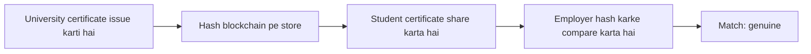
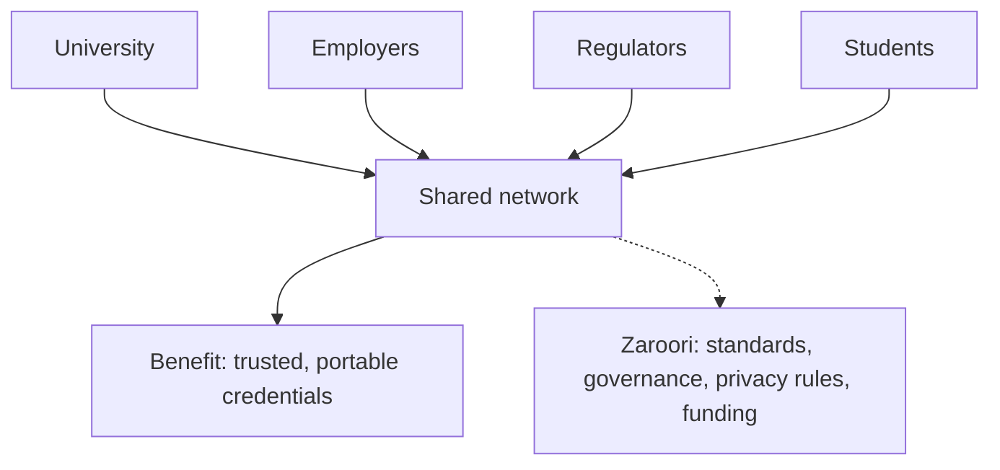

**Ek line mein:** <mark>Blockchain degrees aur certificates store kar sakta hai jinhe koi fake nahi kar sakta, lekin asli colleges mein ise use karna mushkil hai kyunki privacy law, cost, skills, standards aur adoption ki problems hain</mark>. <Cite id="blockchain-applications-blockcerts" />

<Box kind="key">

**Education ke challenges mein ye points likho:**

- **Use:** verifiable certificates (<mark>MIT Blockcerts</mark>), student records, credit transfer, scholarships. College har certificate ka <mark>hash</mark> store karta hai; employer PDF ko dobara hash karke compare karta hai.
- **Privacy aur law:** blockchain <mark>edit nahi ho sakta</mark>, lekin privacy laws (GDPR, India ka DPDP Act) data sudharne ya mitaane ka haq dete hain; <mark>sirf hashes</mark> store karo.
- **Cost aur skills**, **purane systems se integration**, <mark>standards ki kami</mark>, **scalability**.
- <mark>Galat data galat hi rehta hai</mark> (garbage in, garbage out); **key kho jaye** to student lock ho sakta hai.
- **Acceptance aur governance:** employers, regulators aur universities sab ko agree karna hai; nodes kaun chalayega?
- Solutions: <mark>sirf hashes store karo, shared consortium network, common formats (Open Badges), revocation records</mark>.

</Box>

## Core answer (5 marks, yahan ke har question ke liye)

<Box kind="definition">

In education, **blockchain** is used to store tamper-proof records such as degrees, certificates and credits. A college saves the **hash** of each certificate on the chain, and anyone can check a certificate by hashing it again and comparing. <Cite id="blockchain-applications-gfg-industries" />

</Box>

**Main challenges:**

1. **Privacy aur law.** Blockchain edit nahi hota, par privacy laws data sudharne ya mitaane ka haq dete hain. Student data khule mein store nahi hona chahiye; sirf hashes. <Cite id="blockchain-applications-tp-use-cases" />
2. **Cost aur technical skill.** Setup, nodes aur training mehnge hain, aur staff ko blockchain skills nahi hote.
3. **Purane systems se integration.** Colleges ERP aur student information systems use karte hain jinhe jodna mushkil hai.
4. **Standards ki kami.** Alag institutes alag formats use karte hain, isliye certificates platforms ke beech padhe nahi ja sakte.
5. **Scalability.** Lakhon records aur public chains pe slow, mehngi writes.
6. **Galat data galat hi rehta hai.** Blockchain yeh prove karta hai ki record badla nahi, yeh nahi ki shuru mein sahi tha.
7. **Key loss.** Private key kho dene wala student credentials ka access kho sakta hai.
8. **Acceptance aur governance.** Employers, regulators aur universities ko agree karna hoga, aur kisi ko nodes chalane aur galtiyan sudharne hongi.

**Conclusion:** <mark>blockchain can reduce fake degrees, but cost, privacy law, standards and adoption must be solved first</mark>. <Cite id="blockchain-fundamentals-gfg-advantages" />

## Extended answer (10 marks): ye add karo

### 1. Challenges aur unke solutions

| Challenge | Possible solution |
|---|---|
| Privacy aur erasure rights | Sirf hashes store karo; personal data off-chain rakho |
| Cost | Institutions ka shared consortium network |
| Skills | Training aur managed platforms |
| Standards | Common credential formats (jaise Open Badges, Blockcerts) |
| Galtiyan | Revocation record issue karo; data off-chain sudharo |
| Key loss | Institution ka recovery process |
| Energy | Permissioned chain use karo, proof of work nahi |

### 2. Education mein blockchain kahan madad karta hai

- **Certificates aur degrees:** employers turant check karte hain; fake degrees mushkil ho jaati hain.
- Institutions ke beech **student records aur credit transfer**.
- Smart contracts se **scholarships aur fees**.
- **Lifelong learning records** jo student ke apne hote hain. <Cite id="blockchain-applications-blockcerts" />

### 3. Phir bhi mushkil kyun

Blockchain pe certificate tabhi kaam ka hai jab employers aur dusri universities bhi us pe bharosa karein aur use padhein, isliye network effect important hai.

### 4. Balance ke liye advantages

Tamper-proof records, tez verification, kam paperwork aur records pe student ka ownership. Ek line mein likho taaki answer dono pehlu dikhaye. <Cite id="blockchain-fundamentals-gfg-advantages" />

## Har question mein kaise fit karein

- **"What are the challenges faced by Blockchain in the Education sector?"** (10 marks) <PYQ id="2025-05/q4b" />: core answer (use, diagram, aath challenges), phir extended section 1 (challenges aur solutions table) aur 3.

## Exam tips

- Certificate flow **draw karo** aur us pe challenge points mark karo.
- Keywords: <mark>hash, privacy law (GDPR, DPDP), standards, scalability, garbage in garbage out, governance, adoption</mark>.
- Solutions wala column zaroor likho; jo challenges solutions ke saath aate hain unpe examiner zyada marks dete hain.

Exam mein English mein likho.
