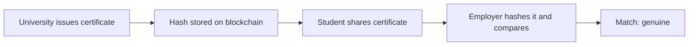
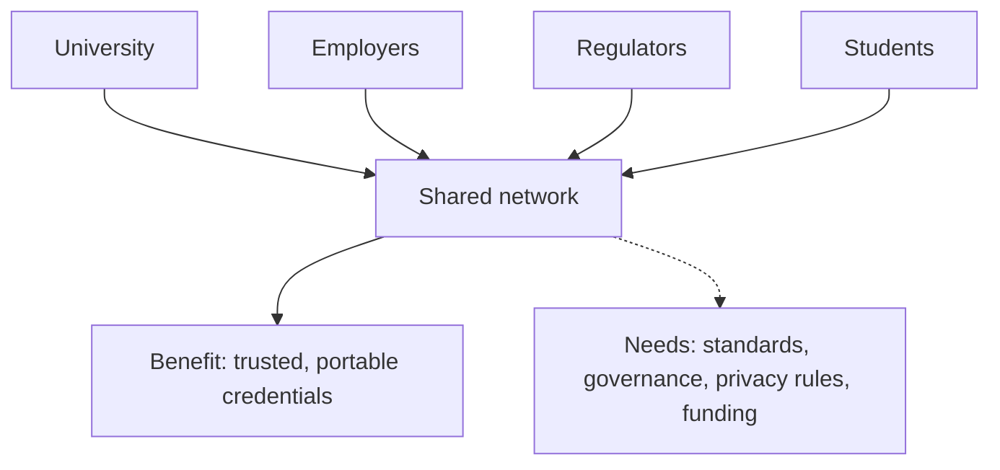

**In one line:** <mark>Blockchain can store degrees and certificates that nobody can fake, but using it in real colleges is hard because of privacy law, cost, skills, standards and adoption</mark>. <Cite id="blockchain-applications-blockcerts" />

<Box kind="key">

**Key points to write (challenges in education):**

- **Use:** verifiable certificates (<mark>MIT Blockcerts</mark>), student records, credit transfer, scholarships. A college stores the <mark>hash</mark> of each certificate; an employer re-hashes the PDF and compares.
- **Privacy and law:** a blockchain <mark>cannot be edited</mark>, but privacy laws (GDPR, India's DPDP Act) give the right to correct or erase data; store <mark>only hashes</mark>.
- **Cost and skills**, **integration with old systems**, <mark>lack of standards</mark>, **scalability**.
- <mark>Wrong data stays wrong</mark> (garbage in, garbage out); **key loss** can lock a student out.
- **Acceptance and governance:** employers, regulators and universities must all agree; who runs the nodes?
- Answers: <mark>store only hashes, shared consortium network, common formats (Open Badges), revocation records</mark>.

</Box>

## Core answer (5 marks, fits every question here)

<Box kind="definition">

In education, **blockchain** is used to store tamper-proof records such as degrees, certificates and credits. A college saves the **hash** of each certificate on the chain, and anyone can check a certificate by hashing it again and comparing. <Cite id="blockchain-applications-gfg-industries" />

</Box>

**Main challenges:**

1. **Privacy and law.** A blockchain cannot be edited, but privacy laws give the right to correct or erase data. Student data must not be stored openly; only hashes should be. <Cite id="blockchain-applications-tp-use-cases" />
2. **Cost and technical skill.** Setup, nodes and training are costly, and staff lack blockchain skills.
3. **Integration with old systems.** Colleges use ERP and student information systems that are hard to connect.
4. **Lack of standards.** Different institutes use different formats, so certificates are not readable across platforms.
5. **Scalability.** Millions of records and slow, costly writes on public chains.
6. **Wrong data stays wrong.** Blockchain proves a record was not changed, not that it was correct at the start.
7. **Key loss.** A student who loses the private key may lose access to credentials.
8. **Acceptance and governance.** Employers, regulators and universities must agree, and someone must run the nodes and fix mistakes.

**Conclusion:** <mark>blockchain can reduce fake degrees, but cost, privacy law, standards and adoption must be solved first</mark>. <Cite id="blockchain-fundamentals-gfg-advantages" />

## Extended answer (10 marks): add these

### 1. Challenges and answers

| Challenge | Possible answer |
|---|---|
| Privacy and erasure rights | Store only hashes; keep personal data off-chain |
| Cost | Shared consortium network of institutions |
| Skills | Training and managed platforms |
| Standards | Common credential formats (such as Open Badges, Blockcerts) |
| Mistakes | Issue a revocation record; correct data off-chain |
| Key loss | Recovery process run by the institution |
| Energy | Use a permissioned chain, not proof of work |

### 2. Where blockchain helps in education

- **Certificates and degrees:** instant checking by employers; fake degrees become hard.
- **Student records and credit transfer** between institutions.
- **Scholarships and fees** through smart contracts.
- **Lifelong learning records** owned by the student. <Cite id="blockchain-applications-blockcerts" />

### 3. Why it is still hard

A certificate on the blockchain is useful only if employers and other universities also trust and read it, so network effects matter.

### 4. Advantages for balance

Tamper-proof records, quick verification, less paperwork and student ownership of records. Mention these in one line so the answer shows both sides. <Cite id="blockchain-fundamentals-gfg-advantages" />

## Fit it to each question

- **"What are the challenges faced by Blockchain in the Education sector?"** (10 marks) <PYQ id="2025-05/q4b" />: core answer (use, diagram, eight challenges), then extended section 1 (challenges and answers table) and 3.

## Exam tips

- **Draw** the certificate flow and mark the challenge points on it.
- Keywords: <mark>hash, privacy law (GDPR, DPDP), standards, scalability, garbage in garbage out, governance, adoption</mark>.
- Always add the solutions column; examiners reward challenges that come with answers.
