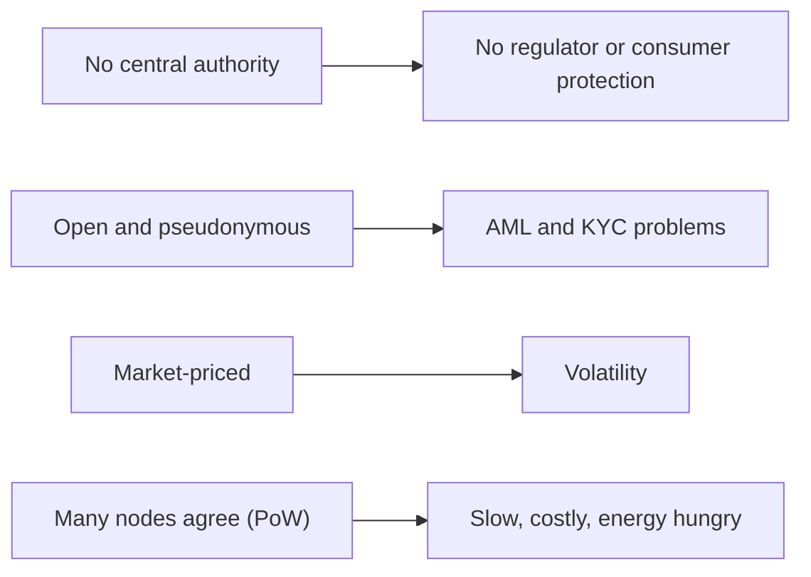
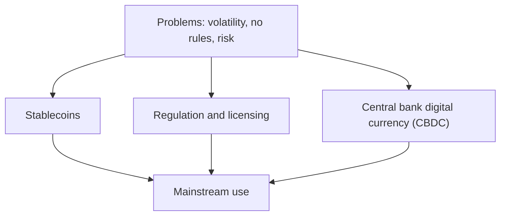

**In one line:** <mark>Cryptocurrencies are hard to use in mainstream finance because of price volatility, unclear regulation, security risks, slow and costly networks, and weak consumer protection</mark>. <Cite id="class-bt-m5" loc="slide 41" />

<Box kind="key">

**Key points to write (challenges of cryptocurrencies):**

- <mark>Volatility:</mark> prices swing fast, so they are poor for pricing, loans and salaries. <Cite id="class-bt-m5" loc="slide 40" />
- <mark>Regulation uncertainty:</mark> rules, tax and legal status differ by country. <Cite id="class-bt-m5" loc="slide 41" />
- <mark>Security and fraud:</mark> scams, fake projects, phishing, hacks of exchanges and wallets. <Cite id="class-bt-m5" loc="slide 81" />
- <mark>Scalability and fees:</mark> few transactions per second and fees that rise when busy. <Cite id="class-bt-m5" loc="slide 51" />
- <mark>Energy use</mark> of Proof of Work; <mark>illegal use</mark> through pseudonymity (AML/KYC).
- <mark>No consumer protection:</mark> transactions are irreversible; a lost private key means lost money.
- Ways forward: <mark>regulation, stablecoins, CBDCs, Proof of Stake, layer 2</mark>.

</Box>

## Core answer (5 marks, fits every question here)

<Box kind="definition">

**Mainstream financial systems** are the regulated world of banks, payment networks and stock markets. A **cryptocurrency** is digital money on a blockchain with no central issuing authority. <Cite id="class-bt-m5" loc="slide 2" /> The challenges come from fitting a decentralised, unregulated asset into a regulated, protected system.

</Box>

1. **Volatility.** The price of a coin can change a lot in a day, so a shop, bank or employer cannot rely on it. *Example:* a loan in a coin can become much larger in rupees overnight. <Cite id="class-bt-m5" loc="slide 40" />
2. **Regulatory uncertainty.** Laws, taxes and legal status of crypto differ across countries, and some have banned or restricted it. <Cite id="web-bt-sol-b-wiki-regulation-crypto" />
3. **Security and fraud.** Fake projects, phishing, and hacks of exchanges and wallets cause losses. <Cite id="class-bt-m5" loc="slide 81" />
4. **Scalability and fees.** Bitcoin handles only a few transactions per second against thousands for card networks, and fees rise when the network is busy. <Cite id="web-bt-1-eth-scaling" />
5. **Energy use.** Proof of Work mining uses a lot of electricity. <Cite id="blockchain-fundamentals-ccaf-cbeci" />
6. **No consumer protection.** A blockchain payment cannot be reversed and there is no bank to call if a key is lost or stolen.
7. **Illegal use and compliance.** Pseudonymous transfers make anti-money-laundering (AML) and know-your-customer (KYC) checks hard. <Cite id="class-bt-m5" loc="slide 41" />

**Conclusion:** <mark>crypto will enter mainstream finance only when volatility, regulation, security and scalability are addressed</mark>. <Cite id="web-bt-sol-b-fsb-crypto" />

## Extended answer (10 marks): add these

### 1. Challenge and response

| Challenge | Why it matters to banks | Common response |
|---|---|---|
| Volatility | Cannot value assets or loans | Stablecoins |
| Regulation | Legal risk, tax confusion | Licensing, clear rules, reporting |
| Security | Customer money at risk | Cold wallets, audits, insurance |
| Scalability | Cannot match card networks | Layer 2, Proof of Stake |
| Energy | Climate rules | Proof of Stake, permissioned chains |
| Illegal use | AML duty on banks | KYC at exchanges, transaction tracing |
| Interoperability | Hard to join old systems | Standards, bridges |

<Cite id="cryptocurrencies-tokens-wiki-stablecoin" /> <Cite id="blockchain-fundamentals-gfg-advantages" />

### 2. Challenges seen in token sales and DeFi

- ICOs had weak due diligence, scams and founders selling their tokens early. <Cite id="class-bt-m5" loc="slide 41" />
- DeFi has changing fees, high volatility, and the user must keep tax records. <Cite id="class-bt-m5" loc="slide 51" />
- Hot wallets face phishing and risky smart-contract approvals. <Cite id="class-bt-m5" loc="slide 82" />

### 3. Bridging the gap

A **CBDC** is digital money issued by a central bank, for example India's e-rupee. It is not decentralised, but it keeps the speed of digital money with the safety of a bank. <Cite id="cryptocurrencies-tokens-wiki-crypto" />

### 4. Advantages that still attract banks

Fast cross-border transfer, 24x7 settlement, lower middleman cost, programmable money through smart contracts, and a transparent record.

## Fit it to each question

- **"Discuss the challenges of using cryptocurrencies in mainstream financial systems."** (10 marks) <PYQ id="assignment-2/q5d" />: core answer, then extended sections 1 and 3, ending with the advantages line.

## Exam tips

- **Number** at least seven challenges and give one short example each (volatility, ban, hack, fees).
- Keywords: <mark>volatility, regulation, KYC/AML, scalability, energy, irreversible, consumer protection, CBDC</mark>.
- Always end with the solutions; it shows balanced understanding.
