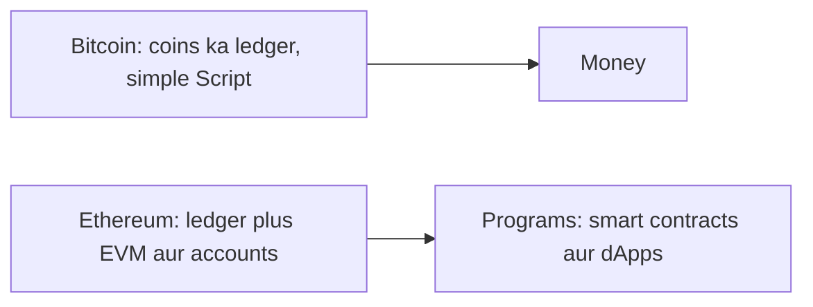

**Ek line mein:** <mark>Bitcoin peer-to-peer digital money hai (UTXO model, proof of work, limited script); Ethereum programmable blockchain hai jiska apna paisa ether hai (account model, proof of stake, EVM pe Solidity smart contracts)</mark>. <Cite id="bitcoin-gfg-bitcoin-vs-ethereum" />

<Box kind="key">

**Bitcoin vs Ethereum ke question mein ye points likho:**

- Purpose: <mark>Bitcoin = digital cash; Ethereum = smart contracts aur dApps ka platform</mark>.
- Creators: <mark>Satoshi Nakamoto (2009); Vitalik Buterin aur others (2015)</mark>.
- Consensus: <mark>PoW (Bitcoin) vs Merge, September 2022 se PoS (Ethereum)</mark>.
- Block time: <mark>lagbhag 10 minutes vs lagbhag 12 seconds</mark>.
- Data model: <mark>UTXO vs account balance model</mark>.
- Supply: <mark>21 million cap vs koi fixed cap nahi</mark>; fees: per byte vs gas; language: Script vs Solidity (Turing complete).

</Box>

## Core answer (5 marks, yahan ke har question ke liye)

<Box kind="definition">

**Bitcoin** is a peer-to-peer electronic cash system. **Ethereum** is a blockchain that can run programs (smart contracts) and has its own coin, ether. <Cite id="bitcoin-gfg-bitcoin-vs-ethereum" />

</Box>

| Point | Bitcoin | Ethereum |
|---|---|---|
| Creator aur year | Satoshi Nakamoto, 2009 | Vitalik Buterin aur others, 2015 |
| Main purpose | Digital cash, store of value | Smart contracts aur dApps ka platform |
| Coin | BTC | ETH |
| Consensus | Proof of Work | Proof of Stake (Merge, 2022 se) |
| Block time | Lagbhag 10 minutes | Lagbhag 12 seconds |
| Ledger model | UTXO (unspent outputs) | Account balance model |
| Scripting | Limited, Turing complete nahi | EVM pe Solidity, Turing complete (gas se bounded) |
| Supply | 21 million pe capped | Fixed cap nahi; fees ka hissa burn hota hai |
| Fees | Transaction size ke per byte | Per unit gas |

<Cite id="bitcoin-educative-bitcoin-vs-ethereum" />

**Similarities:** dono public aur permissionless hain, hashes aur digital signatures use karte hain, aur ledger ki copy kai nodes pe rakhte hain.

**Conclusion:** <mark>Bitcoin secure, simple money banne pe focus karta hai; Ethereum kisi bhi application ke liye flexible platform banne pe</mark>. <Cite id="blockchain-fundamentals-nakamoto" /> <Cite id="ethereum-whitepaper" />

## Extended answer (10 marks): ye add karo

### 1. Example use

Bina bank ke border paar paisa bhejne ke liye Bitcoin use karo. Lending app chalane ya NFT issue karne ke liye Ethereum use karo, jahan contract rules enforce karta hai.

### 2. Bitcoin mein mining difficulty ("kaise calculate karein" wala part)

Miner ko aisa nonce dhoondhna padta hai ki block hash **target se chhota** ho. Difficulty current target ko sabse aasaan target se compare karti hai:

$$
\text{Difficulty} = \frac{\text{target}_{max}}{\text{current target}}
$$

Har **2016 blocks** (lagbhag 2 weeks) pe network retarget karta hai:

$$
\text{new difficulty} = \text{old difficulty} \times \frac{14\ \text{days}}{\text{actual time for the last 2016 blocks}}
$$

Tez blocks matlab zyada difficulty; ek change 4 guna tak limited; ek block ke liye lagbhag difficulty x $2^{32}$ hashes chahiye. <Cite id="bitcoin-btcwiki-difficulty" /> <Cite id="bitcoin-mb-ch12-mining" />

<Sum>

<Given>

Old difficulty $= 1{,}000{,}000$; pichhle 2016 blocks 14 ki jagah 10 days mein bane.

</Given>

<Find>

new difficulty aur ek block ke average hashes.

</Find>

<Steps>

1. Blocks bahut tez aaye, isliye difficulty badhni chahiye. *Reason: 10 days 14 days se kam hain.*
2. Ratio $= 14 / 10 = 1.4$. *Reason: planned time / actual time.*
3. New difficulty $= 1{,}000{,}000 \times 1.4 = 1{,}400{,}000$.
4. Hashes per block $\approx 1{,}400{,}000 \times 2^{32} \approx 6.01 \times 10^{15}$. *Reason: difficulty ki har unit ko lagbhag $2^{32}$ hashes chahiye.*

</Steps>

<Answer>

new difficulty $= 1{,}400{,}000$; ek block ke liye lagbhag $6.01 \times 10^{15}$ hashes.

</Answer>

<Box kind="verify">

Naye difficulty pe wahi miners 2016 blocks ke liye $10 \times 1.4 = 14$ days lete hain, jo planned time hai. Ratio 1.4 limit 4 ke andar hai.

</Box>

</Sum>

### 3. Account model vs UTXO model

| | UTXO (Bitcoin) | Account (Ethereum) |
|---|---|---|
| State | Unspent outputs ka set | Har account ka balance aur nonce |
| Payment | Poore outputs spend karta hai aur change lautata hai | Ek balance se ghatata, dusre mein jodta hai |
| Smart contracts | Mushkil | Natural: contract accounts code aur storage rakhte hain |

<Cite id="ethereum-eth-accounts" /> <Cite id="ethereum-eth-gas" />

## Har question mein kaise fit karein

- **"Compare Bitcoin and Ethereum."** (5 marks) <PYQ id="2024-05-ce/q1e" /> <PYQ id="2024-12-ce/q1b" />: **core answer**: table, similarities aur conclusion; section 1 ka example add karo.
- **"Compare Bitcoin and Ethereum. How to calculate Mining difficulty in bitcoin"** (10 marks) <PYQ id="2022-12-ce/q3a" />: core answer ka table, phir section 2 (difficulty formula aur worked example).

## Exam tips

- **Pehle table:** kam se kam aath rows, key box ke keywords ke saath.
- Ye mat likho ki Ethereum mein kabhi mining nahi thi: September 2022 ke Merge tak wo PoW tha.
- Difficulty part ke liye retarget formula aur ek chhota number example do.

Exam mein English mein likho.
