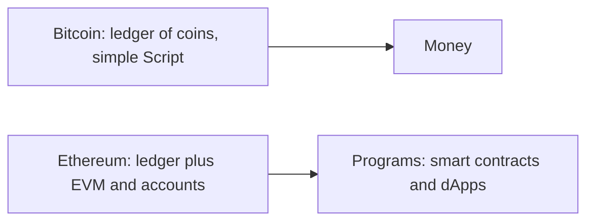

**In one line:** <mark>Bitcoin is peer-to-peer digital money (UTXO model, proof of work, limited script); Ethereum is a programmable blockchain with its own money, ether (account model, proof of stake, Solidity smart contracts on the EVM)</mark>. <Cite id="bitcoin-gfg-bitcoin-vs-ethereum" />

<Box kind="key">

**Key points to write (Bitcoin vs Ethereum):**

- Purpose: <mark>Bitcoin = digital cash; Ethereum = platform for smart contracts and dApps</mark>.
- Creators: <mark>Satoshi Nakamoto (2009); Vitalik Buterin and others (2015)</mark>.
- Consensus: <mark>PoW (Bitcoin) vs PoS since the Merge, September 2022 (Ethereum)</mark>.
- Block time: <mark>about 10 minutes vs about 12 seconds</mark>.
- Data model: <mark>UTXO vs account balance model</mark>.
- Supply: <mark>capped at 21 million vs no fixed cap</mark>; fees: per byte vs gas; language: Script vs Solidity (Turing complete).

</Box>

## Core answer (5 marks, fits every question here)

<Box kind="definition">

**Bitcoin** is a peer-to-peer electronic cash system. **Ethereum** is a blockchain that can run programs (smart contracts) and has its own coin, ether. <Cite id="bitcoin-gfg-bitcoin-vs-ethereum" />

</Box>

| Point | Bitcoin | Ethereum |
|---|---|---|
| Creator and year | Satoshi Nakamoto, 2009 | Vitalik Buterin and others, 2015 |
| Main purpose | Digital cash, store of value | Platform for smart contracts and dApps |
| Coin | BTC | ETH |
| Consensus | Proof of Work | Proof of Stake (since the Merge, 2022) |
| Block time | About 10 minutes | About 12 seconds |
| Ledger model | UTXO (unspent outputs) | Account balance model |
| Scripting | Limited, not Turing complete | Solidity on the EVM, Turing complete (bounded by gas) |
| Supply | Capped at 21 million | No fixed cap; part of fees is burned |
| Fees | Per byte of transaction size | Per unit of gas |

<Cite id="bitcoin-educative-bitcoin-vs-ethereum" />

**Similarities:** both are public and permissionless, use hashes and digital signatures, and keep a ledger copy on many nodes.

**Conclusion:** <mark>Bitcoin focuses on being secure, simple money; Ethereum focuses on being a flexible platform for any application</mark>. <Cite id="blockchain-fundamentals-nakamoto" /> <Cite id="ethereum-whitepaper" />

## Extended answer (10 marks): add these

### 1. Example use

Use Bitcoin to send money across borders without a bank. Use Ethereum to run a lending app or issue an NFT, where a contract enforces the rules.

### 2. Mining difficulty in Bitcoin (for the "how to calculate" part)

A miner must find a nonce so that the block hash is **below a target**. Difficulty compares the current target with the easiest target:

$$
\text{Difficulty} = \frac{\text{target}_{max}}{\text{current target}}
$$

Every **2016 blocks** (about 2 weeks) the network retargets:

$$
\text{new difficulty} = \text{old difficulty} \times \frac{14\ \text{days}}{\text{actual time for the last 2016 blocks}}
$$

Faster blocks mean higher difficulty; one change is limited to a factor of 4; about difficulty x $2^{32}$ hashes are needed for one block. <Cite id="bitcoin-btcwiki-difficulty" /> <Cite id="bitcoin-mb-ch12-mining" />

<Sum>

<Given>

Old difficulty $= 1{,}000{,}000$; the last 2016 blocks took 10 days instead of 14.

</Given>

<Find>

the new difficulty and the average hashes per block.

</Find>

<Steps>

1. Blocks came too fast, so difficulty must rise. *Reason: 10 days is less than 14 days.*
2. Ratio $= 14 / 10 = 1.4$. *Reason: planned time divided by actual time.*
3. New difficulty $= 1{,}000{,}000 \times 1.4 = 1{,}400{,}000$.
4. Hashes per block $\approx 1{,}400{,}000 \times 2^{32} \approx 6.01 \times 10^{15}$. *Reason: each unit of difficulty needs about $2^{32}$ hashes.*

</Steps>

<Answer>

new difficulty $= 1{,}400{,}000$; about $6.01 \times 10^{15}$ hashes per block.

</Answer>

<Box kind="verify">

At the new difficulty the same miners need $10 \times 1.4 = 14$ days for 2016 blocks, the planned time. The ratio 1.4 is within the limit of 4.

</Box>

</Sum>

### 3. Account model versus UTXO model

| | UTXO (Bitcoin) | Account (Ethereum) |
|---|---|---|
| State | Set of unspent outputs | Balance and nonce per account |
| A payment | Spends whole outputs and returns change | Subtracts from one balance, adds to another |
| Smart contracts | Hard | Natural: contract accounts hold code and storage |

<Cite id="ethereum-eth-accounts" /> <Cite id="ethereum-eth-gas" />

## Fit it to each question

## Exam tips

- **Table first:** at least eight rows with the keywords in the key box.
- Do not say Ethereum has no mining ever: it used PoW until the Merge in September 2022.
- For the difficulty part show the retarget formula and one small number example.
