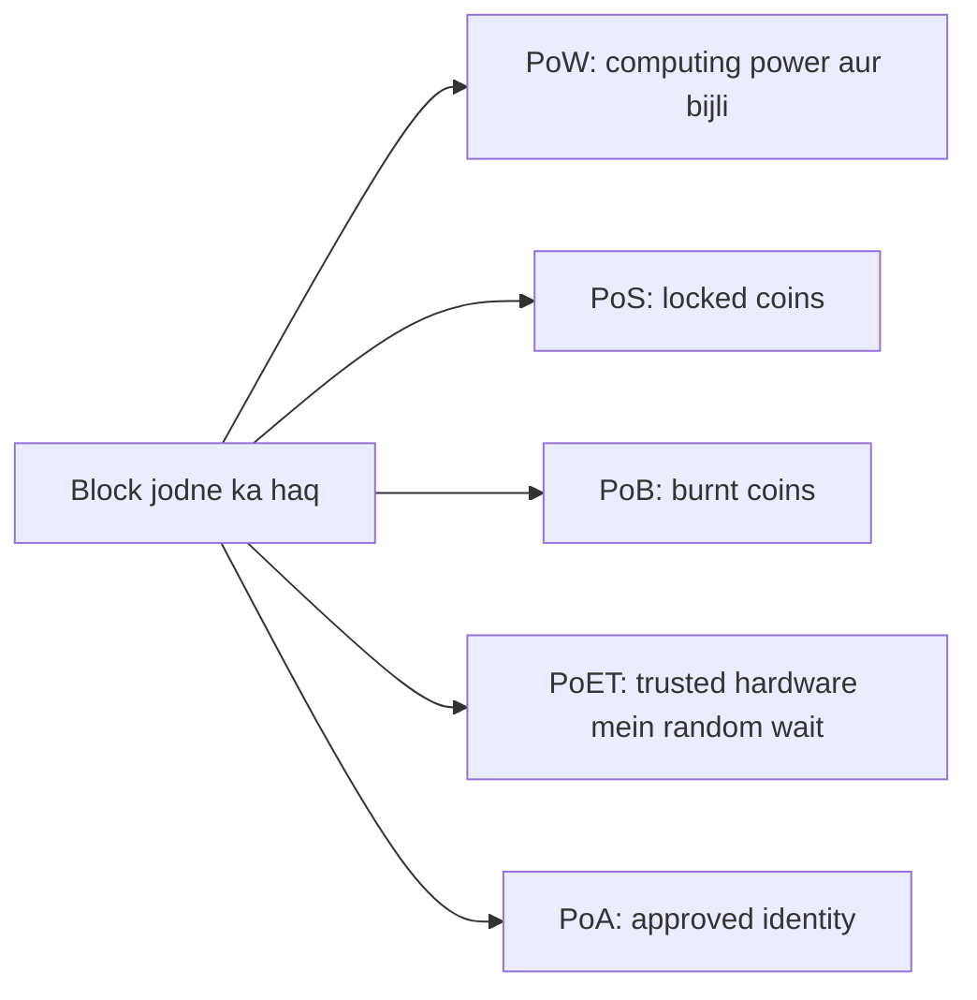
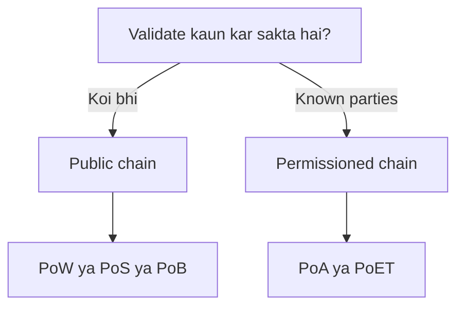

**Ek line mein:** <mark>Consensus protocol tay karta hai ki agla block kaun jodega; PoW, PoS, PoB, PoET aur PoA is baat mein alag hain ki ye haq jeetne ke liye node ko kya dena padta hai: computing power, locked coins, burnt coins, random wait, ya trusted identity</mark>. <Cite id="consensus-mining-gfg-consensus" />

<Box kind="key">

**Consensus protocols compare karne ke question mein ye points likho:**

- <mark>PoW</mark>: miners header ko target se chhota hone tak hash karte hain; pehla jeetta hai; bijli lagti hai; Bitcoin.
- <mark>PoS</mark>: validators coins lock (stake) karte hain; stake aur randomness se chune jaate hain; cheating pe <mark>slashing</mark>; Ethereum 2022 se.
- <mark>PoB</mark>: nodes coins ko unspendable address pe bhejkar burn karte hain; zyada burn, zyada chance; Slimcoin.
- <mark>PoET</mark>: trusted hardware (Intel SGX) random wait time deta hai; sabse chhota wait jeetta hai; Hyperledger Sawtooth.
- <mark>PoA</mark>: kuch approved, known validators blocks sign karte hain; reputation hi stake hai; private aur test networks.
- Hamesha <mark>comparison table</mark> do: resource, energy, speed, decentralisation, main risk, example.

</Box>

## Core answer (5 marks, yahan ke har question ke liye)

<Box kind="definition">

A **consensus protocol** is the rule by which all nodes agree on the next block. The protocols differ in **what you must put at stake to earn the right to add a block**. <Cite id="consensus-mining-gfg-consensus" />

</Box>

1. **Proof of Work (PoW).** Miners nonce badalkar block header ko target se chhota hone tak hash karte hain. Jo pehle dhoondhe wo block jodta hai aur reward pata hai. Cheating ki cost: bijli aur hardware. Bitcoin mein use. <Cite id="consensus-mining-wiki-pow" />
2. **Proof of Stake (PoS).** Validators deposit ke roop mein coins lock karte hain. Stake ke hisaab se ek chuna jaata hai block propose karne ke liye aur baaki attest karte hain. Cheating karne wale validator ka stake ka hissa kat jaata hai (slashing). Ethereum mein Merge (2022) se. <Cite id="consensus-mining-eth-pos" />
3. **Proof of Burn (PoB).** Nodes coins ko aise address pe bhejte hain jahan se koi spend nahi kar sakta. Jitna zyada burn, utna zyada chunne ka chance, lottery tickets ki tarah. Slimcoin mein use. <Cite id="consensus-mining-btcwiki-pob" />
4. **Proof of Elapsed Time (PoET).** Har node trusted hardware (Intel SGX) se random wait time maangta hai; jiska timer pehle khatam ho wo block banata hai, aur hardware prove karta hai ki usne sach mein wait kiya. Hyperledger Sawtooth mein use. <Cite id="consensus-mining-gfg-crypto-consensus" />
5. **Proof of Authority (PoA).** Approved, known validators ki chhoti list baari baari se blocks sign karti hai. Unki identity aur reputation hi stake hai. <Cite id="consensus-mining-eth-poa" />

**Conclusion:** <mark>PoW sabse proven lekin costly hai; PoS, PoB aur PoET energy bachate hain; PoA sabse fast hai lekin kuch known parties pe trust karta hai</mark>.

## Extended answer (10 marks): ye add karo

### 1. Poori comparison table

| Point | PoW | PoS | PoB | PoET | PoA |
|---|---|---|---|---|---|
| Winner kaise chuna jaata hai | Hash puzzle pehle solve karne wala | Stake size plus randomness | Burn kiya amount | Sabse chhota random wait | Approved validators mein baari |
| Stake pe kya | Hardware aur bijli | Locked coins | Burnt coins | Trusted hardware | Reputation aur identity |
| Energy | Bahut zyada | Bahut kam | Kam | Bahut kam | Bahut kam |
| Speed | Slow | Faster | Medium | Fast | Bahut fast |
| Decentralisation | High | Medium se high | Medium | Low se medium | Low |
| Main risk | 51% attack, energy waste | Ameer aur ameer, 51% stake | Coins hamesha ke liye gaye | Chip maker pe trust | Kuch validators collude kar sakte hain |
| Network type | Public | Public | Public | Zyada tar permissioned | Private ya test |
| Example | Bitcoin | Ethereum | Slimcoin | Hyperledger Sawtooth | VeChain, private chains |

<Cite id="web-bt-1-eth-consensus" /> <Cite id="consensus-mining-gfg-pob" /> <Cite id="consensus-mining-wiki-poa" />

### 2. PoW vs PoS short mein (5-mark wali jodi)

| Point | PoW | PoS |
|---|---|---|
| Blocks kaun banata hai | Miners | Validators |
| Kya chahiye | Hardware aur bijli | Locked coins (Ethereum mein 32 ETH) |
| Energy | Bahut zyada | Bahut kam (Ethereum ne Merge pe lagbhag 99.9% kam ki) |
| Penalty | Waste hua kaam | Stake ki slashing |
| Attack cost | 51% hash power | 51% staked coins |

<Cite id="consensus-mining-eth-merge" />

### 3. Advantages aur disadvantages

- **PoW:** bahut secure aur proven; lekin slow, wasteful, bade miners ko favour.
- **PoS:** energy efficient, faster; lekin daulat se power milti hai.
- **PoB:** bijli ki barbaadi nahi; lekin burn kiye coins chale jaate hain.
- **PoET:** sasta aur fast; lekin special hardware aur uske maker pe depend.
- **PoA:** fast aur sasta; lekin kuch validators pe trust.

## Har question mein kaise fit karein

- **"Compare following consensus protocols PoW,PoB,PoS,PoA"** (10 marks) <PYQ id="2025-05/q2a" />: core answer (items 1, 2, 3, 5), phir PoET column ke bina table aur section 3.

## Exam tips

- **Hamesha** kam se kam chhe rows ka table do: resource, energy, speed, decentralisation, risk, example.
- Har ek ka one-line stake likho: <mark>work, coins locked, coins burnt, time waited, identity</mark>.
- Jo protocol question mein nahi hai use hata do; chaar puchhe hon to paanch mat likho.

Exam mein English mein likho.
