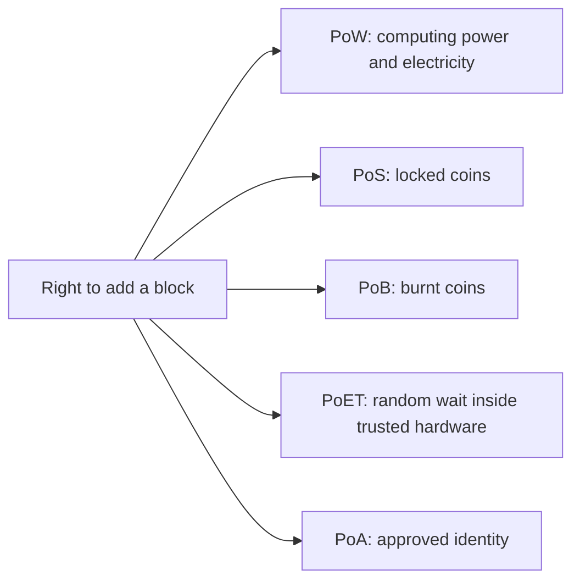
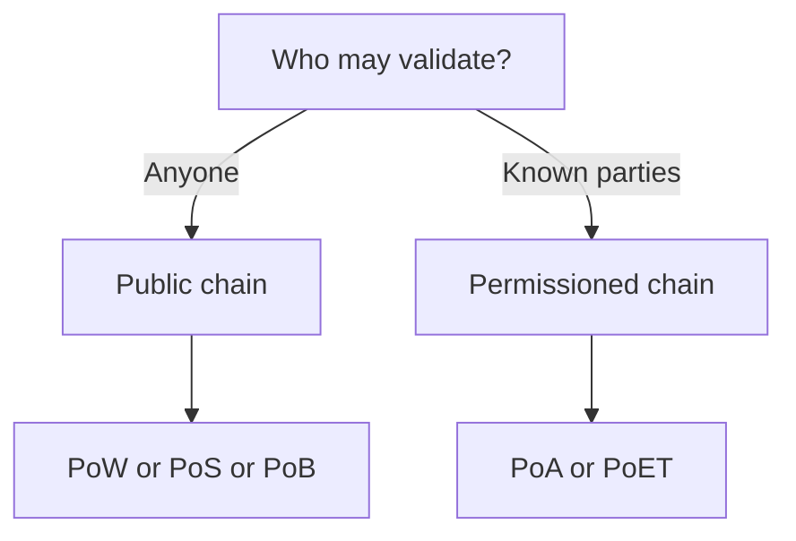

**In one line:** <mark>A consensus protocol decides who adds the next block; PoW, PoS, PoB, PoET and PoA differ in what a node must give up to win that right: computing power, locked coins, burnt coins, a random wait, or a trusted identity</mark>. <Cite id="consensus-mining-gfg-consensus" />

<Box kind="key">

**Key points to write (compare consensus protocols):**

- <mark>PoW</mark>: miners hash the header until it is below the target; first wins; uses electricity; Bitcoin.
- <mark>PoS</mark>: validators lock (stake) coins; chosen by stake and randomness; cheating means <mark>slashing</mark>; Ethereum since 2022.
- <mark>PoB</mark>: nodes burn coins by sending them to an unspendable address; more burnt, more chance; Slimcoin.
- <mark>PoET</mark>: trusted hardware (Intel SGX) gives a random wait time; the shortest wait wins; Hyperledger Sawtooth.
- <mark>PoA</mark>: a few approved, known validators sign blocks; reputation is the stake; private and test networks.
- Always give a <mark>comparison table</mark>: resource, energy, speed, decentralisation, main risk, example.

</Box>

## Core answer (5 marks, fits every question here)

<Box kind="definition">

A **consensus protocol** is the rule by which all nodes agree on the next block. The protocols differ in **what you must put at stake to earn the right to add a block**. <Cite id="consensus-mining-gfg-consensus" />

</Box>

1. **Proof of Work (PoW).** Miners change a nonce and hash the block header until the hash is below a target. The first to find it adds the block and gets the reward. Cost of cheating: electricity and hardware. Used in Bitcoin. <Cite id="consensus-mining-wiki-pow" />
2. **Proof of Stake (PoS).** Validators lock coins as a deposit. One is chosen, weighted by stake, to propose a block and others attest. A cheating validator loses part of the stake (slashing). Used in Ethereum since the Merge (2022). <Cite id="consensus-mining-eth-pos" />
3. **Proof of Burn (PoB).** Nodes send coins to an address nobody can spend from. The more you burn, the higher the chance to be chosen, like buying lottery tickets. Used in Slimcoin. <Cite id="consensus-mining-btcwiki-pob" />
4. **Proof of Elapsed Time (PoET).** Each node asks trusted hardware (Intel SGX) for a random wait time; the node whose timer ends first makes the block, and the hardware proves it really waited. Used in Hyperledger Sawtooth. <Cite id="consensus-mining-gfg-crypto-consensus" />
5. **Proof of Authority (PoA).** A small list of approved, known validators sign blocks in turn. Their identity and reputation is the stake. <Cite id="consensus-mining-eth-poa" />

**Conclusion:** <mark>PoW is the most proven but costly; PoS, PoB and PoET save energy; PoA is the fastest but trusts a few known parties</mark>.

## Extended answer (10 marks): add these

### 1. Full comparison table

| Point | PoW | PoS | PoB | PoET | PoA |
|---|---|---|---|---|---|
| Winner chosen by | First to solve hash puzzle | Stake size plus randomness | Amount burnt | Shortest random wait | Turn among approved validators |
| Resource at stake | Hardware and electricity | Locked coins | Burnt coins | Trusted hardware | Reputation and identity |
| Energy use | Very high | Very low | Low | Very low | Very low |
| Speed | Slow | Faster | Medium | Fast | Very fast |
| Decentralisation | High | Medium to high | Medium | Low to medium | Low |
| Main risk | 51% attack, energy waste | Rich get richer, 51% of stake | Coins lost forever | Trust in chip maker | Few validators can collude |
| Network type | Public | Public | Public | Mostly permissioned | Private or test |
| Example | Bitcoin | Ethereum | Slimcoin | Hyperledger Sawtooth | VeChain, private chains |

<Cite id="web-bt-1-eth-consensus" /> <Cite id="consensus-mining-gfg-pob" /> <Cite id="consensus-mining-wiki-poa" />

### 2. PoW versus PoS in short (the usual 5-mark pair)

| Point | PoW | PoS |
|---|---|---|
| Who creates blocks | Miners | Validators |
| What is needed | Hardware and electricity | Locked coins (32 ETH in Ethereum) |
| Energy | Very high | Very low (Ethereum cut about 99.9% at the Merge) |
| Penalty | Wasted work | Slashing of stake |
| Attack cost | 51% of hash power | 51% of staked coins |

<Cite id="consensus-mining-eth-merge" />

### 3. Advantages and disadvantages

- **PoW:** very secure and proven; but slow, wasteful, favours big miners.
- **PoS:** energy efficient, faster; but wealth gives power.
- **PoB:** no electricity waste; but burnt coins are lost.
- **PoET:** cheap and fast; but depends on special hardware and its maker.
- **PoA:** fast and cheap; but trust in a few validators.

## Fit it to each question

- **"Differentiate between PoW, PoS, PoB & PoET."** (10 marks) <PYQ id="2024-05-ce/q2b" /> <PYQ id="2025-05-ce/q4a" />: core answer (items 1 to 4), then the table without the PoA column and the diagram.
- **"Compare following consensus protocols PoW,PoB,PoS,PoA"** (10 marks) <PYQ id="2025-05/q2a" />: core answer (items 1, 2, 3, 5), then the table without the PoET column and section 3.
- **"Differentiate between PoW and PoS."** (5 marks) <PYQ id="2024-12-ce/q1c" />: items 1 and 2 of the core answer and the section 2 table.

## Exam tips

- **Always** give a table with at least six rows: resource, energy, speed, decentralisation, risk, example.
- Write the one-line stake for each: <mark>work, coins locked, coins burnt, time waited, identity</mark>.
- Drop the protocol that is not in the question; do not write all five when four are asked.
