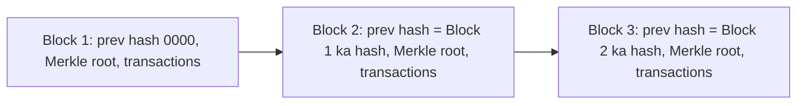
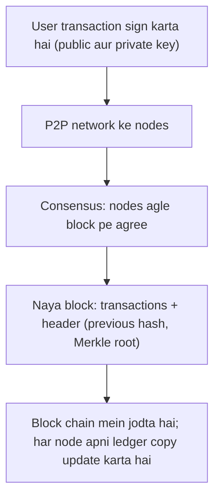

**Ek line mein:** <mark>Blockchain ek distributed, append-only ledger hai jiska data structure blocks ki linked list (hash pointers) hai, aur har block mein transactions ka Merkle tree hota hai</mark>. <Cite id="blockchain-fundamentals-nakamoto" loc="§1-4" />

<Box kind="key">

**Components ya data structure ke question mein ye points likho:**

- Components: <mark>node, transaction, block, chain, cryptography (hash aur signature), distributed ledger (P2P network), consensus mechanism, smart contracts</mark>.
- Data structure 1: <mark>hash pointers use karne wali blocks ki linked list</mark>; har block pichhle block header ka hash rakhta hai.
- Data structure 2: <mark>har block ke andar Merkle tree</mark>; uska root header mein store hota hai.
- Block = <mark>header (version, previous hash, Merkle root, timestamp, difficulty target, nonce) aur body (transactions)</mark>.
- Ek purana block badlo to uska hash badalta hai, isliye <mark>aage ka har link toot jaata hai</mark>: tamper evidence.
- Append-only: naye blocks sirf end mein jodte hain.

</Box>

## Core answer (5 marks, yahan ke har question ke liye)

<Box kind="definition">

A **blockchain** is a distributed, append-only ledger. Transactions are grouped into blocks and each block is linked to the previous one by a cryptographic hash. No single party controls it; the nodes agree on the next block using a consensus rule. <Cite id="blockchain-fundamentals-ibm-blockchain" />

</Box>

**Data structure:** do structures milkar kaam karte hain. <Cite id="blockchain-fundamentals-gfg-structure" />

1. **Blocks ki linked list (hash pointers).** Har block pichhle block header ka hash store karta hai. Ek purana block badlo to uska hash badalta hai, agle block ka link toot jaata hai, aur aise hi aage tak.
2. **Har block ke andar Merkle tree.** Block ke saare transactions pairs mein, level by level hash hote hain ek **Merkle root** tak, jo block header mein store hota hai. <Cite id="block-structure-merkle-wiki-merkle" />

Block mein ek **header** aur ek **body** (transactions ki list) hoti hai. <Cite id="block-structure-merkle-mb-ch11" />

**Conclusion:** <mark>blockchain blocks ki hash-linked list hai, jiske har block mein transactions ka Merkle tree hota hai</mark>, aur ise kai nodes rakhte hain.

## Extended answer (10 marks): ye add karo

### 1. Blockchain ke components

| Component | Kya hai |
|---|---|
| Node | Computer jo ledger ki copy rakhta hai aur rules follow karta hai; full nodes sab check karte hain, light nodes sirf headers rakhte hain |
| Transaction | Basic record, jaise "A pays B 2 coins", sender ke signature ke saath |
| Block | Transactions ka group plus header: previous hash, Merkle root, timestamp, nonce |
| Chain | Har block pichhle block ka hash rakhta hai |
| Cryptography | Hash functions (SHA-256) fingerprint dete hain; digital signatures (public aur private key) prove karte hain ki transaction kisne bheja |
| Distributed ledger (P2P network) | Har node ek copy rakhta hai; central server nahi |
| Consensus mechanism | Wo rule jisse nodes agle block pe agree karte hain, jaise Proof of Work ya Proof of Stake |
| Smart contracts (kuch chains mein) | Chain pe programs jo automatically chalte hain |

<Cite id="blockchain-fundamentals-tp-intro" /> <Cite id="block-structure-merkle-wiki-hash" />

### 2. Ye data structure kyun

- **Tamper detection:** purana data badalne se hashes upar tak badal jaate hain.
- **Light clients:** light client sirf headers rakhta hai aur chhote Merkle proof se ek transaction check karta hai.
- **Append-only:** history kabhi edit nahi hoti, sirf aage badhti hai.

### 3. Block header ke fields

Version, previous block hash, Merkle root, timestamp, difficulty target (nBits) aur nonce. Body transactions ki list hai. <Cite id="blockchain-fundamentals-gfg-structure" />

## Har question mein kaise fit karein

- **"Define Blockchain. Explain the Data structure used in blockchain."** (5 marks) <PYQ id="2024-12/q1a" />: **core answer** likho: definition box, do structures, chain diagram, header aur body ki line.
- **"Explain the components of Blockchain."** (10 marks) <PYQ id="2024-12-ce/q2a" />: chhota core answer, phir section 1 (aath components ka table) aur component-flow diagram, section 2 closing ke roop mein.

## Exam tips

- **Draw karo:** teen blocks ek line mein "previous hash" arrows ke saath; har mein Merkle root ka naam.
- Dono words likho: <mark>hash pointer</mark> aur <mark>Merkle tree</mark>.
- "Components" mein kam se kam chhe likho aur har ek ki ek line; consensus aur cryptography mat bhoolo.

Exam mein English mein likho.
