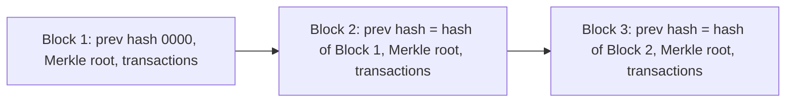
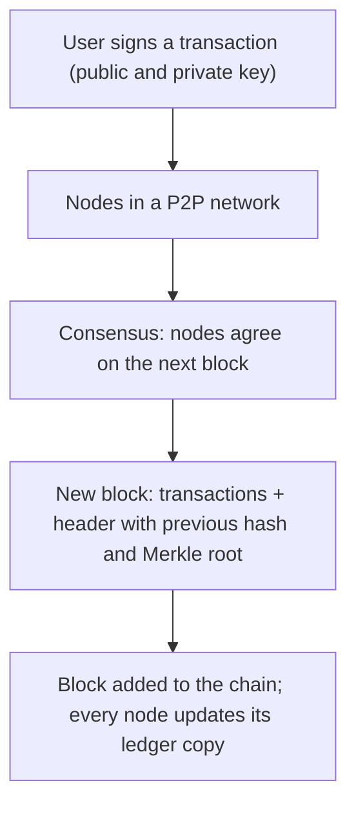

**In one line:** <mark>A blockchain is a distributed, append-only ledger whose data structure is a linked list of blocks (hash pointers), each block holding a Merkle tree of transactions</mark>. <Cite id="blockchain-fundamentals-nakamoto" loc="§1-4" />

<Box kind="key">

**Key points to write (components or data structure):**

- Components: <mark>node, transaction, block, chain, cryptography (hash and signature), distributed ledger (P2P network), consensus mechanism, smart contracts</mark>.
- Data structure 1: <mark>linked list of blocks using hash pointers</mark>; each block stores the hash of the previous block header.
- Data structure 2: <mark>Merkle tree inside each block</mark>; its root is stored in the header.
- Block = <mark>header (version, previous hash, Merkle root, timestamp, difficulty target, nonce) and body (transactions)</mark>.
- Change one old block and its hash changes, so <mark>every later link breaks</mark>: tamper evidence.
- Append-only: new blocks are only added at the end.

</Box>

## Core answer (5 marks, fits every question here)

<Box kind="definition">

A **blockchain** is a distributed, append-only ledger. Transactions are grouped into blocks and each block is linked to the previous one by a cryptographic hash. No single party controls it; the nodes agree on the next block using a consensus rule. <Cite id="blockchain-fundamentals-ibm-blockchain" />

</Box>

**Data structure used:** two structures work together. <Cite id="blockchain-fundamentals-gfg-structure" />

1. **Linked list of blocks (hash pointers).** Each block stores the hash of the previous block header. Change one old block and its hash changes, so the link in the next block breaks, and so on up the chain.
2. **Merkle tree inside each block.** All transactions of the block are hashed in pairs, level by level, to one **Merkle root**, which is stored in the block header. <Cite id="block-structure-merkle-wiki-merkle" />

A block has a **header** and a **body** (list of transactions). <Cite id="block-structure-merkle-mb-ch11" />

**Conclusion:** <mark>a blockchain is a hash-linked list of blocks, each holding a Merkle tree of transactions</mark>, kept by many nodes.

## Extended answer (10 marks): add these

### 1. Components of a blockchain

| Component | What it is |
|---|---|
| Node | Computer that holds a copy of the ledger and follows the rules; full nodes check everything, light nodes keep only headers |
| Transaction | The basic record, such as "A pays B 2 coins", signed by the sender |
| Block | A group of transactions plus a header: previous hash, Merkle root, timestamp, nonce |
| Chain | Each block stores the hash of the one before it |
| Cryptography | Hash functions (SHA-256) give fingerprints; digital signatures (public and private keys) prove who sent a transaction |
| Distributed ledger (P2P network) | Every node keeps a copy; no central server |
| Consensus mechanism | The rule by which nodes agree on the next block, such as Proof of Work or Proof of Stake |
| Smart contracts (in some chains) | Programs on the chain that run automatically |

<Cite id="blockchain-fundamentals-tp-intro" /> <Cite id="block-structure-merkle-wiki-hash" />

### 2. Why this data structure

- **Tamper detection:** changing old data changes hashes all the way up.
- **Light clients:** a light client keeps only headers and checks one transaction with a short Merkle proof.
- **Append-only:** history is never edited, only extended.

### 3. Block header fields

Version, previous block hash, Merkle root, timestamp, difficulty target (nBits) and nonce. The body is the list of transactions. <Cite id="blockchain-fundamentals-gfg-structure" />

## Fit it to each question

- **"Define Blockchain. Explain the Data structure used in blockchain."** (5 marks) <PYQ id="2024-12/q1a" />: write the **core answer**: definition box, two structures, chain diagram, header and body line.

## Exam tips

- **Draw** three blocks in a row with "previous hash" arrows; name the Merkle root in each.
- Write both words: <mark>hash pointer</mark> and <mark>Merkle tree</mark>.
- For "components", list at least six and give one line each; do not forget consensus and cryptography.
