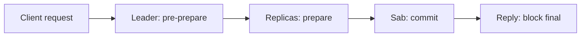
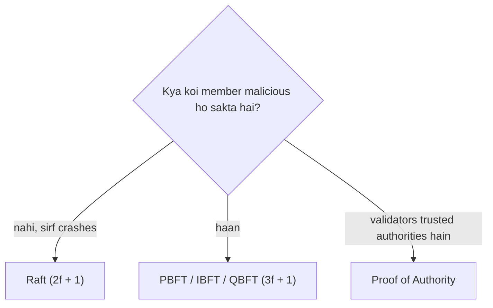

**Ek line mein:** <mark>Private blockchain mein saare validators known aur approved hote hain, isliye mehnge mining ki zaroorat nahi: nodes simply vote karte hain jab tak agree na ho jayein</mark> (Raft, Paxos, PBFT, IBFT/QBFT, Proof of Authority). <Cite id="private-blockchain-gfg-private" />

<Box kind="key">

**Private blockchain consensus mein ye points likho:**

- Nodes <mark>kam, known aur permissioned</mark> hote hain, isliye <mark>mining ki jagah voting</mark>: fast aur lagbhag bina energy ke.
- **Raft:** <mark>leader election + log replication, crash fault tolerant, n >= 2f + 1</mark>; Fabric ordering mein use hota hai.
- **Paxos:** purana crash-tolerant protocol, wahi majority idea; samajhna mushkil.
- **PBFT:** <mark>pre-prepare, prepare, commit; malicious nodes tolerate karta hai; n >= 3f + 1</mark>; turant finality; messages n squared badhte hain.
- **IBFT / QBFT:** Quorum jaisi Ethereum-based private chains ke liye PBFT-style voting.
- **Proof of Authority:** approved validators <mark>baari-baari se blocks sign karte hain</mark>.
- Members pe bharosa ho to **Raft**, kuch malicious ho sakte hon to **PBFT** chuno.

</Box>

## Core answer (5 marks, yahan ke har question ke liye)

<Box kind="definition">

**Consensus in a private blockchain** is the way a small group of known, approved nodes agree on the next block. Because identities are known, a bad node can be found and removed, so the nodes use **voting-based** algorithms instead of mining. <Cite id="private-blockchain-gfg-private" />

</Box>

**Voting yahan kyun kaam karta hai:** nodes ki sankhya kam hai aur unki identity known hai, isliye network votes gin sakta hai. Isse high speed, low cost aur kam energy milti hai.

**Common methods:**

1. **Raft (crash fault tolerant).** Ek elected *leader* commands *followers* ko copy karta hai; majority confirm karti hai. n >= 2f + 1 chahiye. Hyperledger Fabric ki ordering service mein use hota hai. <Cite id="bft-paxos-raft-raft-paper" /> <Cite id="bft-paxos-raft-fabric-orderer" />
2. **Paxos.** Purana crash-tolerant protocol (proposers, acceptors, learners). Samajhna mushkil, isliye Raft aasaan alternative ke roop mein bana.
3. **PBFT (Byzantine fault tolerant).** Faulty ya malicious nodes ko teen phases mein handle karta hai. n >= 3f + 1 chahiye aur turant finality deta hai. <Cite id="bft-paxos-raft-gfg-pbft" />
4. **IBFT / QBFT.** Quorum ke liye PBFT-style voting. <Cite id="corda-ripple-quorum-quorum-ibft" />
5. **Proof of Authority.** Approved validators baari-baari se blocks sign karte hain.

**Conclusion:** <mark>private chains replace mining by voting among known nodes; pick Raft if you trust members not to lie, and PBFT if some may be malicious</mark>.

## Extended answer (10 marks): ye add karo

### 1. Raft aur Paxos thoda detail mein

- **Raft:** followers heartbeats ka intezaar karte hain; na aaye to follower candidate banta hai aur **votes ki majority** use leader bana deti hai. Leader har block apne log mein append karta hai aur commit hone se pehle **majority** ko use store karna padta hai.
- **Paxos:** proposer Prepare bhejta hai, acceptors Promise karte hain, proposer Accept bhejta hai, aur acceptors ki majority accept karti hai. <Cite id="bft-paxos-raft-gfg-paxos" />

### 2. PBFT thoda detail mein

Ek replica **primary** hai, baaki **backups**. Phases: pre-prepare (primary propose karta hai), prepare (backups echo karte hain), commit (2f + 1 matching votes), reply (client f + 1 equal replies ka wait karta hai). Faulty primary **view change** se badla jata hai. <Cite id="web-bt-2-wiki-pbft" />

### 3. Comparison

| Point | Raft | Paxos | PBFT |
|---|---|---|---|
| Kaunse faults | Sirf crash | Sirf crash | Crash aur malicious |
| f faults ke liye nodes | 2f + 1 | 2f + 1 | 3f + 1 |
| Example | 3 nodes 1 crash survive | 3 nodes 1 crash survive | 4 nodes 1 bad node survive |
| Speed | Bahut fast | Fast | Fast, zyada nodes pe slow |
| Kahan use | Fabric ordering, Quorum | Chubby-style systems | BFT-based permissioned chains |

### 4. Mining kyun nahi

Proof of work bahut energy leta hai aur slow hai, aur woh anonymous networks ko bachane ke liye hai. Permissioned network mein identities pehle se suraksha deti hain, isliye voting kaafi hai. <Cite id="private-blockchain-gfg-private" />

## Har question mein kaise fit karein

- **"Consensus in private blockchain"** (10 marks) <PYQ id="2023-12/q6b" />: core answer likho (voting kyun, paanch methods, diagram), phir extended section 3 (comparison table) aur decision diagram.

## Exam tips

- PBFT ka teen-round flow **draw karo** aur Raft vs PBFT table add karo.
- Keywords: <mark>known validators, voting, crash fault, Byzantine fault, 2f + 1, 3f + 1, finality</mark>.
- Rule likho: members trusted hon to Raft, kuch malicious ho sakte hon to PBFT.

Exam mein English mein likho.
