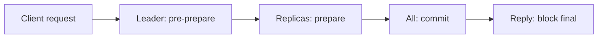
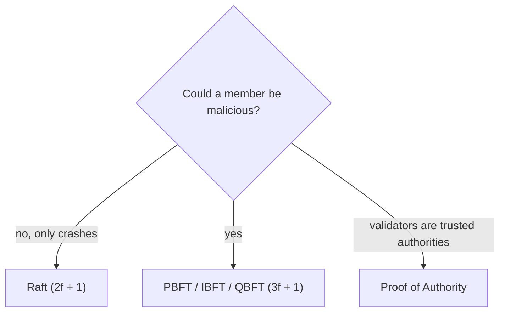

**In one line:** <mark>In a private blockchain all validators are known and approved, so there is no need for costly mining: the nodes simply vote until they agree</mark> (Raft, Paxos, PBFT, IBFT/QBFT, Proof of Authority). <Cite id="private-blockchain-gfg-private" />

<Box kind="key">

**Key points to write (consensus in private blockchain):**

- Nodes are <mark>few, known and permissioned</mark>, so <mark>voting replaces mining</mark>: fast and almost no energy.
- **Raft:** <mark>leader election + log replication, crash fault tolerant, n >= 2f + 1</mark>; used in Fabric ordering.
- **Paxos:** older crash-tolerant protocol with the same majority idea; harder to understand.
- **PBFT:** <mark>pre-prepare, prepare, commit; tolerates malicious nodes; n >= 3f + 1</mark>; instant finality; messages grow as n squared.
- **IBFT / QBFT:** PBFT-style voting for Ethereum-based private chains such as Quorum.
- **Proof of Authority:** approved validators <mark>sign blocks in turn</mark>.
- Choose **Raft** if members are trusted not to lie, **PBFT** if some may be malicious.

</Box>

## Core answer (5 marks, fits every question here)

<Box kind="definition">

**Consensus in a private blockchain** is the way a small group of known, approved nodes agree on the next block. Because identities are known, a bad node can be found and removed, so the nodes use **voting-based** algorithms instead of mining. <Cite id="private-blockchain-gfg-private" />

</Box>

**Why voting works here:** the number of nodes is small and their identities are known, so the network can count votes. This gives high speed, low cost and low energy.

**Common methods:**

1. **Raft (crash fault tolerant).** One elected *leader* copies commands to *followers*; a majority confirms. Needs n >= 2f + 1. Used in Hyperledger Fabric's ordering service. <Cite id="bft-paxos-raft-raft-paper" /> <Cite id="bft-paxos-raft-fabric-orderer" />
2. **Paxos.** An older crash-tolerant protocol (proposers, acceptors, learners). Hard to understand, so Raft was made as an easier alternative.
3. **PBFT (Byzantine fault tolerant).** Handles faulty or malicious nodes in three phases. Needs n >= 3f + 1 and gives instant finality. <Cite id="bft-paxos-raft-gfg-pbft" />
4. **IBFT / QBFT.** PBFT-style voting for Quorum. <Cite id="corda-ripple-quorum-quorum-ibft" />
5. **Proof of Authority.** Approved validators sign blocks in turn.

**Conclusion:** <mark>private chains replace mining by voting among known nodes; pick Raft if you trust members not to lie, and PBFT if some may be malicious</mark>.

## Extended answer (10 marks): add these

### 1. Raft and Paxos in a little more detail

- **Raft:** followers expect heartbeats; if none arrives, a follower becomes a candidate and a **majority of votes** makes it leader. The leader appends each block to its log and a **majority** must store it before it is committed.
- **Paxos:** a proposer sends Prepare, acceptors Promise, the proposer sends Accept, and a majority of acceptors accept. <Cite id="bft-paxos-raft-gfg-paxos" />

### 2. PBFT in a little more detail

One replica is the **primary**, the others are **backups**. Phases: pre-prepare (primary proposes), prepare (backups echo), commit (2f + 1 matching votes), reply (client waits for f + 1 equal replies). A faulty primary is replaced by a **view change**. <Cite id="web-bt-2-wiki-pbft" />

### 3. Comparison

| Point | Raft | Paxos | PBFT |
|---|---|---|---|
| Faults handled | Crash only | Crash only | Crash and malicious |
| Nodes needed for f faults | 2f + 1 | 2f + 1 | 3f + 1 |
| Example | 3 nodes survive 1 crash | 3 nodes survive 1 crash | 4 nodes survive 1 bad node |
| Speed | Very fast | Fast | Fast, slows with many nodes |
| Used in | Fabric ordering, Quorum | Chubby-style systems | BFT-based permissioned chains |

### 4. Why not mining

Proof of work needs huge energy and is slow, and it exists to protect anonymous networks. In a permissioned network the identities already give protection, so voting is enough. <Cite id="private-blockchain-gfg-private" />

## Fit it to each question

- **"Consensus in private blockchain"** (10 marks) <PYQ id="2023-12/q6b" />: write the core answer (why voting works, the five methods, diagram), then extended section 3 (comparison table) and the decision diagram.

## Exam tips

- **Draw** the PBFT three-round flow and add the Raft versus PBFT table.
- Keywords: <mark>known validators, voting, crash fault, Byzantine fault, 2f + 1, 3f + 1, finality</mark>.
- State the rule: Raft if members are trusted, PBFT if some may be malicious.
