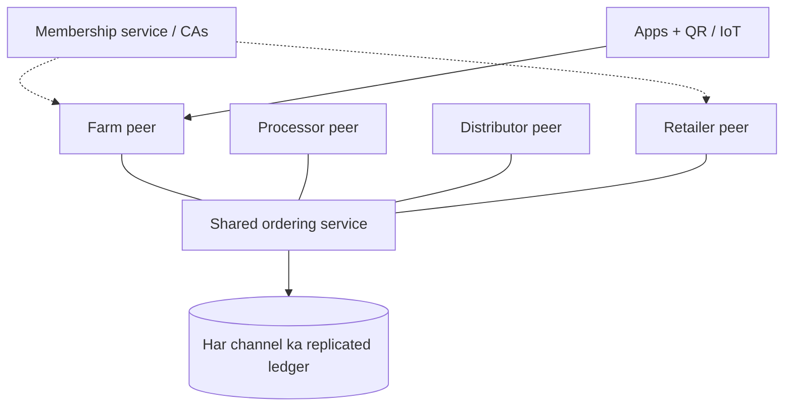
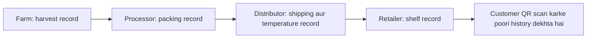

**Ek line mein:** <mark>Consortium blockchain ek permissioned blockchain hai jo organisations ka group milkar chalata hai, jahan blocks validate karne ka haq un sab mein baanta hota hai</mark>; Hyperledger Fabric pe IBM Food Trust ek standard case study hai. <Cite id="private-blockchain-gfg-consortium" />

<Box kind="key">

**Consortium case study mein ye points likho:**

- Definition: <mark>permissioned, validation pre-selected organisations ke group mein shared</mark> (federated).
- Case: <mark>IBM Food Trust (food supply chain), Hyperledger Fabric pe</mark>.
- **Problem:** alag-alag records, isliye contaminated food trace karne mein din lagte hain.
- **Members:** farms, processors, distributors, retailers (Walmart, Carrefour, Nestle), IBM operator ke roop mein.
- **Result:** Walmart ne mangoes ko farm tak <mark>2.2 seconds mein trace kiya, pehle lagbhag 7 din lagte the</mark>.
- Architecture: <mark>har organisation ke peers, CA/MSP, shared ordering service, channels, chaincode, apps aur QR/IoT</mark>.

</Box>

## Core answer (5 marks, yahan ke har question ke liye)

<Box kind="definition">

A **consortium (federated) blockchain** is permissioned, and the right to validate blocks is shared among a pre-selected group of organisations. No single company owns it and it is not open to the whole world. <Cite id="private-blockchain-gfg-consortium" />

</Box>

**Case study: IBM Food Trust (Hyperledger Fabric).**

- **Problem:** retailers, suppliers aur farms alag records rakhte hain, isliye contaminated food trace karne mein din lagte hain.
- **Solution:** har handover (harvest, packing, shipping, shelf) shared ledger pe record hota hai. Har member sirf wahi data dekhta hai jiski use ijazat hai.
- **Result:** pilot mein Walmart ne mangoes ko unke farm tak 2.2 seconds mein trace kiya, jab ki pehle lagbhag 7 din lagte the. Recalls tez hote hain, waste kam hota hai aur trust badhta hai. <Cite id="hyperledger-fabric-ibm-fabric" />

**Architecture:**

1. Har organisation peer nodes chalati hai aur uski apni certificate authority hoti hai.
2. Members membership service (MSP) se join karte hain jo identities deti hai.
3. Milkar chalayi gayi common ordering service transactions ko order karti hai.
4. Channels se members ke subsets private data share karte hain.
5. Chaincode mein business rules hote hain; endorsement ke liye kai organisations ke signatures chahiye. <Cite id="private-blockchain-fabric-network" />
6. Apps aur IoT ya barcode scanners APIs se transactions submit karte hain.

**Conclusion:** <mark>a consortium chain suits businesses that must cooperate but do not fully trust one another</mark>.

## Extended answer (10 marks): ye add karo

### 1. Ek food item ka flow

Agar koi batch contaminated nikle to retailer code scan karke seconds mein farm dhoondh leta hai, isliye sirf wahi batch recall hota hai.

### 2. Public, private aur consortium

| Point | Public | Private | Consortium |
|---|---|---|---|
| Kaun chalata hai | Sab | Ek organisation | Organisations ka group |
| Kaun validate kare | Koi bhi | Owner ke nodes | Chune hue members |
| Trust | Zaroorat nahi | Owner pe | Members mein shared |
| Speed | Slow | Fast | Fast |
| Example | Bitcoin | Internal bank ledger | Food Trust, Corda networks |

<Cite id="private-blockchain-gfg-pubpriv" />

### 3. Aur consortium examples

Banks ke liye R3 Corda, trade finance ke liye we.trade, shipping ke liye TradeLens (2023 mein band). <Cite id="blockchain-applications-gfg-supply-revolution" />

### 4. Benefits aur limits

**Benefits:** ek boss ke bina shared trust, privacy, speed, tez recalls. **Limits:** members ko governance pe agree karna padta hai (kaun join kare, kaun kharcha de, galti kaun sudhare), aur yeh public chain se kam open hai.

## Har question mein kaise fit karein

- **"Illustrate a case study on consortium blockchain. Give its architecture."** (10 marks) <PYQ id="2024-12/q5a" />: core answer (definition, case study, architecture ke chhe points, diagram), phir extended section 1 (flow diagram) aur 2 (table).

## Exam tips

- Architecture **draw karo**: kai organisations ke peers ek ordering service ke aas-paas.
- Keywords: <mark>consortium, shared validation, Fabric, ordering service, MSP, channel, traceability</mark>.
- Ek real case number ke saath likho (Walmart mango trace: 2.2 seconds).

Exam mein English mein likho.
