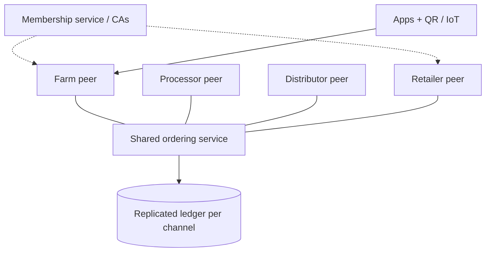
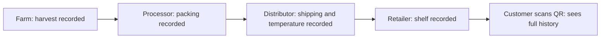

**In one line:** <mark>A consortium blockchain is a permissioned blockchain run jointly by a group of organisations, where the right to validate blocks is shared among them</mark>; IBM Food Trust on Hyperledger Fabric is a standard case study. <Cite id="private-blockchain-gfg-consortium" />

<Box kind="key">

**Key points to write (consortium case study):**

- Definition: <mark>permissioned, validation shared among a pre-selected group of organisations</mark> (federated).
- Case: <mark>IBM Food Trust (food supply chain) on Hyperledger Fabric</mark>.
- **Problem:** separate records, so tracing contaminated food takes days.
- **Members:** farms, processors, distributors, retailers (Walmart, Carrefour, Nestle), IBM as operator.
- **Result:** Walmart traced mangoes to the farm in <mark>2.2 seconds versus nearly 7 days</mark>.
- Architecture: <mark>peers per organisation, CA/MSP, shared ordering service, channels, chaincode, apps and QR/IoT</mark>.

</Box>

## Core answer (5 marks, fits every question here)

<Box kind="definition">

A **consortium (federated) blockchain** is permissioned, and the right to validate blocks is shared among a pre-selected group of organisations. No single company owns it and it is not open to the whole world. <Cite id="private-blockchain-gfg-consortium" />

</Box>

**Case study: IBM Food Trust (Hyperledger Fabric).**

- **Problem:** retailers, suppliers and farms keep separate records, so tracing a contaminated food takes days.
- **Solution:** every handover (harvest, packing, shipping, shelf) is recorded on a shared ledger. Each member sees only the data it is allowed to see.
- **Result:** in a pilot, Walmart traced mangoes to their farm in 2.2 seconds, versus nearly 7 days earlier. Recalls become faster, waste falls and trust grows. <Cite id="hyperledger-fabric-ibm-fabric" />

**Architecture:**

1. Each organisation runs peer nodes and has its own certificate authority.
2. Members join through a membership service (MSP) that gives identities.
3. A common ordering service, run jointly, orders transactions.
4. Channels let subsets of members share private data.
5. Chaincode holds the business rules; endorsement needs signatures from several organisations. <Cite id="private-blockchain-fabric-network" />
6. Apps and IoT or barcode scanners submit transactions through APIs.

**Conclusion:** <mark>a consortium chain suits businesses that must cooperate but do not fully trust one another</mark>.

## Extended answer (10 marks): add these

### 1. Flow of one food item

If a batch is found to be contaminated, the retailer scans the code and finds the farm in seconds, so only that batch is recalled.

### 2. Public, private and consortium

| Point | Public | Private | Consortium |
|---|---|---|---|
| Who runs it | Everyone | One organisation | A group of organisations |
| Who can validate | Anyone | Owner's nodes | Chosen members |
| Trust | None needed | In the owner | Shared among members |
| Speed | Slow | Fast | Fast |
| Example | Bitcoin | Internal bank ledger | Food Trust, Corda networks |

<Cite id="private-blockchain-gfg-pubpriv" />

### 3. Other consortium examples

R3 Corda for banks, we.trade for trade finance, TradeLens for shipping (wound down in 2023). <Cite id="blockchain-applications-gfg-supply-revolution" />

### 4. Benefits and limits

**Benefits:** shared trust without one boss, privacy, speed, faster recalls. **Limits:** members must agree on governance (who joins, who pays, who fixes errors), and it is less open than a public chain.

## Fit it to each question

- **"Illustrate a case study on consortium blockchain. Give its architecture."** (10 marks) <PYQ id="2024-12/q5a" />: core answer (definition, case study, six architecture points, diagram), then extended section 1 (flow diagram) and 2 (table).

## Exam tips

- **Draw** the architecture with several organisation peers around one ordering service.
- Keywords: <mark>consortium, shared validation, Fabric, ordering service, MSP, channel, traceability</mark>.
- Name one real case with a number (Walmart mango trace: 2.2 seconds).
