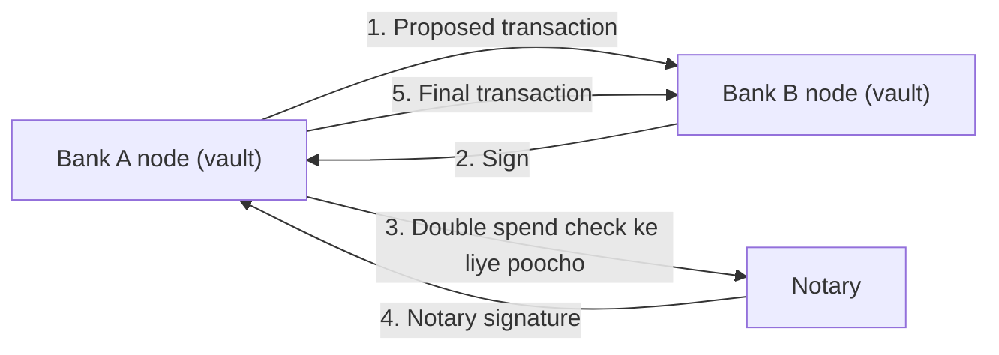
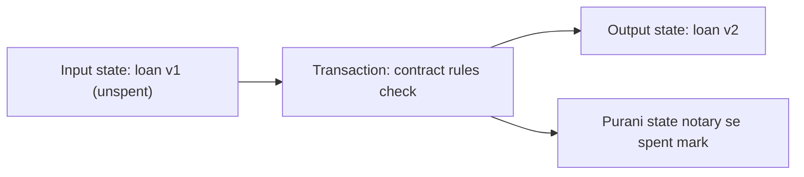

**Ek line mein:** <mark>Corda R3 ka open-source blockchain platform hai banks aur regulated businesses ke liye, jahan har deal sirf involved parties ke saath share hoti hai aur notary double spending rokta hai</mark>. <Cite id="corda-ripple-quorum-corda-intro-wp" />

<Box kind="key">

**Har Corda question mein ye points likho:**

- <mark>Finance aur legal agreements</mark> ke liye bana; <mark>permissioned</mark>; Java/Kotlin mein, JVM pe.
- <mark>Global ledger nahi, broadcast nahi</mark>: har node ke paas **vault** hota hai jisme sirf wahi facts hain jinka woh party hai (privacy).
- **States** = immutable facts (loan); state <mark>consume hoke naye se replace hoti hai</mark> (UTXO jaisa).
- **Contracts** validity check karte hain aur legal prose se juden hote hain; **flows** nodes ko step by step agree karate hain.
- **Notary** = <mark>check karta hai ki input state pehle spent nahi hui</mark> (uniqueness consensus); Raft ya BFT cluster ho sakta hai.
- **Network map aur doorman** identity dete hain; **oracles** bahar ke facts laate hain.
- Quorum se farq: <mark>Corda data need-to-know pe share karta hai; Quorum Ethereum ka fork hai jisme private transactions hain</mark>.

</Box>

## Core answer (5 marks, yahan ke har question ke liye)

<Box kind="definition">

**Corda** is an open-source distributed ledger platform developed by R3 for banks and other regulated businesses. Unlike Bitcoin, it does not send every transaction to everybody: only the parties to a deal see it. <Cite id="corda-ripple-quorum-corda-intro-wp" />

</Box>

**Kaunsi problem solve karta hai:** har bank apni books rakhta hai, isliye ek hi deal kai jagah record hoti hai aur haath se match karni padti hai (reconciliation). Yeh slow, mehnga aur galti-prone hai, aur banks sensitive deals public chain pe nahi daal sakte.

**Architecture:**

1. **Nodes.** Har organisation apna node chalati hai jisme uska apna **vault** (database) hota hai. Global ledger nahi hota.
2. **States.** Kisi fact ka immutable record, jaise Rs 10 lakh ka loan. Deal purani state consume karke nayi state banane se badalti hai.
3. **Contracts.** Code (Java/Kotlin) jo batata hai transaction kab valid hai; legal agreement se juda hota hai.
4. **Flows.** Step-by-step protocols jisme nodes signatures jama karte hain aur transactions peer to peer share karte hain.
5. **Notary.** Service (single node ya Raft/BFT cluster) jo confirm karti hai ki koi input state pehle spent nahi hui, isliye double spending rukti hai.
6. **Network map aur doorman.** Identity ke liye permissioned directory aur certificates.
7. **Oracles.** Exchange rates jaise bahar ke facts dete hain. <Cite id="corda-ripple-quorum-corda-tech-wp" />

**Conclusion:** <mark>Corda shares data on a need-to-know basis, trading global broadcast for privacy and legal fit</mark>. <Cite id="corda-ripple-quorum-xoriant-corda" />

## Extended answer (10 marks): ye add karo

### 1. Corda transaction kaise chalti hai

1. Bank A transaction banata hai jo input state (purana loan) consume karti hai aur output state (naya loan) banati hai.
2. Contract code rules check karta hai (jaise amount positive ho).
3. Bank A sign karke **flow** se Bank B ko bhejta hai; Bank B check karke sign karta hai.
4. Agar input state pehle nahi dekhi gayi to **notary** sign karta hai, jisse prove hota hai ki woh unspent hai.
5. Dono banks finished transaction apne vaults mein record karte hain. Koi aur node use nahi dekhta. <Cite id="corda-ripple-quorum-corda-github" />

### 2. Corda vs Quorum

| Point | Corda | Quorum |
|---|---|---|
| Base | Scratch se bana | Ethereum (Geth) ka fork |
| Data sharing | Sirf involved parties | Saare nodes; private transactions Tessera se |
| Ledger | Global ledger nahi; har node ka vault | Ek shared chain |
| Smart contracts | Java/Kotlin | Solidity (EVM) |
| Consensus | Notary (uniqueness) | IBFT, QBFT ya Raft |
| Model | UTXO-jaisi states | Account-based |
| Focus | Finance, legal agreements | General enterprise |

<Cite id="corda-ripple-quorum-gfg-quorum" /> <Cite id="corda-ripple-quorum-quorum-github" />

### 3. Use cases, strengths aur limits

**Use:** trade finance, insurance claims aur syndicated loans, jahan kuch known parties ek agreement share karti hain aur privacy aur legal clarity chahiye.

| Strengths | Limits |
|---|---|
| Design se hi privacy | Ethereum se chhoti community |
| Contracts se legal link | Trusted network aur notary chahiye |
| Mining nahi, fast finality | Public, open coins ke liye nahi |

## Har question mein kaise fit karein

- **"Corda"** (10 marks) <PYQ id="2022-12-ce/q6a" /> <PYQ id="2023-05-ce/q6c" /> <PYQ id="2024-12-ce/q6d" />: poora answer: core answer plus extended sections 1 aur 3.
- **"Explain Corda architecture. Compare it with quorum."** (10 marks) <PYQ id="2024-12/q4b" />: core answer (saat architecture points aur diagram), phir extended section 2 (Corda vs Quorum table).

## Exam tips

- Notary ke saath do-bank flow **draw karo**.
- Keywords: <mark>vault, state, contract, flow, notary, need-to-know, no global ledger</mark>.
- Yeh mat likho ki Corda public chain hai ya mining use karta hai.

Exam mein English mein likho.
