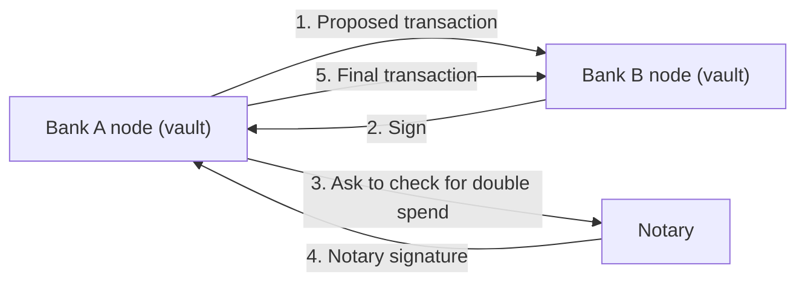
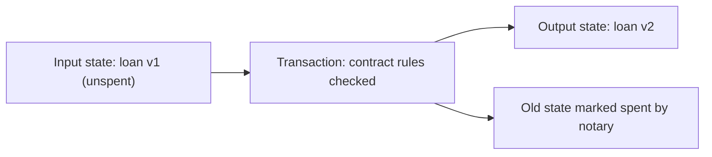

**In one line:** <mark>Corda is an open-source blockchain platform by R3 for banks and regulated businesses, where each deal is shared only with the parties involved and a notary stops double spending</mark>. <Cite id="corda-ripple-quorum-corda-intro-wp" />

<Box kind="key">

**Key points to write (any Corda question):**

- Built for <mark>finance and legal agreements</mark>; <mark>permissioned</mark>; written in Java/Kotlin on the JVM.
- <mark>No global ledger and no broadcast</mark>: each node keeps a **vault** with only the facts it is party to (privacy).
- **States** = immutable facts (a loan); a state is <mark>consumed and replaced</mark> (UTXO-like).
- **Contracts** check validity and are tied to legal prose; **flows** let nodes agree step by step.
- **Notary** = <mark>checks that an input state was not spent before</mark> (uniqueness consensus); can be a Raft or BFT cluster.
- **Network map and doorman** give identity; **oracles** bring outside facts.
- Versus Quorum: <mark>Corda shares data need-to-know; Quorum is an Ethereum fork with private transactions</mark>.

</Box>

## Core answer (5 marks, fits every question here)

<Box kind="definition">

**Corda** is an open-source distributed ledger platform developed by R3 for banks and other regulated businesses. Unlike Bitcoin, it does not send every transaction to everybody: only the parties to a deal see it. <Cite id="corda-ripple-quorum-corda-intro-wp" />

</Box>

**Problem it solves:** every bank keeps its own books, so the same deal is recorded in many places and must be matched by hand (reconciliation). That is slow, costly and error-prone, and banks cannot put sensitive deals on a public chain.

**Architecture:**

1. **Nodes.** Each organisation runs a node with its own **vault** (database). There is no global ledger.
2. **States.** An immutable record of a fact, for example a loan of Rs 10 lakh. A deal changes by consuming the old state and creating a new one.
3. **Contracts.** Code (Java/Kotlin) that says when a transaction is valid; tied to the legal agreement in words.
4. **Flows.** Step-by-step protocols in which nodes collect signatures and share transactions directly, peer to peer.
5. **Notary.** A service (single node or a Raft/BFT cluster) that confirms no input state was spent before, so double spending is stopped.
6. **Network map and doorman.** A permissioned directory and certificates for identity.
7. **Oracles.** Supply outside facts such as exchange rates. <Cite id="corda-ripple-quorum-corda-tech-wp" />

**Conclusion:** <mark>Corda shares data on a need-to-know basis, trading global broadcast for privacy and legal fit</mark>. <Cite id="corda-ripple-quorum-xoriant-corda" />

## Extended answer (10 marks): add these

### 1. How a Corda transaction works

1. Bank A builds a transaction that consumes an input state (old loan) and creates an output state (new loan).
2. The contract code checks the rules (for example, the amount is positive).
3. Bank A signs and sends it to Bank B by a **flow**; Bank B checks and signs.
4. If the input state was not seen before, the **notary** signs, proving it is unspent.
5. Both banks record the finished transaction in their vaults. No other node sees it. <Cite id="corda-ripple-quorum-corda-github" />

### 2. Corda versus Quorum

| Point | Corda | Quorum |
|---|---|---|
| Base | Built from scratch | Fork of Ethereum (Geth) |
| Data sharing | Only involved parties | All nodes; private transactions via Tessera |
| Ledger | No global ledger; per-node vaults | One shared chain |
| Smart contracts | Java/Kotlin | Solidity (EVM) |
| Consensus | Notary (uniqueness) | IBFT, QBFT or Raft |
| Model | UTXO-like states | Account-based |
| Focus | Finance, legal agreements | General enterprise |

<Cite id="corda-ripple-quorum-gfg-quorum" /> <Cite id="corda-ripple-quorum-quorum-github" />

### 3. Use cases, strengths and limits

**Use:** trade finance, insurance claims and syndicated loans, where a few known parties share an agreement and need privacy and legal clarity.

| Strengths | Limits |
|---|---|
| Privacy by design | Smaller community than Ethereum |
| Legal link to contracts | Needs a trusted network and notary |
| No mining, fast finality | Not for public, open coins |

## Fit it to each question

- **"Explain Corda architecture. Compare it with quorum."** (10 marks) <PYQ id="2024-12/q4b" />: core answer (the seven architecture points and the diagram), then extended section 2 (the Corda versus Quorum table).

## Exam tips

- **Draw** the two-bank flow with the notary.
- Keywords: <mark>vault, state, contract, flow, notary, need-to-know, no global ledger</mark>.
- Do not say Corda is a public chain or uses mining.
