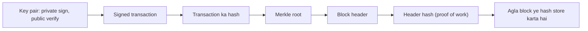
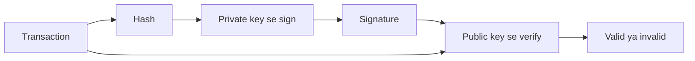

**Ek line mein:** <mark>Blockchain cryptography use karta hai integrity ke liye (hash functions), ownership aur authentication ke liye (public-key cryptography aur digital signatures) aur fast proofs ke liye (Merkle trees)</mark>. <Cite id="block-structure-merkle-me-ch4" />

<Box kind="key">

**Cryptography in blockchain ke question mein ye points likho:**

- <mark>Hash function</mark>: fixed-size fingerprint; one-way, chhota change bhi bilkul alag hash deta hai, collisions infeasible; SHA-256 (Bitcoin), Keccak-256 (Ethereum).
- <mark>Public-key cryptography</mark>: private key (secret) aur public key (shared); ek se dusri nahi nikaal sakte; Bitcoin elliptic curves use karta hai.
- <mark>Digital signature</mark>: private key se sign, public key se verify; authentication, integrity aur non-repudiation deta hai.
- <mark>Merkle tree</mark>: bahut saare transaction hashes block header mein ek root mein.
- Uses: block hash aur links, proof of work, addresses, transactions sign karna.
- <mark>Hashing encryption nahi hai</mark>; blockchain data public hai, cryptography proof aur integrity deti hai, secrecy nahi.

</Box>

## Core answer (5 marks, yahan ke har question ke liye)

<Box kind="definition">

**Cryptography** is the science of keeping data safe and proving it is genuine. A blockchain is built from a few cryptographic tools that make it tamper-evident and let people own coins without a bank. <Cite id="block-structure-merkle-me-ch4" />

</Box>

1. **Cryptographic hash function.** Kisi bhi data ko fixed-size fingerprint mein badalta hai (Bitcoin mein SHA-256). Ye one-way hai, chhota change poora alag hash deta hai, aur same hash wale do inputs dhoondhna infeasible hai. Block hashes, chain links, proof of work, Merkle tree aur addresses mein use hota hai. Analogy: parcel ki tamper seal. <Cite id="block-structure-merkle-wiki-hash" /> <Cite id="web-bt-1-nist-sha" />
2. **Public-key cryptography.** Har user ke paas ek **private key** (secret) aur ek **public key** (shared) hoti hai. Address public key se banta hai. <Cite id="block-structure-merkle-wiki-pubkey" /> <Cite id="bitcoin-mb-ch04-keys" />
3. **Digital signature.** Owner transaction ko private key se sign karta hai; koi bhi public key se verify kar sakta hai. Ye authentication, integrity aur non-repudiation prove karta hai. Analogy: cheque pe aapka signature. <Cite id="block-structure-merkle-wiki-digsig" />
4. **Merkle tree.** Transaction hashes pair hoke upar ek **Merkle root** tak jaate hain, jo block header mein hota hai. <Cite id="block-structure-merkle-gfg-merkle" />

**Conclusion:** <mark>hashes blocks ko link karte hain, signatures ownership prove karte hain aur Merkle trees transactions ko summarise karte hain, isliye blockchain bina central authority ke secure hai</mark>.

## Extended answer (10 marks): ye add karo

### 1. Achhe hash function ki properties

- **Deterministic:** same input, same hash.
- **Compute karna fast**, lekin **one-way** (pre-image resistant).
- **Avalanche effect:** ek bit badlo to lagbhag aadhe output bits badal jaate hain.
- **Collision resistant:** same hash wale do alag inputs dhoondhna infeasible hai.

### 2. Sign aur verify kaise hota hai

1. Alice transaction ko hash karti hai aur hash ko apni **private key** se sign karti hai.
2. Wo transaction, signature aur apni public key bhejti hai.
3. Koi bhi node signature ko uski **public key** se verify karta hai; match ho to transaction genuine aur unchanged hai.

Bitcoin secp256k1 curve pe ECDSA use karta hai. <Cite id="web-bt-1-ecdsa" />

### 3. Summary table

| Tool | Kya deta hai | Kahan use |
|---|---|---|
| Hash | Integrity, tamper evidence | Blocks, PoW, Merkle tree, addresses |
| Key pair | Secret share kiye bina ownership | Wallets aur addresses |
| Signature | Authentication, non-repudiation | Har transaction |
| Merkle tree | Bahut items ka ek hash, chhote proofs | Block header |

### 4. Important point

**Hashing encryption nahi hai.** Hash kuch chhupata nahi. Bitcoin transactions public aur readable hain; cryptography proof aur integrity ke liye hai, secrecy ke liye nahi. Private keys safe rakho: key khoyi to coins gaye.

## Har question mein kaise fit karein

- **"Cryptography in Blockchain"** (10 marks) <PYQ id="2023-12-ce/q6c" />: core answer (chaar tools aur fit-together diagram), phir sections 1 se 4: hash properties, picture ke saath signing steps, summary table aur "hashing is not encryption" point.

## Exam tips

- **Fit-together diagram draw karo;** ye chaaron tools ko ek picture mein jodta hai.
- Signature ki teen guarantees likho: <mark>authentication, integrity, non-repudiation</mark>.
- Likho ki SHA-256 Bitcoin use karta hai aur Keccak-256 Ethereum.

Exam mein English mein likho.
