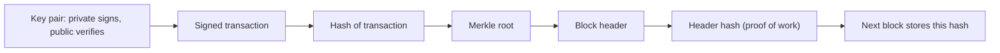
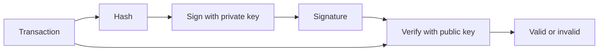

**In one line:** <mark>Blockchain uses cryptography for integrity (hash functions), ownership and authentication (public-key cryptography and digital signatures) and fast proofs (Merkle trees)</mark>. <Cite id="block-structure-merkle-me-ch4" />

<Box kind="key">

**Key points to write (cryptography in blockchain):**

- <mark>Hash function</mark>: fixed-size fingerprint; one-way, tiny change gives a very different hash, collisions infeasible; SHA-256 (Bitcoin), Keccak-256 (Ethereum).
- <mark>Public-key cryptography</mark>: private key (secret) and public key (shared); one cannot be worked out from the other; Bitcoin uses elliptic curves.
- <mark>Digital signature</mark>: signed with the private key, verified with the public key; gives authentication, integrity and non-repudiation.
- <mark>Merkle tree</mark>: many transaction hashes combined into one root in the block header.
- Uses: block hash and links, proof of work, addresses, signing transactions.
- <mark>Hashing is not encryption</mark>; blockchain data is public, cryptography gives proof and integrity, not secrecy.

</Box>

## Core answer (5 marks, fits every question here)

<Box kind="definition">

**Cryptography** is the science of keeping data safe and proving it is genuine. A blockchain is built from a few cryptographic tools that make it tamper-evident and let people own coins without a bank. <Cite id="block-structure-merkle-me-ch4" />

</Box>

1. **Cryptographic hash function.** Turns any data into a fixed-size fingerprint (SHA-256 in Bitcoin). It is one-way, a tiny change gives a completely different hash, and finding two inputs with the same hash is infeasible. Used for block hashes, chain links, proof of work, the Merkle tree and addresses. Analogy: the tamper seal on a parcel. <Cite id="block-structure-merkle-wiki-hash" /> <Cite id="web-bt-1-nist-sha" />
2. **Public-key cryptography.** Every user has a **private key** (secret) and a **public key** (shared). The address is made from the public key. <Cite id="block-structure-merkle-wiki-pubkey" /> <Cite id="bitcoin-mb-ch04-keys" />
3. **Digital signature.** The owner signs a transaction with the private key; anyone verifies it with the public key. It proves authentication, integrity and non-repudiation. Analogy: your signature on a cheque. <Cite id="block-structure-merkle-wiki-digsig" />
4. **Merkle tree.** Transaction hashes are paired and hashed up to one **Merkle root** in the block header. <Cite id="block-structure-merkle-gfg-merkle" />

**Conclusion:** <mark>hashes link the blocks, signatures prove ownership and Merkle trees summarise transactions, so a blockchain is secure without a central authority</mark>.

## Extended answer (10 marks): add these

### 1. Properties of a good hash function

- **Deterministic:** same input, same hash.
- **Fast to compute**, but **one-way** (pre-image resistant).
- **Avalanche effect:** change one bit and about half the output bits change.
- **Collision resistant:** it is infeasible to find two different inputs with the same hash.

### 2. How signing and verifying work

1. Alice hashes the transaction and signs the hash with her **private key**.
2. She sends the transaction, the signature and her public key.
3. Any node verifies the signature with her **public key**; if it matches, the transaction is genuine and unchanged.

Bitcoin uses ECDSA on the secp256k1 curve. <Cite id="web-bt-1-ecdsa" />

### 3. Summary table

| Tool | What it gives | Where used |
|---|---|---|
| Hash | Integrity, tamper evidence | Blocks, PoW, Merkle tree, addresses |
| Key pair | Ownership without sharing a secret | Wallets and addresses |
| Signature | Authentication, non-repudiation | Every transaction |
| Merkle tree | One hash for many items, short proofs | Block header |

### 4. Important point

**Hashing is not encryption.** Nothing is hidden by a hash. Bitcoin transactions are public and readable; cryptography is used for proof and integrity, not secrecy. Private keys must be kept safe: a lost key means lost coins.

## Fit it to each question

- **"Cryptography in Blockchain"** (10 marks) <PYQ id="2023-12-ce/q6c" />: core answer (four tools and the fit-together diagram), then sections 1 to 4: hash properties, signing steps with the picture, the summary table and the "hashing is not encryption" point.

## Exam tips

- **Draw** the fit-together diagram; it connects all four tools in one picture.
- Name the three signature guarantees: <mark>authentication, integrity, non-repudiation</mark>.
- Write that SHA-256 is used by Bitcoin and Keccak-256 by Ethereum.
