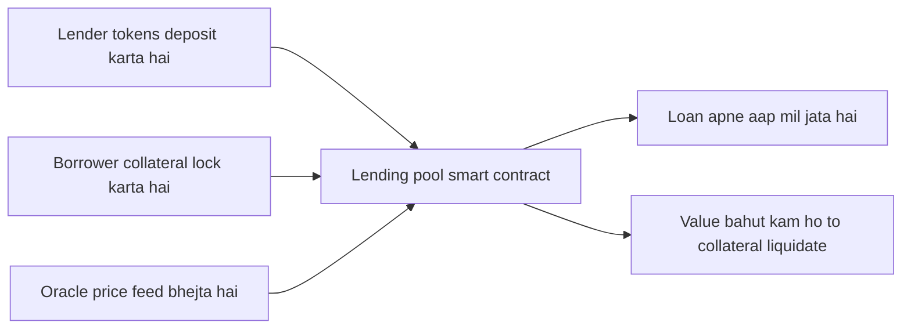
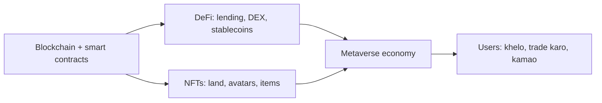

**Ek line mein:** <mark>DeFi (decentralized finance) blockchain pe banking jaisi services (lending, trading, saving) deta hai, smart contracts se chalti hui, bina bank ya broker ke</mark>. <Cite id="smart-contracts-wiki-defi" />

<Box kind="key">

**Har DeFi question mein ye points likho:**

- Definition: <mark>public blockchain (zyadatar Ethereum) pe smart contracts se di jane wali financial services, koi middleman nahi</mark>.
- **Layers (architecture):** <mark>settlement (blockchain), asset (ETH aur tokens), protocol (DEX, lending), application, aggregation</mark>.
- **Smart contract roles:** <mark>lending aur borrowing, DEX, stablecoins, yield farming, derivatives aur insurance, composability</mark>.
- **Oracles** bahar ke prices contracts tak pahunchate hain.
- **Benefits:** sab ke liye open, 24x7, transparent, user keys rakhta hai. **Risks:** <mark>contract bugs aur hacks, price swings, scams, unclear regulation</mark>.
- **Metaverse:** shared 3D virtual world; blockchain deta hai <mark>ownership (NFTs), payments (cryptocurrency) aur governance (DAOs)</mark>.

</Box>

## Core answer (5 marks, yahan ke har question ke liye)

<Box kind="definition">

**DeFi (decentralized finance)** is a set of financial services (lending, borrowing, trading, saving, insurance) delivered by **smart contracts** on a public blockchain, mostly Ethereum. There is no bank in the middle: anyone with a wallet can use it. <Cite id="blockchain-applications-ethereum-org-defi" />

</Box>

**Smart contract kya hai:** blockchain pe stored code jo condition poori hone par bilkul likhe hue tareeke se chalta hai, aur ek party use badal ya rok nahi sakti. <Cite id="smart-contracts-eth-intro" />

**Building blocks:** stablecoins, decentralised exchanges (Uniswap), lending pools (Aave, Compound), yield farming, wallets.

**Kaise kaam karta hai:** user wallet connect karta hai, tokens contract mein deposit karta hai, aur contract unhe code ke set kiye interest rate pe dusron ko udhaar deta hai.

**Benefits:** sab ke liye open, 24x7, transparent code, middleman fee nahi, users apni keys khud rakhte hain. **Risks:** contract bugs aur hacks, price swings, scams, unclear regulation.

**Conclusion:** <mark>smart contracts automate trust, so DeFi needs no central party, but the code must be correct</mark>.

## Extended answer (10 marks): ye add karo

### 1. DeFi architecture (layers)

| Layer | Isme kya hai | Example |
|---|---|---|
| Settlement | Base blockchain | Ethereum |
| Asset | Native coin aur tokens | ETH, stablecoins, ERC-20 |
| Protocol | Rules wale smart contracts | Uniswap, Aave, Compound |
| Application | User interface (wallet se juda app) | Lending website |
| Aggregation | Kai apps ko ek view mein jodta hai | Yield aggregators |

### 2. DeFi mein smart contracts ka role

1. **Lending aur borrowing:** borrower loan se zyada value ka collateral lock karta hai. Value bahut gir jaye to contract use apne aap **liquidate** kar deta hai.
2. **Decentralized exchange (DEX):** contract do tokens ka pool rakhta hai aur price formula se tay karta hai, isliye users seedhe wallet se trade karte hain.
3. **Stablecoins:** contracts locked collateral ke against coins mint karte hain taaki price 1 dollar ke paas rahe (DAI).
4. **Yield farming aur staking:** contracts liquidity dene ya tokens lock karne par rewards dete hain.
5. **Derivatives aur insurance:** jab **oracle** ki di hui condition poori hoti hai to payout apne aap hota hai. <Cite id="smart-contracts-eth-oracles" />
6. **Composability:** ek contract dusre ko call kar sakta hai, isliye DeFi apps "money Lego" ki tarah jud jaate hain. <Cite id="smart-contracts-eth-defi" />

### 3. Traditional finance vs DeFi

| Point | Traditional finance | DeFi |
|---|---|---|
| Kaun chalata hai | Banks, brokers | Smart contracts |
| Access | Account, KYC, working hours | Wallet, hamesha open |
| Transparency | Private records | Public ledger aur code |
| Custody | Bank paisa rakhta hai | User keys rakhta hai |

### 4. Risks

Contract code ke bugs (2016 ke DAO hack mein lagbhag 3.6 million ETH gaya), oracle manipulation, flash-loan attacks, price volatility, customer support ya deposit insurance nahi, aur unclear regulation. Audits risk kam karte hain par khatam nahi karte.

### 5. Metaverse mein blockchain

**Metaverse** ek persistent, shared 3D virtual duniya hai jahan log (avatars ke roop mein) milte, khelte, kaam karte aur trade karte hain. Blockchain **NFTs** se digital land, avatars aur items ki ownership prove karta hai, andar payment ke liye **cryptocurrency** deta hai, aur community ko **DAOs** se vote karne deta hai. Examples: Decentraland, The Sandbox. <Cite id="cryptocurrencies-tokens-wiki-metaverse" /> <Cite id="blockchain-applications-ethereum-org-nft" />

**Link:** virtual duniya mein user token se land khareed sakta hai, us land ko DeFi loan mein collateral bana sakta hai, aur stablecoins mein kiraya kama sakta hai. <Cite id="cryptocurrencies-tokens-gfg-metaverse" />

## Har question mein kaise fit karein

- **"Blockchain in Defi and Metaverse"** (10 marks) <PYQ id="2023-12/q6c" />: core answer (chhota), phir extended section 5 (Metaverse) aur dono ka link.
- **"Defi"** (10 marks) <PYQ id="2025-05/q6a" />: poora answer: core, layers, roles, comparison table aur risks.

## Exam tips

- Layer stack **draw karo** (neeche settlement) ya oracle ke saath lending flow.
- Keywords: <mark>smart contract, DEX, lending pool, stablecoin, collateral, liquidation, oracle, composability</mark>.
- Hamesha risks se khatam karo: code bugs aur regulation.

Exam mein English mein likho.
