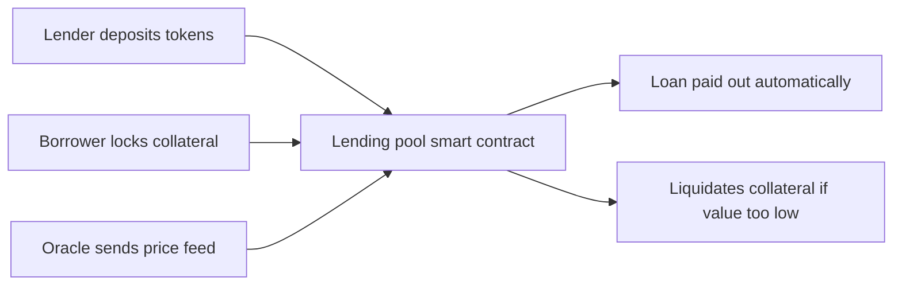
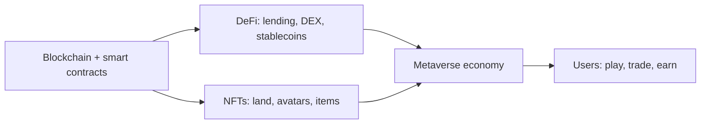

**In one line:** <mark>DeFi (decentralized finance) offers banking-style services such as lending, trading and saving on a blockchain, run by smart contracts without a bank or broker</mark>. <Cite id="smart-contracts-wiki-defi" />

<Box kind="key">

**Key points to write (any DeFi question):**

- Definition: <mark>financial services delivered by smart contracts on a public blockchain (mostly Ethereum), with no middleman</mark>.
- **Layers (architecture):** <mark>settlement (blockchain), asset (ETH and tokens), protocol (DEX, lending), application, aggregation</mark>.
- **Smart contract roles:** <mark>lending and borrowing, DEX, stablecoins, yield farming, derivatives and insurance, composability</mark>.
- **Oracles** feed outside prices into contracts.
- **Benefits:** open to all, 24x7, transparent, user keeps keys. **Risks:** <mark>contract bugs and hacks, price swings, scams, unclear regulation</mark>.
- **Metaverse:** shared 3D virtual world; blockchain gives <mark>ownership (NFTs), payments (cryptocurrency) and governance (DAOs)</mark>.

</Box>

## Core answer (5 marks, fits every question here)

<Box kind="definition">

**DeFi (decentralized finance)** is a set of financial services (lending, borrowing, trading, saving, insurance) delivered by **smart contracts** on a public blockchain, mostly Ethereum. There is no bank in the middle: anyone with a wallet can use it. <Cite id="blockchain-applications-ethereum-org-defi" />

</Box>

**What a smart contract is:** code stored on the blockchain that runs exactly as written when its conditions are met, and cannot be changed or stopped by one party. <Cite id="smart-contracts-eth-intro" />

**Building blocks:** stablecoins, decentralised exchanges (Uniswap), lending pools (Aave, Compound), yield farming, wallets.

**How it works:** a user connects a wallet, deposits tokens into a contract, and the contract lends them to others at an interest rate set by code.

**Benefits:** open to anyone, works 24x7, transparent code, no middleman fee, users keep their own keys. **Risks:** contract bugs and hacks, price swings, scams, unclear regulation.

**Conclusion:** <mark>smart contracts automate trust, so DeFi needs no central party, but the code must be correct</mark>.

## Extended answer (10 marks): add these

### 1. DeFi architecture (layers)

| Layer | What it holds | Example |
|---|---|---|
| Settlement | The base blockchain | Ethereum |
| Asset | Native coin and tokens | ETH, stablecoins, ERC-20 |
| Protocol | Smart contracts with the rules | Uniswap, Aave, Compound |
| Application | The user interface (wallet-connected app) | A lending website |
| Aggregation | Joins many apps into one view | Yield aggregators |

### 2. Role of smart contracts in DeFi

1. **Lending and borrowing:** a borrower locks collateral worth more than the loan. If its value falls too low, the contract **liquidates** it automatically.
2. **Decentralized exchange (DEX):** a contract holds a pool of two tokens and sets the price by a formula, so users trade straight from their wallets.
3. **Stablecoins:** contracts mint coins against locked collateral to keep the price near 1 dollar (DAI).
4. **Yield farming and staking:** contracts pay rewards for supplying liquidity or locking tokens.
5. **Derivatives and insurance:** payouts happen automatically when a condition, supplied by an **oracle**, is met. <Cite id="smart-contracts-eth-oracles" />
6. **Composability:** one contract can call another, so DeFi apps connect like "money Lego". <Cite id="smart-contracts-eth-defi" />

### 3. Traditional finance versus DeFi

| Point | Traditional finance | DeFi |
|---|---|---|
| Who runs it | Banks, brokers | Smart contracts |
| Access | Account, KYC, working hours | Wallet, always open |
| Transparency | Private records | Public ledger and code |
| Custody | Bank holds funds | User holds keys |

### 4. Risks

Bugs in contract code (the 2016 DAO hack lost about 3.6 million ETH), oracle manipulation, flash-loan attacks, price volatility, no customer support or deposit insurance, and unclear regulation. Audits reduce but do not remove the risk.

### 5. Blockchain in the Metaverse

The **Metaverse** is a persistent, shared 3D virtual world where people (as avatars) meet, play, work and trade. Blockchain proves who owns digital land, avatars and items as **NFTs**, provides **cryptocurrency** to pay inside, and lets the community vote through **DAOs**. Examples: Decentraland, The Sandbox. <Cite id="cryptocurrencies-tokens-wiki-metaverse" /> <Cite id="blockchain-applications-ethereum-org-nft" />

**Link:** in a virtual world a user can buy land with a token, use the land as collateral in a DeFi loan, and earn rent in stablecoins. <Cite id="cryptocurrencies-tokens-gfg-metaverse" />

## Fit it to each question

- **"Blockchain in Defi and Metaverse"** (10 marks) <PYQ id="2023-12/q6c" />: core answer (shortened), then extended section 5 (Metaverse) and the link between the two.
- **"Defi"** (10 marks) <PYQ id="2025-05/q6a" />: the full answer: core, layers, roles, comparison table and risks.

## Exam tips

- **Draw** the layer stack (settlement at the bottom) or the lending flow with the oracle.
- Keywords: <mark>smart contract, DEX, lending pool, stablecoin, collateral, liquidation, oracle, composability</mark>.
- Always end with risks: code bugs and regulation.
