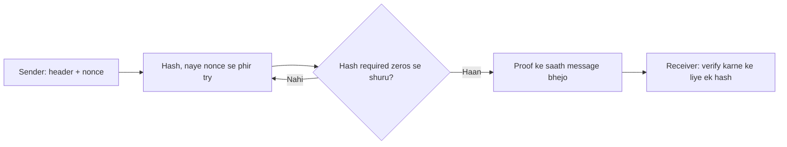
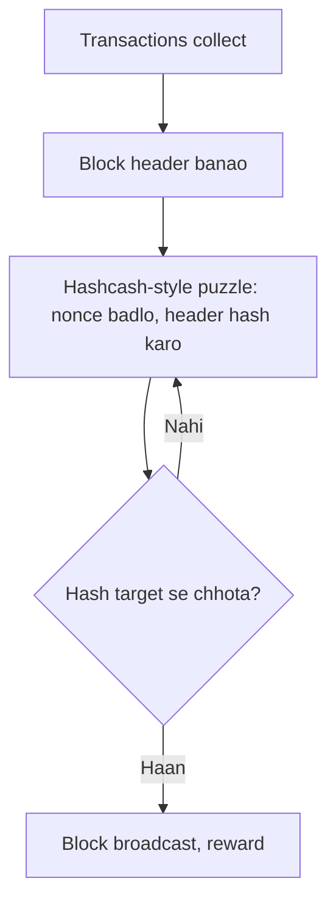

**Ek line mein:** <mark>Bitcoin bina bank ke peer-to-peer digital cash system hai; hashcash ek proof-of-work idea hai (banana costly, check karna sasta) jise Bitcoin apne blocks secure karne ke liye use karta hai</mark>. <Cite id="blockchain-fundamentals-nakamoto" />

<Box kind="key">

**Bitcoin aur hashcash ke question mein ye points likho:**

- Bitcoin: <mark>pehli cryptocurrency, peer-to-peer electronic cash</mark>, Satoshi Nakamoto ne 2008 mein describe kiya, 2009 mein shuru.
- Payments <mark>public blockchain</mark> mein store hote hain, hashes aur digital signatures se protected; miners <mark>proof of work</mark> se blocks jodte hain.
- Hashcash: <mark>Adam Back</mark> ka (1997 mein propose, paper 2002) email spam rokne ke liye.
- Sender ko aisa nonce dhoondhna padta hai ki <mark>header ke hash ki shuruaat fixed number of zero bits se ho</mark>.
- Kaam <mark>karna costly, verify karna sasta</mark> (ek hash).
- Bitcoin mein role: wahi idea <mark>proof of work</mark> hai: nonce badalte raho jab tak header hash target se chhota na ho.

</Box>

## Core answer (5 marks, yahan ke har question ke liye)

<Box kind="definition">

**Bitcoin** is a peer-to-peer electronic cash system: people send digital coins directly to each other with no bank. The network records every payment in a public blockchain. <Cite id="bitcoin-wiki-bitcoin" />

</Box>

**Bitcoin kya hai?** Pehli cryptocurrency, Satoshi Nakamoto ne 2008 mein describe ki aur 2009 mein shuru ki. Payments cryptography (hashes aur digital signatures) se protected hain, aur naye blocks miners proof of work se jodte hain. <Cite id="blockchain-fundamentals-nakamoto" />

**Hashcash kya hai?** Adam Back ki proof-of-work scheme (1997 mein propose, paper 2002) email spam rokne ke liye. Sender ko ek number (nonce) dhoondhna padta hai taaki email header ke hash ki shuruaat fixed number of zero bits se ho. Ye kaam sender ke liye costly hai lekin koi bhi ek hash se check kar sakta hai. Normal user ko lagbhag kuch nahi dena padta; lakhon emails bhejne wale spammer ko bahut. <Cite id="bitcoin-hashcash-back" /> <Cite id="bitcoin-wiki-hashcash" />

**Bitcoin mein hashcash ka role:**

1. Bitcoin wahi idea apne **proof of work** ke roop mein use karta hai: block header ka nonce badalte raho jab tak header ka double SHA-256 target se chhota na ho.
2. Isse block jodna **mehenga** ho jaata hai, isliye cheating mein asli bijli aur hardware lagta hai.
3. Attacker ko **longest chain** badalne ke liye har block ka work dobara karna padega.
4. Checking sasti hai: baaki nodes ek hash se verify karte hain.
5. Target (difficulty) is tarah adjust hota hai ki lagbhag 10 minutes mein ek block aaye. <Cite id="bitcoin-gfg-pow" />

**Conclusion:** <mark>Bitcoin peer-to-peer digital cash hai, aur hashcash use wo costly-to-make, easy-to-check work deta hai jo chain ko secure rakhta hai</mark>.

## Extended answer (10 marks): ye add karo

### 1. Hashcash vs Bitcoin proof of work

| | Hashcash | Bitcoin PoW (2009) |
|---|---|---|
| Purpose | Spam email rokna | Agle block pe agree |
| Kaam kispe | Email header | Block header |
| Hash | SHA-1 | Double SHA-256 |
| Check kaun karta hai | Receive karne wala mail server | Har node |
| Reward | Nahi | Block reward aur fees |

<Cite id="consensus-mining-wiki-hashcash" /> <Cite id="web-bt-1-block-hashing" />

### 2. Bitcoin ki features

- **Decentralised:** koi central bank ya server nahi.
- **Capped supply:** 21 million coins.
- **Pseudonymous:** names nahi, addresses.
- **Block time:** lagbhag 10 minutes; difficulty har 2016 blocks pe adjust.
- **Mining reward:** har block ke miner ko naye coins aur fees.

## Har question mein kaise fit karein

- **"What is Bitcoin? Explain the role of hash cash."** (5 marks) <PYQ id="2023-12/q1b" />: **core answer** likho: Bitcoin definition, hashcash definition diagram ke saath, paanch roles, aur time ho to comparison table.

## Exam tips

- **Adam Back ka naam** aur email-spam purpose likho; phir Bitcoin ke proof of work se jodo.
- <mark>"costly to produce, cheap to verify"</mark> phrase use karo.
- Nonce aur target ka zikr karo; mining se link ke liye ye keywords hain.

Exam mein English mein likho.
