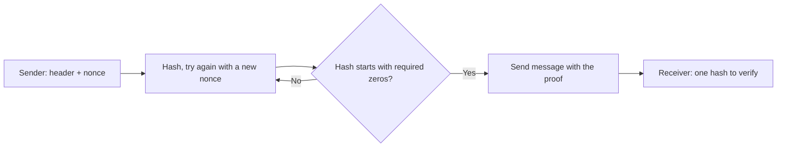
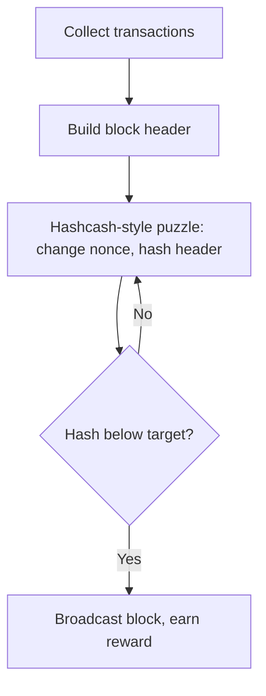

**In one line:** <mark>Bitcoin is a peer-to-peer digital cash system with no bank; hashcash is a proof-of-work idea (costly to make, cheap to check) that Bitcoin uses to secure its blocks</mark>. <Cite id="blockchain-fundamentals-nakamoto" />

<Box kind="key">

**Key points to write (Bitcoin and hashcash):**

- Bitcoin: <mark>first cryptocurrency, peer-to-peer electronic cash</mark>, described by Satoshi Nakamoto in 2008, started in 2009.
- Payments are stored in a <mark>public blockchain</mark>, protected by hashes and digital signatures; miners add blocks by <mark>proof of work</mark>.
- Hashcash: by <mark>Adam Back</mark> (proposed 1997, paper 2002) to stop email spam.
- Sender must find a nonce so that the <mark>hash of the header starts with a fixed number of zero bits</mark>.
- Work is <mark>costly to do but cheap to verify</mark> (one hash).
- Role in Bitcoin: the same idea is the <mark>proof of work</mark>: change the nonce until the header hash is below the target.

</Box>

## Core answer (5 marks, fits every question here)

<Box kind="definition">

**Bitcoin** is a peer-to-peer electronic cash system: people send digital coins directly to each other with no bank. The network records every payment in a public blockchain. <Cite id="bitcoin-wiki-bitcoin" />

</Box>

**What is Bitcoin?** The first cryptocurrency, described by Satoshi Nakamoto in 2008 and started in 2009. Payments are protected by cryptography (hashes and digital signatures), and new blocks are added by miners using proof of work. <Cite id="blockchain-fundamentals-nakamoto" />

**What is hashcash?** A proof-of-work scheme by Adam Back (proposed 1997, paper 2002) to stop email spam. The sender must find a number (nonce) so that the hash of the email header starts with a fixed number of zero bits. This work is costly for the sender but anyone can check it with one hash. A normal user pays almost nothing; a spammer sending millions of emails pays a lot. <Cite id="bitcoin-hashcash-back" /> <Cite id="bitcoin-wiki-hashcash" />

**Role of hashcash in Bitcoin:**

1. Bitcoin uses the same idea as its **proof of work**: change the nonce in the block header until the double SHA-256 of the header is below a target.
2. It makes adding a block **expensive**, so cheating costs real electricity and hardware.
3. An attacker must redo the work for every block to rewrite the **longest chain**.
4. Checking is cheap: other nodes verify with one hash.
5. The target (difficulty) is adjusted to keep about one block per 10 minutes. <Cite id="bitcoin-gfg-pow" />

**Conclusion:** <mark>Bitcoin is peer-to-peer digital cash, and hashcash gives it the costly-to-make, easy-to-check work that keeps the chain secure</mark>.

## Extended answer (10 marks): add these

### 1. Hashcash versus Bitcoin proof of work

| | Hashcash | Bitcoin PoW (2009) |
|---|---|---|
| Purpose | Stop spam email | Agree on the next block |
| Work done on | Email header | Block header |
| Hash | SHA-1 | Double SHA-256 |
| Who checks | The receiving mail server | Every node |
| Reward | None | Block reward and fees |

<Cite id="consensus-mining-wiki-hashcash" /> <Cite id="web-bt-1-block-hashing" />

### 2. Features of Bitcoin

- **Decentralised:** no central bank or server.
- **Capped supply:** 21 million coins.
- **Pseudonymous:** addresses, not names.
- **Block time:** about 10 minutes; difficulty adjusts every 2016 blocks.
- **Mining reward:** new coins and fees for the miner of each block.

## Fit it to each question

- **"What is Bitcoin? Explain the role of hash cash."** (5 marks) <PYQ id="2023-12/q1b" />: write the **core answer**: Bitcoin definition, hashcash definition with its diagram, the five roles, and the comparison table if time remains.

## Exam tips

- **Name Adam Back** and the email-spam purpose; then link it to Bitcoin's proof of work.
- Use the phrase <mark>"costly to produce, cheap to verify"</mark>.
- Mention the nonce and the target; they are the keywords for the link to mining.
