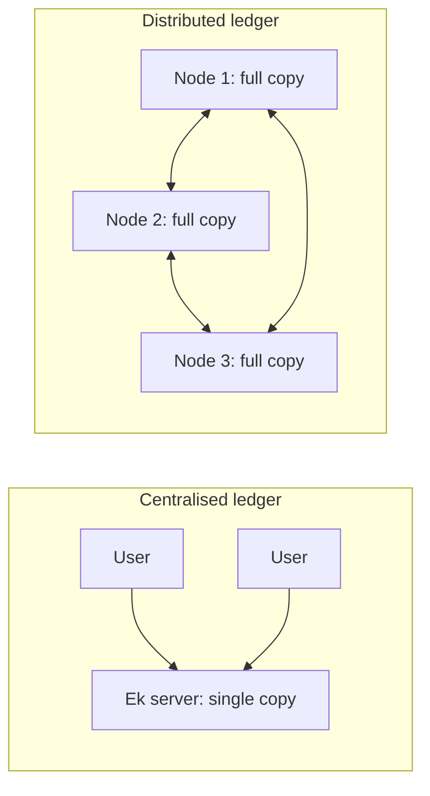
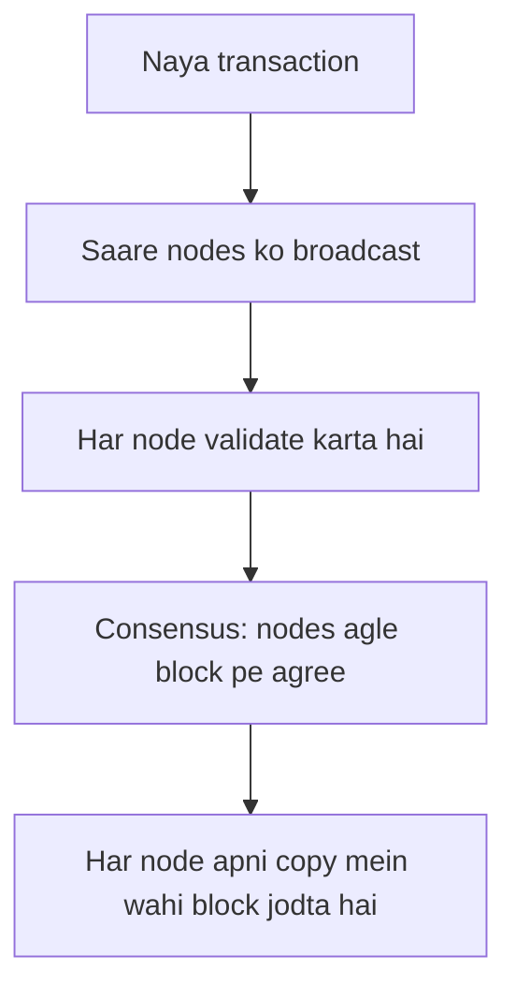

**Ek line mein:** <mark>Distributed ledger ek database hai jo kai nodes pe shared, copy aur synchronised hota hai, bina kisi central administrator ke; blockchain distributed ledger ka ek type hai</mark>. <Cite id="blockchain-fundamentals-wiki-dlt" />

<Box kind="key">

**Distributed ledger ke question mein ye points likho:**

- <mark>Ledger = transactions ki record book</mark>; distributed = <mark>har node ke paas poori copy</mark>, ek master copy nahi.
- Copies ko <mark>agreed rules (consensus)</mark> same rakhte hain.
- Blockchain ek distributed ledger hai jiske records <mark>blocks mein group hote hain aur hashes se chain hote hain</mark>.
- Need 1: <mark>single point of failure nahi</mark>. Need 2: <mark>kisi ek party pe trust ki zarurat nahi</mark>.
- Need 3: <mark>tamper resistance</mark> (attacker ko zyada tar copies badalni padengi). Need 4: <mark>transparency aur audit</mark>.
- Need 5: <mark>double spending rokta hai</mark>, kyunki saare nodes transactions ke ek order pe agree karte hain.

</Box>

## Core answer (5 marks, yahan ke har question ke liye)

<Box kind="definition">

A **distributed ledger** is a database that is shared, copied and synchronised across many nodes (computers) in different places, with no central administrator. Every participant holds a copy and all copies are kept the same by agreed rules. <Cite id="blockchain-fundamentals-wiki-dlt" />

</Box>

**Blockchain** ek distributed ledger hai jisme records **blocks** mein group hote hain aur har block pichhle block se hash ke through linked hota hai. <Cite id="blockchain-fundamentals-ibm-blockchain" />

**Blockchain mein distributed ledger ki zarurat:**

1. **Single point of failure nahi.** Ek node crash ho to baaki nodes ke paas poora data hai.
2. **Ek party pe trust nahi chahiye.** Purane tareeke mein bank book rakhta hai aur hum us pe trust karte hain; yahan koi bhi data check kar sakta hai.
3. **Tamper resistance.** Record badalne ke liye attacker ko zyada tar copies ek saath badalni padengi. <Cite id="blockchain-fundamentals-nakamoto" />
4. **Transparency aur audit.** Saare participants wahi history dekhte hain, isliye disputes aasaani se settle hote hain.
5. **Double spending rokta hai.** Saare nodes transactions ke ek order pe agree karte hain, isliye ek coin do baar kharch nahi ho sakta. <Cite id="blockchain-fundamentals-wiki-doublespend" />

**Example:** Bitcoin ka ledger duniya bhar ke hazaaron nodes pe copy hai aur har node har payment verify kar sakta hai. <Cite id="blockchain-fundamentals-gfg-intro" />

**Conclusion:** <mark>distributed ledger record ko shared, verifiable aur badalne mein mushkil banakar middleman hata deta hai</mark>.

## Extended answer (10 marks): ye add karo

### 1. Centralised vs distributed ledger

| Point | Centralised ledger | Distributed ledger |
|---|---|---|
| Copies | Ek master copy | Har node pe full copy |
| Control | Ek administrator | Saare nodes mein shared |
| Failure | Single point of failure | Node failures se bach jaata hai |
| Trust | Owner pe trust | Rules aur consensus pe trust |
| Tampering | Admin records edit kar sakta hai | Zyada tar nodes pe change chahiye |
| Update speed | Fast | Slow (agreement chahiye) |

### 2. Blockchain distributed ledger ka ek type hai

Har blockchain distributed ledger hai, lekin har distributed ledger blockchain nahi hota. Kuch blocks ki jagah directed graph ya dusre structures use karte hain. Blockchain teen cheezein add karta hai: <mark>blocks, hash links aur consensus rule</mark>. <Cite id="blockchain-fundamentals-nist-8202" />

## Har question mein kaise fit karein

- **"What is distributed ledger? Explain its need in the Blockchain."** (5 marks) <PYQ id="2023-12/q1a" /> <PYQ id="2025-05/q1a" />: **core answer** likho: definition, do-picture diagram, paanch needs aur Bitcoin example.

## Exam tips

- **Draw karo:** centralised (ek server) aur distributed (mesh mein nodes) ek saath.
- Paanch needs ko paanch numbered lines banao; <mark>"no single point of failure"</mark> aur <mark>"double spending"</mark> keywords hain.
- Ye mat likho ki blockchain aur distributed ledger ek hi cheez hain; likho ki blockchain uska ek type hai.

Exam mein English mein likho.
