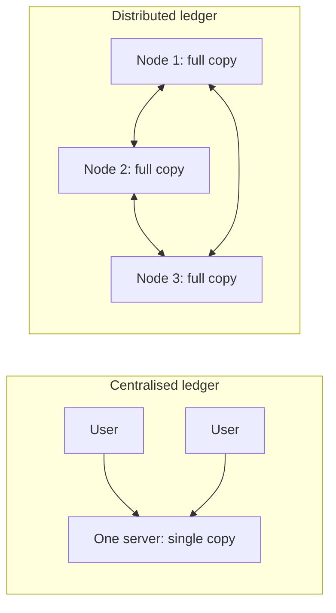
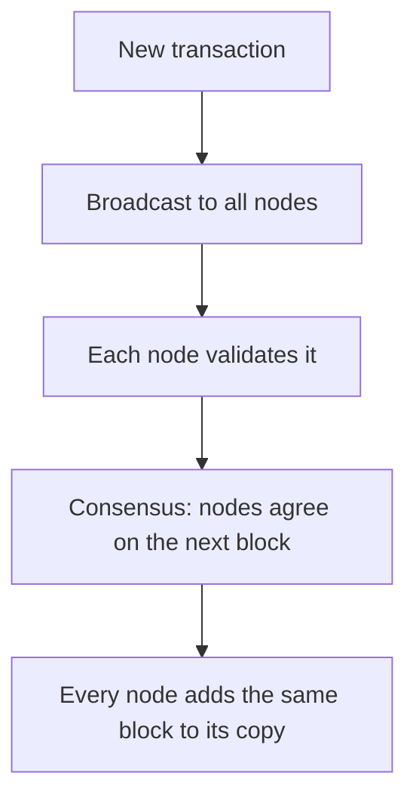

**In one line:** <mark>A distributed ledger is a database that is shared, copied and synchronised across many nodes, with no central administrator; a blockchain is one kind of distributed ledger</mark>. <Cite id="blockchain-fundamentals-wiki-dlt" />

<Box kind="key">

**Key points to write (distributed ledger question):**

- <mark>Ledger = record book of transactions</mark>; distributed = <mark>every node holds a full copy</mark>, no single master copy.
- Copies are kept the same by <mark>agreed rules (consensus)</mark>.
- Blockchain is a distributed ledger whose records are <mark>grouped in blocks and chained by hashes</mark>.
- Need 1: <mark>no single point of failure</mark>. Need 2: <mark>no need to trust one party</mark>.
- Need 3: <mark>tamper resistance</mark> (attacker must change most copies). Need 4: <mark>transparency and audit</mark>.
- Need 5: <mark>stops double spending</mark> because all nodes agree one order of transactions.

</Box>

## Core answer (5 marks, fits every question here)

<Box kind="definition">

A **distributed ledger** is a database that is shared, copied and synchronised across many nodes (computers) in different places, with no central administrator. Every participant holds a copy and all copies are kept the same by agreed rules. <Cite id="blockchain-fundamentals-wiki-dlt" />

</Box>

**Blockchain** is a distributed ledger in which records are grouped in **blocks** and each block is linked to the previous one by a hash. <Cite id="blockchain-fundamentals-ibm-blockchain" />

**Need of a distributed ledger in blockchain:**

1. **No single point of failure.** If one node crashes, the others still hold all data.
2. **No need to trust one party.** In the old way a bank keeps the book and we trust it; here anyone can check the data.
3. **Tamper resistance.** To change a record the attacker must change it on most copies at once. <Cite id="blockchain-fundamentals-nakamoto" />
4. **Transparency and audit.** All participants see the same history, so disputes are easy to settle.
5. **Stops double spending.** All nodes agree on one order of transactions, so one coin cannot be spent twice. <Cite id="blockchain-fundamentals-wiki-doublespend" />

**Example:** Bitcoin's ledger is copied on thousands of nodes worldwide and each can verify every payment. <Cite id="blockchain-fundamentals-gfg-intro" />

**Conclusion:** <mark>the distributed ledger removes the middleman by making the record shared, verifiable and hard to change</mark>.

## Extended answer (10 marks): add these

### 1. Centralised vs distributed ledger

| Point | Centralised ledger | Distributed ledger |
|---|---|---|
| Copies | One master copy | Full copy on every node |
| Control | One administrator | Shared by all nodes |
| Failure | Single point of failure | Survives node failures |
| Trust | Trust the owner | Trust the rules and consensus |
| Tampering | Admin can edit records | Needs changes on most nodes |
| Speed of updates | Fast | Slower (agreement needed) |

### 2. Blockchain is one type of distributed ledger

All blockchains are distributed ledgers, but not every distributed ledger is a blockchain. Some use a directed graph or other structures instead of blocks. A blockchain adds three things: <mark>blocks, hash links and a consensus rule</mark>. <Cite id="blockchain-fundamentals-nist-8202" />

## Fit it to each question

- **"What is distributed ledger? Explain its need in the Blockchain."** (5 marks) <PYQ id="2023-12/q1a" /> <PYQ id="2025-05/q1a" />: write the **core answer**: definition, the two-picture diagram, the five needs and the Bitcoin example.

## Exam tips

- **Draw** the centralised (one server) next to the distributed (nodes in a mesh) picture.
- Use the five needs as five numbered lines; <mark>"no single point of failure"</mark> and <mark>"double spending"</mark> are the keywords.
- Do not write that blockchain and distributed ledger are the same thing; say blockchain is a type of it.
