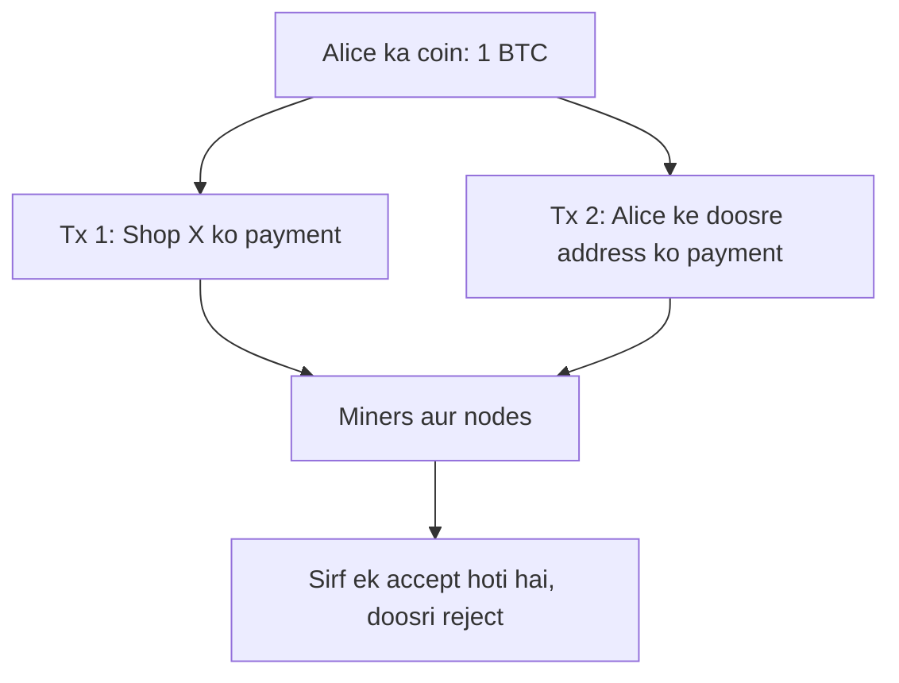
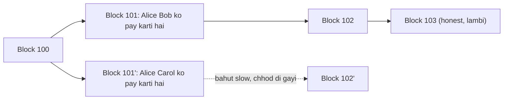

**Ek line mein:** <mark>Double spending ka matlab ek hi digital coin ko do baar kharch karna; Bitcoin ise UTXO check, Proof of Work aur longest-chain rule se rokta hai</mark>. <Cite id="wallets-utxo-double-spending-gfg-double-spending" />

<Box kind="key">

**Har double-spending question mein ye points likho:**

- Problem: digital data copy ho sakta hai, isliye <mark>ek hi coin do logon ko bheja ja sakta hai</mark>. Bank dusri payment reject kar deta; Bitcoin mein bank nahi hai.
- Example: Alice ke paas 1 coin hai, woh Bob (Tx1) aur Carol (Tx2) dono ko bhejti hai. <mark>Sirf ek valid ho sakti hai</mark>.
- **UTXO check:** har node aise input ko reject karta hai jo <mark>pehle se spent</mark> hai.
- **Proof of Work:** miners hash puzzle solve karte hain; <mark>sabse zyada work (longest chain)</mark> wali chain jeetti hai, isliye order badalna mehnga hai.
- **Confirmations:** upar ka har block ek confirmation hai; <mark>lagbhag 6 confirmations</mark> safe maane jaate hain.
- Attacks: <mark>race attack, Finney attack, 51% attack</mark>. 51% attacker (majority hash power) abhi bhi double spend kar sakta hai.

</Box>

## Core answer (5 marks, yahan ke har question ke liye)

<Box kind="definition">

**Double spending** is using the same digital coin in two different payments. Cash cannot be given twice, but digital files can be copied, so a network without a bank must stop it itself. <Cite id="blockchain-fundamentals-nakamoto" loc="Abstract" />

</Box>

**Example:**

1. Alice ke paas 1 BTC ka ek coin hai.
2. Woh use Shop X ko bhejti hai (Tx1) aur saaman leti hai.
3. Lagbhag usi samay woh Tx2 sign karti hai jo wahi coin uske apne doosre address pe bhejti hai, zyada fee ke saath.
4. Miners Tx2 ko pehle include kar sakte hain. Tab Tx1 invalid ho jati hai aur drop ho jati hai.
5. Alice ke paas saaman bhi hai aur coin bhi.

**Kaise roka jata hai:**

- Har node check karta hai ki input UTXO set mein abhi bhi **unspent** hai aur doosra spend reject karta hai. <Cite id="wallets-utxo-double-spending-gfg-utxo" />
- **Digital signatures** dusron ko tumhara coin kharch karne se rokte hain.
- **Proof of Work** transactions ko blocks mein order karta hai aur sirf ek chain jeetti hai.
- **Confirmations** reversal ko bahut mehnga bana dete hain. <Cite id="wallets-utxo-double-spending-gfg-prevent-double" />

**Conclusion:** <mark>double spending is stopped by a public, ordered and verified ledger, not by a trusted middleman</mark>.

## Extended answer (10 marks): ye add karo

### 1. Proof of Work ise kaise solve karta hai

1. Transactions broadcast hoti hain aur miners unhe block mein jama karte hain.
2. Block add karne ke liye miner ko **nonce** dhoondhna padta hai taaki block hash target se chhota ho. Isme bahut computing work lagta hai, par koi bhi ek hash se verify kar sakta hai. <Cite id="bitcoin-gfg-pow" />
3. Har block mein pichhle block ka hash hota hai, aur nodes **longest chain** (sabse zyada work) follow karte hain.
4. Chain mein pehli transaction jeetti hai. Doosri jo wahi coin kharch karti hai reject ho jati hai kyunki coin pehle se spent hai.
5. Tx1 ko undo karne ke liye attacker ko us block aur uske baad ke har block ka work dobara karna padega aur honest miners se aage nikalna padega. Iske liye 50% se zyada hash power chahiye.
6. Isliye merchants **confirmations** (upar ke blocks) ka wait karte hain. <Cite id="consensus-mining-btcwiki-confirmation" />

### 2. Wait karna kyun kaam karta hai (numbers)

Nakamoto ne nikala ki hash power ka hissa q rakhne wala attacker z blocks peeche se kabhi barabari kar paye iski probability kitni hai. q = 0.1 ke liye:

| Confirmations z | Attacker ke succeed hone ki probability |
|---|---|
| 0 | 1.0000000 |
| 1 | 0.2045873 |
| 2 | 0.0509779 |
| 6 | 0.0002428 |

Yaani 6 confirmations ke baad 10% power wala attacker lagbhag 0.02% baar hi succeed hota hai. z badhne par chance exponentially girta hai. <Cite id="blockchain-fundamentals-nakamoto" loc="§11" />

<Box kind="verify">

Maine Nakamoto ke formula (attacker ki progress pe Poisson sum) se yeh values dobara nikali; woh q = 0.1 ke liye unki published table se match karti hain.

</Box>

### 3. Attack ke forms

| Attack | Idea | Defence |
|---|---|---|
| Race attack | Alag merchants ko jaldi se do conflicting transactions bhejna | Confirmations ka wait |
| Finney attack | Miner chupke se aisa block mine karta hai jisme doosra spend hai | Confirmations ka wait |
| 51% attack | Majority hash power wala attacker purane blocks rewrite karta hai | Bada honest hash power, kai confirmations |

<Cite id="wallets-utxo-double-spending-btcwiki-double-spending" /> <Cite id="web-bt-2-wiki-double-spending" />

### 4. UTXO plus PoW

**UTXO** rule ek chain ke andar coin ko do baar kharch hone se rokta hai (wahi output dobara spend karna invalid). **PoW** tay karta hai ki do conflicting transactions mein se kaun pehle aayi aur us order ko badalna bahut mushkil banata hai. Dono milkar bank ke bina double spending solve karte hain. <Cite id="wallets-utxo-double-spending-ibm-double-spend" />

## Har question mein kaise fit karein

- **"What is the UTXO model? How can the double spending problem be solved in bitcoin Blockchain?"** (10 marks) <PYQ id="2024-12/q3a" />: pehle UTXO model (UTXO wala answer dekho: inputs, outputs, change), phir core answer plus extended sections 1 aur 4.

## Exam tips

- Ek coin se do conflicting transactions **draw karo** aur dikhao ki ek reject hui.
- Keywords: <mark>double spending, UTXO, Proof of Work, longest chain, confirmations, 51% attack</mark>.
- Limits ke baare mein honest raho: PoW 51% attacker ke against perfect safety nahi deta.

Exam mein English mein likho.
