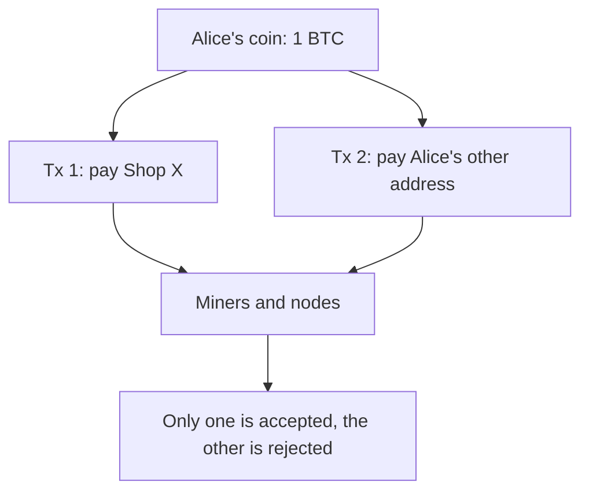
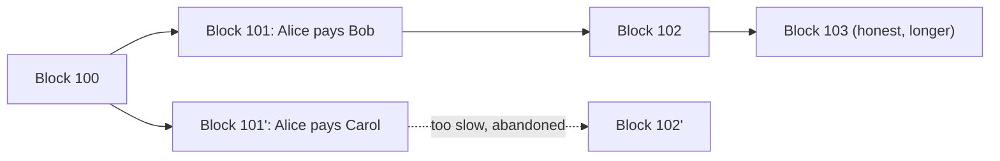

**In one line:** <mark>Double spending means spending the same digital coin twice; Bitcoin stops it with the UTXO check, Proof of Work and the longest-chain rule</mark>. <Cite id="wallets-utxo-double-spending-gfg-double-spending" />

<Box kind="key">

**Key points to write (any double-spending question):**

- Problem: digital data can be copied, so <mark>the same coin could be sent to two people</mark>. A bank would reject the second; Bitcoin has no bank.
- Example: Alice has 1 coin, sends it to Bob (Tx1) and to Carol (Tx2). <mark>Only one can be valid</mark>.
- **UTXO check:** every node rejects an input that is <mark>already spent</mark>.
- **Proof of Work:** miners solve a hash puzzle; the chain with the <mark>most work (longest chain)</mark> wins, so order is costly to rewrite.
- **Confirmations:** each block on top is one; <mark>about 6 confirmations</mark> are treated as safe.
- Attacks: <mark>race attack, Finney attack, 51% attack</mark>. A 51% attacker (majority hash power) can still double spend.

</Box>

## Core answer (5 marks, fits every question here)

<Box kind="definition">

**Double spending** is using the same digital coin in two different payments. Cash cannot be given twice, but digital files can be copied, so a network without a bank must stop it itself. <Cite id="blockchain-fundamentals-nakamoto" loc="Abstract" />

</Box>

**Example:**

1. Alice has one coin of 1 BTC.
2. She sends it to Shop X (Tx1) and gets goods.
3. At almost the same time she signs Tx2 that spends the same coin to her own second address, with a higher fee.
4. Miners may include Tx2 first. Tx1 then becomes invalid and is dropped.
5. Alice has the goods and still has her coin.

**How it is prevented:**

- Every node checks that an input is still **unspent** in the UTXO set and rejects a second spend. <Cite id="wallets-utxo-double-spending-gfg-utxo" />
- **Digital signatures** stop others from spending your coin.
- **Proof of Work** orders transactions in blocks and only one chain wins.
- **Confirmations** make reversal very costly. <Cite id="wallets-utxo-double-spending-gfg-prevent-double" />

**Conclusion:** <mark>double spending is stopped by a public, ordered and verified ledger, not by a trusted middleman</mark>.

## Extended answer (10 marks): add these

### 1. How Proof of Work solves it

1. Transactions are broadcast and collected by miners into a block.
2. To add the block, a miner must find a **nonce** so that the block hash is below a target. This needs huge computing work, but anyone can verify it with one hash. <Cite id="bitcoin-gfg-pow" />
3. Each block holds the previous block's hash, and nodes follow the **longest chain** (most work).
4. The first transaction in the chain wins. The second one that spends the same coin is rejected because that coin is already spent.
5. To undo Tx1, the attacker must redo the work of that block and every block after it and outpace the honest miners. This needs more than 50% of the hash power.
6. Merchants therefore wait for **confirmations** (blocks on top). <Cite id="consensus-mining-btcwiki-confirmation" />

### 2. Why waiting helps (numbers)

Nakamoto computes the chance that an attacker with a share q of the hash power ever catches up from z blocks behind. For q = 0.1:

| Confirmations z | Attacker success probability |
|---|---|
| 0 | 1.0000000 |
| 1 | 0.2045873 |
| 2 | 0.0509779 |
| 6 | 0.0002428 |

So after 6 confirmations an attacker with 10% of the power succeeds about 0.02% of the time. The chance falls exponentially as z grows. <Cite id="blockchain-fundamentals-nakamoto" loc="§11" />

<Box kind="verify">

I recomputed these values with Nakamoto's formula (a Poisson sum over the attacker's progress); they match his published table for q = 0.1.

</Box>

### 3. Forms of attack

| Attack | Idea | Defence |
|---|---|---|
| Race attack | Send two conflicting transactions quickly to different merchants | Wait for confirmations |
| Finney attack | A miner secretly mines a block containing the second spend | Wait for confirmations |
| 51% attack | An attacker with majority hash power rewrites past blocks | Large honest hash power, many confirmations |

<Cite id="wallets-utxo-double-spending-btcwiki-double-spending" /> <Cite id="web-bt-2-wiki-double-spending" />

### 4. UTXO plus PoW

The **UTXO** rule stops a coin from being spent twice inside one chain (a second spend of the same output is invalid). **PoW** decides which of two conflicting transactions comes first and makes that order very hard to change. Together they solve double spending without a bank. <Cite id="wallets-utxo-double-spending-ibm-double-spend" />

## Fit it to each question

- **"What is the UTXO model? How can the double spending problem be solved in bitcoin Blockchain?"** (10 marks) <PYQ id="2024-12/q3a" />: first the UTXO model (see the UTXO answer: inputs, outputs, change), then the core answer plus extended sections 1 and 4.

## Exam tips

- **Draw** the two conflicting transactions from one coin and show one rejected.
- Keywords: <mark>double spending, UTXO, Proof of Work, longest chain, confirmations, 51% attack</mark>.
- Be honest about limits: PoW does not give perfect safety against a 51% attacker.
