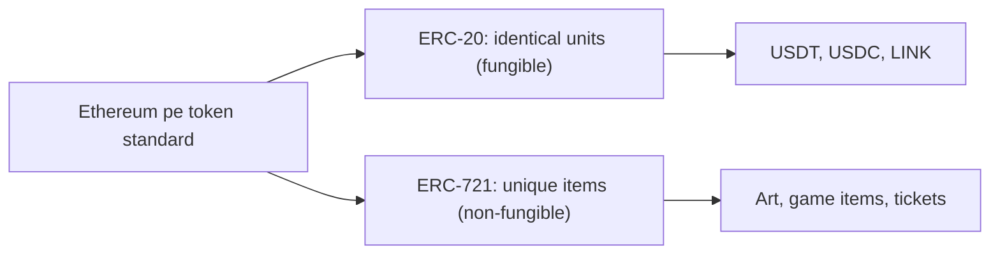

**Ek line mein:** <mark>ERC-20 fungible (identical, badli ho sakne wale) tokens ka Ethereum standard hai aur ERC-721 non-fungible (unique) tokens ka standard hai</mark>; ICO aur STO naye tokens bechne ke do tareeke hain. <Cite id="cryptocurrencies-tokens-eip20" />

<Box kind="key">

**ERC20, ERC721, ICO, STO mein ye points likho:**

- **ERC-20:** <mark>fungible</mark>, har token identical aur divisible. Functions: <mark>totalSupply, balanceOf, transfer, approve, allowance, transferFrom</mark>; events Transfer, Approval. Examples: USDT, USDC, LINK.
- **ERC-721:** <mark>non-fungible</mark>, har token ka <mark>unique tokenId</mark> aur ek owner; divisible nahi. Functions: ownerOf, balanceOf, transferFrom, safeTransferFrom, approve, getApproved. Examples: CryptoKitties, art NFTs.
- Sab tokens ek hi interface follow karte hain, isliye <mark>wallets aur exchanges unhe apne aap support karte hain</mark>.
- **ICO:** start-up <mark>naye tokens public ko bechta hai</mark> funds raise karne ke liye; kam regulation, high risk.
- **STO:** tokens jo <mark>asli ownership (shares, bonds)</mark> dikhate hain aur securities law follow karte hain; KYC/AML; kam risk.

</Box>

## Core answer (5 marks, yahan ke har question ke liye)

<Box kind="definition">

**ERC-20** is the Ethereum standard for **fungible tokens**: every token is identical and interchangeable, like rupee notes. **ERC-721** is the standard for **non-fungible tokens (NFTs)**: every token has a unique `tokenId` and owner, like a land deed. <Cite id="cryptocurrencies-tokens-eth-erc20" /> <Cite id="cryptocurrencies-tokens-eth-erc721" />

</Box>

| Point | ERC-20 | ERC-721 |
|---|---|---|
| Token type | Fungible | Non-fungible |
| Identity | Saari units same | Unique `tokenId` |
| Divisible | Haan (decimals) | Nahi, poora hi owned |
| Balance | Har address ka ek number | Owned token ids ki list |
| Main functions | `transfer`, `approve`, `allowance`, `transferFrom` | `ownerOf`, `safeTransferFrom`, `approve`, `getApproved` |
| Ek contract mein | Ek kism ka token | Kai unique tokens |
| Use | Currency, utility, stablecoins | Art, game items, tickets, certificates |
| Examples | USDT, USDC, LINK | CryptoKitties, Bored Apes |

<Cite id="cryptocurrencies-tokens-gfg-erc-vs" />

**Conclusion:** <mark>ERC-20 suits money-like tokens; ERC-721 suits unique items</mark>.

## Extended answer (10 marks): ye add karo

### 1. ERC-20 detail mein

- **Required functions:** `totalSupply`, `balanceOf`, `transfer`, `approve`, `allowance`, `transferFrom`. **Events:** `Transfer`, `Approval`. Optional: `name`, `symbol`, `decimals`.
- `approve` plus `transferFrom` kisi contract (jaise exchange) ko tumhari taraf se ek allowance tak tokens kharch karne dete hain. <Cite id="cryptocurrencies-tokens-eip20" />

### 2. ERC-721 detail mein

- **Functions:** `balanceOf`, `ownerOf`, `transferFrom`, `safeTransferFrom`, `approve`, `getApproved`, `setApprovalForAll`.
- Metadata (`tokenURI`) image ya data ki taraf point karta hai, jo aam taur pe chain ke bahar store hota hai. <Cite id="cryptocurrencies-tokens-eip721" /> <Cite id="web-bt-2-eth-erc721" /> <Cite id="web-bt-2-wiki-nft" />

### 3. ICO (Initial Coin Offering)

Start-up naye bane tokens public ko bechta hai, aam taur pe ETH ya BTC ke badle, product ready hone se pehle funds raise karne ke liye. Steps: **whitepaper** publish karo, token contract banao (aam taur pe ERC-20), sale chalao, exchanges pe list karo. Yeh IPO jaisa hai par regulation kam hai, isliye bahut scams hue. <Cite id="cryptocurrencies-tokens-gfg-ico" /> <Cite id="cryptocurrencies-tokens-wiki-ico" />

### 4. STO (Security Token Offering)

Tokens jo asli ownership (shares, bonds, real estate, profit rights) dikhate hain aur securities law follow karte hain. Investors **KYC/AML** checks se guzarte hain aur issuer regulated hota hai, isliye yeh ICO se safer hai. <Cite id="cryptocurrencies-tokens-gfg-security-token" /> <Cite id="web-bt-2-wiki-security-token" />

| Point | ICO | STO |
|---|---|---|
| Token ke peeche | Aam taur pe kuch nahi, ya utility | Asli asset ya share |
| Regulation | Kam | Poora securities law |
| Investor checks | Aksar nahi | KYC/AML |
| Risk | Zyada | Kam |

## Har question mein kaise fit karein

- **"Differentiate between ERC20 and ERC721."** (5 marks) <PYQ id="2025-05/q1c" />: core answer: ek-ek line ki definitions aur paanch ya zyada rows wali comparison table.
- **"Differentiate between ERC20 and ERC721."** (5 marks) <PYQ id="2023-12/q1e" />: upar jaisa; example row aur diagram add karo.
- **"Explain the ERC20, ERC721, ICO and STO in detail."** (10 marks) <PYQ id="2024-12/q4a" />: core answer (chhota), phir extended sections 1 se 4 aur ICO vs STO table.

## Exam tips

- Comparison **hamesha table** mein do, pehli row "fungible vs non-fungible".
- Keywords: <mark>fungible, tokenId, transfer, approve, ownerOf, whitepaper, KYC/AML</mark>.
- ICO vs STO mein regulation aur token ke peeche kya hai, yeh zaroor likho.

Exam mein English mein likho.
