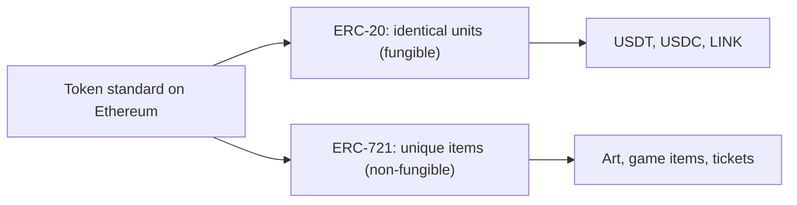
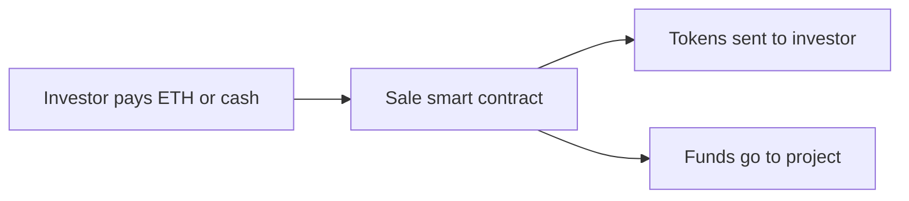

**In one line:** <mark>ERC-20 is the Ethereum standard for fungible (identical, interchangeable) tokens and ERC-721 is the standard for non-fungible (unique) tokens</mark>; ICO and STO are two ways of selling new tokens. <Cite id="cryptocurrencies-tokens-eip20" />

<Box kind="key">

**Key points to write (ERC20, ERC721, ICO, STO):**

- **ERC-20:** <mark>fungible</mark>, every token identical and divisible. Functions: <mark>totalSupply, balanceOf, transfer, approve, allowance, transferFrom</mark>; events Transfer, Approval. Examples: USDT, USDC, LINK.
- **ERC-721:** <mark>non-fungible</mark>, each token has a <mark>unique tokenId</mark> and one owner; not divisible. Functions: ownerOf, balanceOf, transferFrom, safeTransferFrom, approve, getApproved. Examples: CryptoKitties, art NFTs.
- Because all tokens follow one interface, <mark>wallets and exchanges support them automatically</mark>.
- **ICO:** a start-up <mark>sells new tokens to the public</mark> to raise funds; little regulation, high risk.
- **STO:** tokens that represent <mark>real ownership (shares, bonds)</mark> and follow securities law; KYC/AML; lower risk.

</Box>

## Core answer (5 marks, fits every question here)

<Box kind="definition">

**ERC-20** is the Ethereum standard for **fungible tokens**: every token is identical and interchangeable, like rupee notes. **ERC-721** is the standard for **non-fungible tokens (NFTs)**: every token has a unique `tokenId` and owner, like a land deed. <Cite id="cryptocurrencies-tokens-eth-erc20" /> <Cite id="cryptocurrencies-tokens-eth-erc721" />

</Box>

| Point | ERC-20 | ERC-721 |
|---|---|---|
| Token type | Fungible | Non-fungible |
| Identity | All units same | Unique `tokenId` |
| Divisible | Yes (decimals) | No, owned whole |
| Balance | One number per address | List of owned token ids |
| Main functions | `transfer`, `approve`, `allowance`, `transferFrom` | `ownerOf`, `safeTransferFrom`, `approve`, `getApproved` |
| One contract holds | One kind of token | Many unique tokens |
| Use | Currency, utility, stablecoins | Art, game items, tickets, certificates |
| Examples | USDT, USDC, LINK | CryptoKitties, Bored Apes |

<Cite id="cryptocurrencies-tokens-gfg-erc-vs" />

**Conclusion:** <mark>ERC-20 suits money-like tokens; ERC-721 suits unique items</mark>.

## Extended answer (10 marks): add these

### 1. ERC-20 in detail

- **Required functions:** `totalSupply`, `balanceOf`, `transfer`, `approve`, `allowance`, `transferFrom`. **Events:** `Transfer`, `Approval`. Optional: `name`, `symbol`, `decimals`.
- `approve` plus `transferFrom` let a contract (for example an exchange) spend tokens on your behalf up to an allowance. <Cite id="cryptocurrencies-tokens-eip20" />

### 2. ERC-721 in detail

- **Functions:** `balanceOf`, `ownerOf`, `transferFrom`, `safeTransferFrom`, `approve`, `getApproved`, `setApprovalForAll`.
- Metadata (`tokenURI`) points to the image or data, which is usually stored off the chain. <Cite id="cryptocurrencies-tokens-eip721" /> <Cite id="web-bt-2-eth-erc721" /> <Cite id="web-bt-2-wiki-nft" />

### 3. ICO (Initial Coin Offering)

A start-up sells newly created tokens to the public, usually for ETH or BTC, to raise funds before the product is ready. Steps: publish a **whitepaper**, build the token contract (usually ERC-20), run the sale, list on exchanges. It is like an IPO but with little regulation, so there were many scams. <Cite id="cryptocurrencies-tokens-gfg-ico" /> <Cite id="cryptocurrencies-tokens-wiki-ico" />

### 4. STO (Security Token Offering)

Tokens that represent real ownership (shares, bonds, real estate, profit rights) and obey securities law. Investors go through **KYC/AML** checks and the issuer is regulated, so it is safer than an ICO. <Cite id="cryptocurrencies-tokens-gfg-security-token" /> <Cite id="web-bt-2-wiki-security-token" />

| Point | ICO | STO |
|---|---|---|
| Token backs | Usually nothing, or utility | Real asset or share |
| Regulation | Little | Full securities law |
| Investor checks | Often none | KYC/AML |
| Risk | High | Lower |

## Fit it to each question

- **"Differentiate between ERC20 and ERC721."** (5 marks) <PYQ id="2025-05/q1c" />: the core answer: one-line definitions and the comparison table with five or more rows.
- **"Differentiate between ERC20 and ERC721."** (5 marks) <PYQ id="2023-12/q1e" />: same; add the example row and the diagram.
- **"Explain the ERC20, ERC721, ICO and STO in detail."** (10 marks) <PYQ id="2024-12/q4a" />: core answer (short), then extended sections 1 to 4 and the ICO versus STO table.

## Exam tips

- **Always** give the comparison as a table with "fungible versus non-fungible" in the first row.
- Keywords: <mark>fungible, tokenId, transfer, approve, ownerOf, whitepaper, KYC/AML</mark>.
- For ICO versus STO, stress regulation and what backs the token.
