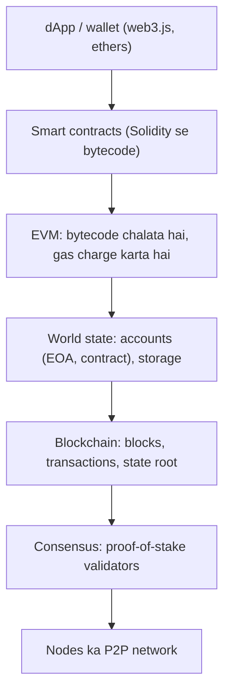
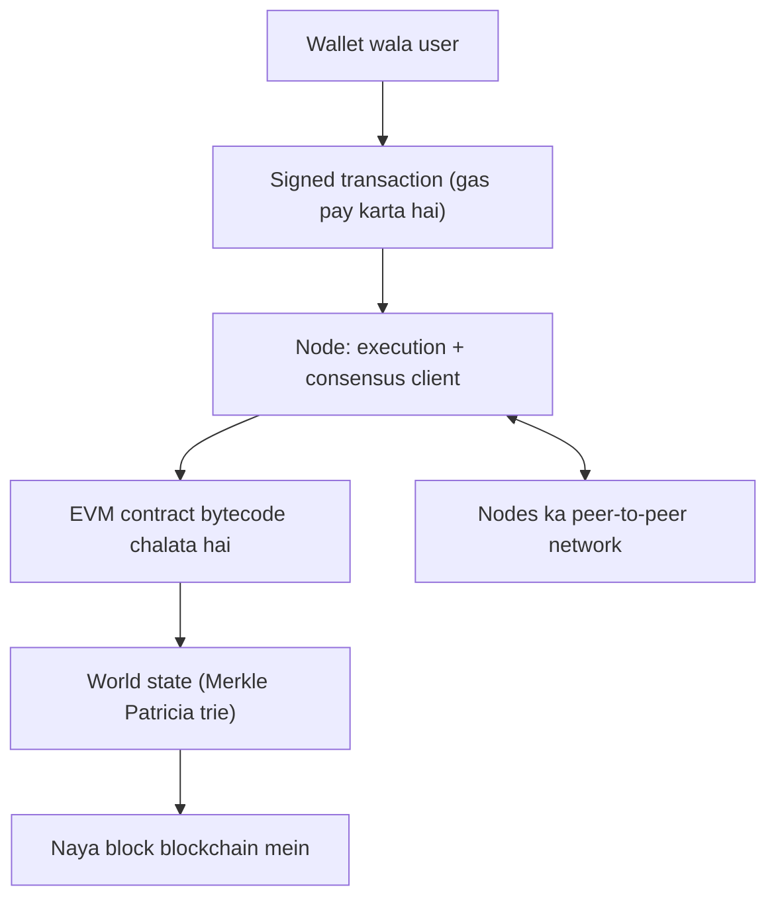

**Ek line mein:** <mark>Ethereum ek world computer hai jise hazaaron nodes share karte hain: sab ek hi state (accounts aur contract data) rakhte hain, aur state ka har change ek transaction hai jo EVM chalata hai, gas se pay hota hai aur proof of stake se agree hota hai</mark>. <Cite id="ethereum-whitepaper" />

<Box kind="key">

**Ethereum architecture ya components ke question mein ye points likho:**

- <mark>Accounts</mark>: externally owned account (EOA, private key) aur contract account (code).
- <mark>Transactions</mark> (EOA se signed) aur messages; <mark>Ether (ETH)</mark> native coin hai.
- <mark>EVM</mark>: sandbox jo contract bytecode har node pe same tarah chalata hai.
- <mark>Gas</mark>: fee = gas used x gas price; infinite loops rokta hai aur validators ko pay karta hai.
- <mark>World state</mark> Merkle Patricia trie mein; state root har block header mein.
- <mark>Blocks aur chain, nodes (execution aur consensus client), consensus (2022 se Proof of Stake)</mark>, smart contracts (Solidity), wallets aur Web3, dApps.

</Box>

## Core answer (5 marks, yahan ke har question ke liye)

<Box kind="definition">

**Ethereum** is a public blockchain that can run programs (smart contracts), not just move coins. Think of it as one shared computer that thousands of nodes keep in step; anyone can put a program on it and everyone can check it ran correctly. <Cite id="ethereum-whitepaper" />

</Box>

**Components:** <Cite id="ethereum-gfg-components" />

1. **Accounts:** **externally owned account (EOA)** private key se control hota hai; **contract account** apne code se. Har ka address, balance aur nonce hota hai. <Cite id="ethereum-eth-accounts" />
2. **Transactions:** EOA ke signed messages: ether bhejna, contract deploy karna ya function call karna.
3. **EVM (Ethereum Virtual Machine):** har node pe sandbox mein contract bytecode chalata hai. <Cite id="ethereum-eth-evm" />
4. **Gas aur Ether:** gas kaam ko naapta hai; fee = gas used x gas price, ETH mein. <Cite id="ethereum-eth-gas" />
5. **World state:** saare accounts aur storage, Merkle Patricia trie mein.
6. **Blocks aur blockchain:** blocks mein transactions, state root aur parent hash.
7. **Nodes aur network:** nodes ka peer-to-peer network. <Cite id="ethereum-eth-nodes" />
8. **Consensus:** Proof of Stake: validators 32 ETH stake karke blocks propose aur vote karte hain (September 2022 se pehle Proof of Work).

**Conclusion:** <mark>accounts, transactions, EVM, gas, state aur staking network milkar Ethereum ko programmable blockchain banate hain</mark>. <Cite id="ethereum-me-ch1" />

## Extended answer (10 marks): ye add karo

### 1. Workflow, step by step

<Cite id="ethereum-me-ch6" loc="Transaction Life Cycle" />

1. **Create aur sign.** Wallet recipient, value, data, gas limit aur fees bharta hai, phir private key se sign karta hai.
2. **Send.** Node quick check karta hai aur use apne mempool mein rakhta hai.
3. **Gossip.** Node use peers ko deta hai, jo check karke aage badhate hain.
4. **Include.** Agle slot ke liye chuna gaya validator use block mein daalta hai.
5. **Execute.** EVM signature aur nonce check karta hai, value move karta hai aur contract code chalata hai. Har node yahi dohraata hai aur state root compare karta hai.
6. **Settle.** Bacha hua gas refund hota hai, base fee burn hoti hai aur tip proposer ko jaata hai.
7. **Finalise.** Lagbhag 12 minutes baad block final ho jaata hai. <Cite id="ethereum-eth-stack" />

### 2. Aur components

| Component | Role |
|---|---|
| Nodes aur clients | Execution client (EVM chalata hai, state rakhta hai) aur consensus client (proof of stake); jaise Geth. <Cite id="web-bt-1-eth-node-arch" /> |
| Smart contracts | Solidity ke programs jo bytecode mein compile hote hain |
| Wallets aur Web3 | Wallets (MetaMask) keys rakhte aur sign karte hain; web3.js ya ethers.js apps ko node se jodte hain |
| dApps | Front end plus smart contracts; bade files off-chain IPFS ya Swarm mein |
| Networks | Asli ETH ke liye Mainnet aur practice ke liye Sepolia jaise testnets |

<Cite id="ethereum-eth-stack" />

### 3. Block aur state

Har block header mein parent hash, **stateRoot**, **transactionsRoot** aur **receiptsRoot** hote hain, jo sab Merkle Patricia tries ke roots hain. <Cite id="block-structure-merkle-eth-mpt" />

### 4. Ethereum vs Bitcoin (ek line)

Bitcoin mainly money hai limited script aur UTXOs ke saath; Ethereum general programs chalata hai aur accounts use karta hai.

## Har question mein kaise fit karein

- **"Explain ethereum components in detail?"** (10 marks) <PYQ id="2023-12/q5a" />: core answer, phir section 2 (table) aur section 3.
- **"Explain various components of ethereum."** (10 marks) <PYQ id="2024-12/q2b" />: upar jaisa; end mein layer diagram.
- **"Explain components of Ethereum."** (10 marks) <PYQ id="2025-05/q5a" />: upar jaisa; dApp mein NFT khareedne jaisa real example add karo.

## Exam tips

- **Layered diagram ya workflow flow draw karo;** "architecture" ke liye dono chalte hain.
- Hamesha <mark>EOA, contract account, EVM, gas, state, nodes, consensus</mark> likho.
- Likho ki ab consensus proof of stake hai (Merge, 2022).

Exam mein English mein likho.
