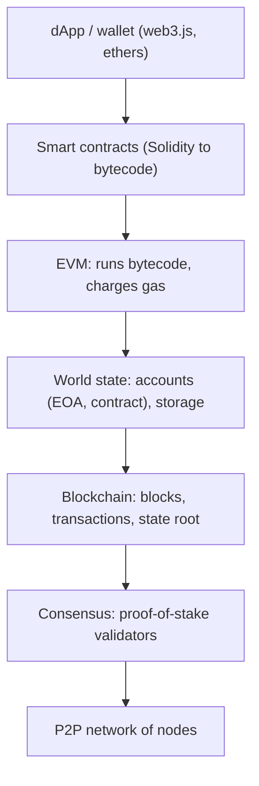
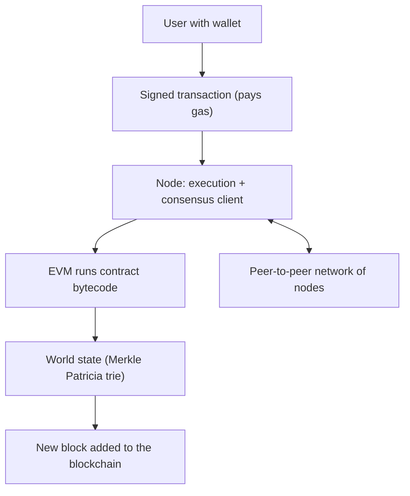

**In one line:** <mark>Ethereum is a world computer shared by thousands of nodes: everyone keeps the same state (accounts and contract data), and every change to that state is a transaction run by the EVM, paid with gas and agreed by proof of stake</mark>. <Cite id="ethereum-whitepaper" />

<Box kind="key">

**Key points to write (Ethereum architecture or components):**

- <mark>Accounts</mark>: externally owned account (EOA, private key) and contract account (code).
- <mark>Transactions</mark> (signed by an EOA) and messages; <mark>Ether (ETH)</mark> is the native coin.
- <mark>EVM</mark>: sandbox that runs contract bytecode the same way on every node.
- <mark>Gas</mark>: fee = gas used x gas price; stops infinite loops and pays validators.
- <mark>World state</mark> in a Merkle Patricia trie; the state root is in each block header.
- <mark>Blocks and chain, nodes (execution and consensus client), consensus (Proof of Stake since 2022)</mark>, smart contracts (Solidity), wallets and Web3, dApps.

</Box>

## Core answer (5 marks, fits every question here)

<Box kind="definition">

**Ethereum** is a public blockchain that can run programs (smart contracts), not just move coins. Think of it as one shared computer that thousands of nodes keep in step; anyone can put a program on it and everyone can check it ran correctly. <Cite id="ethereum-whitepaper" />

</Box>

**Components:** <Cite id="ethereum-gfg-components" />

1. **Accounts:** an **externally owned account (EOA)** is controlled by a private key; a **contract account** is controlled by its code. Each has an address, balance and nonce. <Cite id="ethereum-eth-accounts" />
2. **Transactions:** signed messages from an EOA: send ether, deploy a contract or call a function.
3. **EVM (Ethereum Virtual Machine):** runs contract bytecode on every node in a sandbox. <Cite id="ethereum-eth-evm" />
4. **Gas and Ether:** gas measures work; fee = gas used x gas price, paid in ETH. <Cite id="ethereum-eth-gas" />
5. **World state:** all accounts and storage, in a Merkle Patricia trie.
6. **Blocks and blockchain:** blocks hold transactions, the state root and the parent hash.
7. **Nodes and network:** a peer-to-peer network of nodes. <Cite id="ethereum-eth-nodes" />
8. **Consensus:** Proof of Stake: validators stake 32 ETH to propose and vote on blocks (Proof of Work before September 2022).

**Conclusion:** <mark>accounts, transactions, the EVM, gas, state and a staking network together make Ethereum a programmable blockchain</mark>. <Cite id="ethereum-me-ch1" />

## Extended answer (10 marks): add these

### 1. Workflow, step by step

<Cite id="ethereum-me-ch6" loc="Transaction Life Cycle" />

1. **Create and sign.** The wallet fills recipient, value, data, gas limit and fees, then signs with the private key.
2. **Send.** A node does a quick check and keeps it in its mempool.
3. **Gossip.** The node passes it to peers, who check it and pass it on.
4. **Include.** The validator chosen for the next slot puts it in a block.
5. **Execute.** The EVM checks the signature and nonce, moves the value and runs contract code. Every node repeats this and compares the state root.
6. **Settle.** Unused gas is refunded, the base fee is burned and the tip goes to the proposer.
7. **Finalise.** After about 12 minutes the block is final. <Cite id="ethereum-eth-stack" />

### 2. More components

| Component | Role |
|---|---|
| Nodes and clients | Execution client (runs EVM, keeps state) and consensus client (proof of stake); e.g. Geth. <Cite id="web-bt-1-eth-node-arch" /> |
| Smart contracts | Programs in Solidity compiled to bytecode |
| Wallets and Web3 | Wallets (MetaMask) keep keys and sign; web3.js or ethers.js connect apps to a node |
| dApps | Front end plus smart contracts; large files kept off-chain in IPFS or Swarm |
| Networks | Mainnet for real ETH and testnets such as Sepolia for practice |

<Cite id="ethereum-eth-stack" />

### 3. Block and state

Each block header holds the parent hash, **stateRoot**, **transactionsRoot** and **receiptsRoot**, all roots of Merkle Patricia tries. <Cite id="block-structure-merkle-eth-mpt" />

### 4. Ethereum versus Bitcoin (one line)

Bitcoin is mainly money with a limited script and UTXOs; Ethereum runs general programs and uses accounts.

## Fit it to each question

- **"Explain ethereum components in detail?"** (10 marks) <PYQ id="2023-12/q5a" />: core answer, then section 2 (table) and section 3.
- **"Explain various components of ethereum."** (10 marks) <PYQ id="2024-12/q2b" />: same as above; end with the layer diagram.
- **"Explain components of Ethereum."** (10 marks) <PYQ id="2025-05/q5a" />: same as above; add a real example such as buying an NFT in a dApp.

## Exam tips

- **Draw** the layered diagram or the workflow flow; both are accepted for "architecture".
- Always name <mark>EOA, contract account, EVM, gas, state, nodes, consensus</mark>.
- Mention that consensus is proof of stake now (Merge, 2022).
