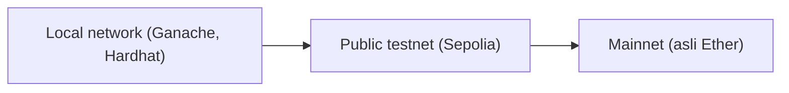
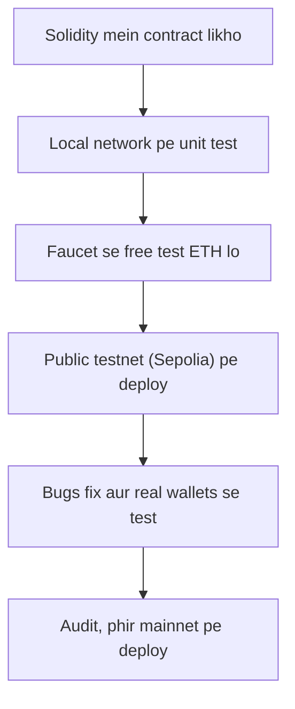

**Ek line mein:** <mark>Test network (testnet) blockchain ki practice copy hai jiske coins ki koi value nahi, jahan developers asli mainnet use karne se pehle smart contracts free mein deploy aur test karte hain</mark>. <Cite id="ethereum-eth-networks" />

<Box kind="key">

**Ethereum test networks ke question mein ye points likho:**

- <mark>Mainnet = asli ETH; testnet = same rules, bekaar coins</mark>.
- Test ETH <mark>faucet</mark> se free milta hai.
- Types: <mark>local network (Ganache, Hardhat), public testnets, devnets</mark>.
- Purane public testnets: <mark>Ropsten (PoW), Kovan (PoA), Rinkeby (PoA), Goerli</mark>: ab retired.
- Current: <mark>Sepolia</mark> (app aur contract developers ke liye default) aur <mark>Hoodi</mark> (protocol developers aur validator testing), dono proof of stake.
- Contract ka raasta: <mark>local, phir testnet, phir mainnet</mark>.

</Box>

## Core answer (5 marks, yahan ke har question ke liye)

<Box kind="definition">

A **test network (testnet)** is a practice copy of a blockchain. It works like the real network (the **mainnet**), but its coins have no value, so developers can deploy and test smart contracts for free and make mistakes safely. <Cite id="ethereum-eth-networks" />

</Box>

**Kyun chahiye:** deploy hua contract badalna mushkil hai aur bug se asli paisa ja sakta hai, isliye code pehle testnet pe try hota hai. Test ether **faucet** se free milta hai, jo ek website hai jo test coins deti hai. <Cite id="ethereum-alchemy-testnets" />

**Test networks ke types:**

1. **Local (private) network:** aapke apne computer pe blockchain, jaise **Ganache** ya Hardhat ka built-in node. Blocks turant aur free, lekin sirf aap use karte ho. <Cite id="ethereum-tp-ganache" />
2. **Public testnets:** open networks jinme kai nodes judte hain aur jo mainnet jaisa behave karte hain.
3. **Developer networks (devnets):** client teams ke banaye chhote time ke networks naye upgrades try karne ke liye.

**Conclusion:** <mark>pehle local pe test karo, phir Sepolia jaise public testnet pe, aur mainnet pe tabhi deploy karo jab contract sahi chale</mark>.

## Extended answer (10 marks): ye add karo

### 1. Public Ethereum testnets

| Testnet | Consensus | Status aur use |
|---|---|---|
| Ropsten | Proof of work | Retired |
| Kovan | Proof of authority | Retired |
| Rinkeby | Proof of authority | Retired |
| Goerli | Proof of authority, phir 2022 Merge ke baad proof of stake | Retired |
| Sepolia | Proof of stake | Current; contract aur app developers ke liye default |
| Hoodi | Proof of stake | Current; protocol developers aur validator testing ke liye |

Ropsten, Kovan, Rinkeby aur Goerli purani books mein aate hain, isliye jaano lekin likho ki ab band hain. **Proof of authority** matlab kuch named nodes pe blocks banane ka trust: sasta aur fast lekin kam decentralised. <Cite id="ethereum-consensys-testnets" /> <Cite id="consensus-mining-eth-poa" />

### 2. Mainnet vs testnet

| Point | Mainnet | Testnet |
|---|---|---|
| Coin value | Asli paisa | Koi value nahi |
| Purpose | Live use | Testing aur practice |
| Coins kaise milte hain | Khareedo | Faucet se free |
| Risk | Galti se paisa jaata hai | Fail hona safe |

### 3. Local network ke tools

- **Ganache:** test accounts aur instant mining wali personal blockchain. <Cite id="ethereum-ganache-docs" />
- **Hardhat network:** testing ke liye built-in local chain.
- **Remix:** browser IDE jo local VM ya testnet pe deploy kar sakta hai.

## Har question mein kaise fit karein

- **"List and explain the types of test networks used in ethereum."** (10 marks) <PYQ id="2023-12-ce/q4a" />: core answer, section 1 (table) aur section 2; end mein testing-steps diagram.
- **"Explain types of test network"** (10 marks) <PYQ id="2025-05-ce/q5b" />: wahi; pehle teen types, phir table.

## Exam tips

- **Local, testnet, mainnet ka raasta draw karo.**
- Purane testnets ke naam likho aur batao ki retired hain; <mark>Sepolia</mark> aur <mark>Hoodi</mark> ko current likho.
- <mark>faucet</mark> word likho; ye favourite keyword hai.

Exam mein English mein likho.
