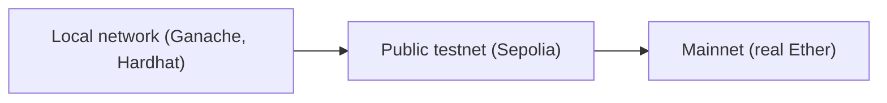
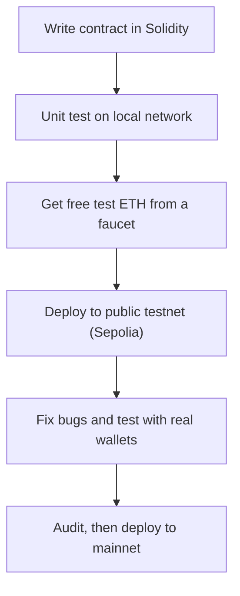

**In one line:** <mark>A test network (testnet) is a practice copy of a blockchain whose coins have no value, where developers deploy and test smart contracts for free before using the real mainnet</mark>. <Cite id="ethereum-eth-networks" />

<Box kind="key">

**Key points to write (Ethereum test networks):**

- <mark>Mainnet = real ETH; testnet = same rules, worthless coins</mark>.
- Test ETH comes free from a <mark>faucet</mark>.
- Types: <mark>local network (Ganache, Hardhat), public testnets, devnets</mark>.
- Old public testnets: <mark>Ropsten (PoW), Kovan (PoA), Rinkeby (PoA), Goerli</mark>: now retired.
- Current: <mark>Sepolia</mark> (default for app and contract developers) and <mark>Hoodi</mark> (protocol developers and validator testing), both proof of stake.
- Path of a contract: <mark>local, then testnet, then mainnet</mark>.

</Box>

## Core answer (5 marks, fits every question here)

<Box kind="definition">

A **test network (testnet)** is a practice copy of a blockchain. It works like the real network (the **mainnet**), but its coins have no value, so developers can deploy and test smart contracts for free and make mistakes safely. <Cite id="ethereum-eth-networks" />

</Box>

**Why needed:** a deployed contract is hard to change and a bug can cost real money, so code is tried on a testnet first. Test ether is free from a **faucet**, a website that gives out test coins. <Cite id="ethereum-alchemy-testnets" />

**Types of test networks:**

1. **Local (private) network:** a blockchain on your own computer, such as **Ganache** or the built-in Hardhat node. Blocks are instant and free, but only you use it. <Cite id="ethereum-tp-ganache" />
2. **Public testnets:** open networks that many nodes join and that behave like mainnet.
3. **Developer networks (devnets):** short-lived networks made by client teams to try new upgrades.

**Conclusion:** <mark>test locally first, then on a public testnet such as Sepolia, and deploy to mainnet only when the contract works</mark>.

## Extended answer (10 marks): add these

### 1. Public Ethereum testnets

| Testnet | Consensus | Status and use |
|---|---|---|
| Ropsten | Proof of work | Retired |
| Kovan | Proof of authority | Retired |
| Rinkeby | Proof of authority | Retired |
| Goerli | Proof of authority, then proof of stake after the 2022 Merge | Retired |
| Sepolia | Proof of stake | Current; default for contract and app developers |
| Hoodi | Proof of stake | Current; for protocol developers and validator testing |

Ropsten, Kovan, Rinkeby and Goerli appear in older books, so know them but say they are now shut down. **Proof of authority** means a few named nodes are trusted to make blocks: cheap and fast but less decentralised. <Cite id="ethereum-consensys-testnets" /> <Cite id="consensus-mining-eth-poa" />

### 2. Mainnet versus testnet

| Point | Mainnet | Testnet |
|---|---|---|
| Coin value | Real money | No value |
| Purpose | Live use | Testing and practice |
| How to get coins | Buy | Free from a faucet |
| Risk | Mistakes cost money | Safe to fail |

### 3. Tools for a local network

- **Ganache:** personal blockchain with test accounts and instant mining. <Cite id="ethereum-ganache-docs" />
- **Hardhat network:** built-in local chain for testing.
- **Remix:** browser IDE that can deploy to a local VM or a testnet.

## Fit it to each question

- **"List and explain the types of test networks used in ethereum."** (10 marks) <PYQ id="2023-12-ce/q4a" />: core answer, section 1 (table) and section 2; end with the testing-steps diagram.
- **"Explain types of test network"** (10 marks) <PYQ id="2025-05-ce/q5b" />: the same; write the three types first and the table second.

## Exam tips

- **Draw** the local, testnet, mainnet path.
- Name the old testnets and say they are retired; name <mark>Sepolia</mark> and <mark>Hoodi</mark> as current.
- Write the word <mark>faucet</mark>; it is a favourite keyword.
