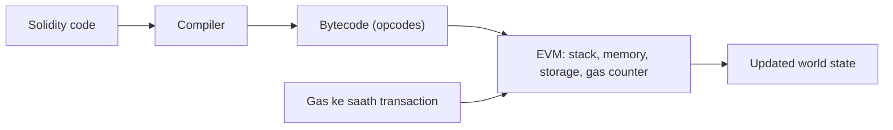
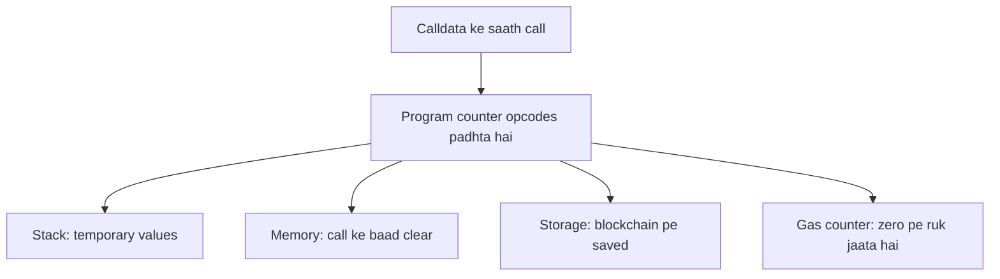

**Ek line mein:** <mark>EVM har Ethereum node ke andar ki sandboxed, deterministic, stack-based virtual machine hai jo smart-contract bytecode chalati hai aur state update karti hai</mark>. <Cite id="ethereum-eth-evm" />

<Box kind="key">

**EVM ke question mein ye points likho:**

- <mark>Virtual machine = software computer</mark>; har node ke paas copy hai aur sab copies ka <mark>result same (deterministic)</mark> hota hai.
- Solidity se compile hua <mark>bytecode (opcodes)</mark> chalati hai.
- Parts: <mark>stack (256 bits ke 1024 items), memory, storage, calldata, program counter, gas counter</mark>.
- <mark>Gas</mark>: har opcode ka gas cost; gas khatam to run ruk jaata hai aur uske changes undo ho jaate hain.
- <mark>Sandboxed</mark>: kharab contract node ko nuksan nahi pahuncha sakta; <mark>Turing complete</mark> lekin gas se bounded.
- Flow: Solidity, compiler, bytecode, transaction mein deploy, node ki EVM chalati hai, state badalti hai.

</Box>

## Core answer (5 marks, yahan ke har question ke liye)

<Box kind="definition">

The **Ethereum Virtual Machine (EVM)** is a sandboxed, stack-based virtual machine that executes contract bytecode and updates the Ethereum state. It is deterministic: the same input always gives the same output on every node. <Cite id="ethereum-gfg-evm" />

</Box>

Ye "virtual" isliye hai kyunki ye software hai, asli machine nahi. Har node ek copy chalata hai, isliye hazaaron computers ko same jawab milta hai. <Cite id="ethereum-eth-evm" />

**Contract EVM tak kaise pahunchta hai:**

1. Developer contract Solidity mein likhta hai.
2. Compiler use **bytecode** mein badalta hai (ADD, PUSH, SSTORE jaise opcodes).
3. Bytecode transaction mein deploy hota hai aur contract address pe store hota hai.
4. Transaction contract ko call kare to har node ki EVM bytecode chalati hai.
5. Result state (balances, storage) badalta hai aur block mein record hota hai.

**Conclusion:** <mark>EVM shared, safe aur predictable engine hai jo Ethereum ko programmable banata hai</mark>. <Cite id="ethereum-sol-intro" />

## Extended answer (10 marks): ye add karo

### 1. EVM ke parts

| Part | Kya karta hai |
|---|---|
| Stack | Last-in-first-out area; operations values lete aur rakhte hain (256 bits ke 1024 items tak) |
| Memory | Temporary space, har call ke baad clear |
| Storage | Contract ka permanent key-value store, blockchain pe saved; costly |
| Calldata | Call ka read-only input |
| Program counter aur bytecode | EVM ek time pe ek opcode padhti hai |
| Gas counter | Har opcode ka gas cost; zero pe run ruk jaata hai aur changes undo |

<Cite id="web-bt-1-eth-opcodes" />

### 2. Features

- **Isolated:** kharab contract host machine ko nuksan nahi pahuncha sakta.
- **Deterministic:** zaroori hai taaki saare nodes same state pe pahunchein.
- **Turing complete:** koi bhi computation chala sakti hai, sirf gas se limited. <Cite id="ethereum-eth-gas" />
- **Dusri languages:** Vyper jaisi languages bhi EVM bytecode mein compile ho sakti hain.

### 3. Worked example: gas fee

<Sum>

<Given>

Simple Ether transfer 21,000 gas leta hai. Gas price 20 gwei per gas hai (1 gwei = $10^{-9}$ ETH).

</Given>

<Find>

ETH mein fee.

</Find>

<Steps>

1. Fee = gas used x gas price. *Reason: har unit kaam ka offered price pe paisa dete ho.*
2. Fee $= 21{,}000 \times 20 = 420{,}000$ gwei.
3. Convert: $420{,}000 \times 10^{-9} = 0.00042$ ETH.

</Steps>

<Answer>

fee = 0.00042 ETH

</Answer>

<Box kind="verify">

Ulta: 0.00042 ETH = 420,000 gwei, aur $420{,}000 / 21{,}000 = 20$ gwei per gas, jo starting price tha.

</Box>

</Sum>

## Har question mein kaise fit karein

- **"Ethereum Virtual Machine (EVM)"** (10 marks) <PYQ id="2024-05-ce/q6c" /> <PYQ id="2025-05-ce/q6a" />: core answer (definition, paanch-step flow aur diagram), phir section 1 (parts ka table), section 2 (features) aur time ho to section 3 (gas example).

## Exam tips

- **Solidity, compiler, bytecode, EVM flow draw karo** aur stack, memory, storage list karo.
- <mark>"deterministic"</mark>, <mark>"sandboxed"</mark> aur <mark>"gas"</mark> likho.
- Memory (temporary) aur storage (permanent) ko confuse mat karo.

Exam mein English mein likho.
