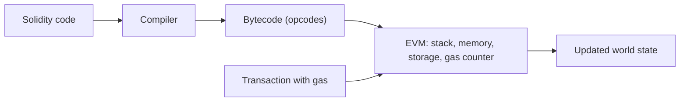
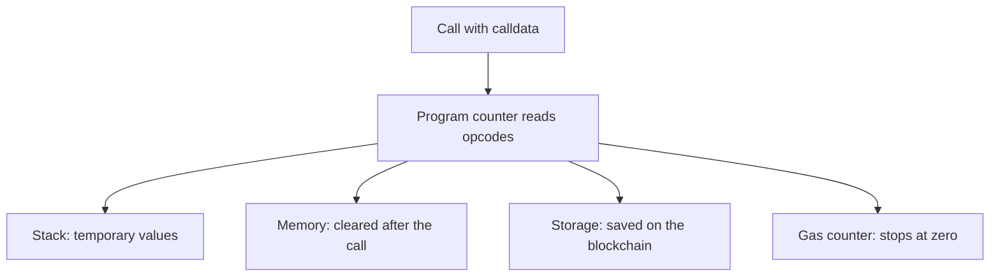

**In one line:** <mark>The EVM is the sandboxed, deterministic, stack-based virtual machine inside every Ethereum node that runs smart-contract bytecode and updates the state</mark>. <Cite id="ethereum-eth-evm" />

<Box kind="key">

**Key points to write (EVM):**

- <mark>Virtual machine = software computer</mark>; every node has a copy and all copies give the <mark>same result (deterministic)</mark>.
- Runs <mark>bytecode (opcodes)</mark> compiled from Solidity.
- Parts: <mark>stack (1024 items of 256 bits), memory, storage, calldata, program counter, gas counter</mark>.
- <mark>Gas</mark>: every opcode costs gas; when gas ends the run stops and its changes are undone.
- <mark>Sandboxed</mark>: a bad contract cannot harm the node; <mark>Turing complete</mark> but bounded by gas.
- Flow: Solidity, compiler, bytecode, deploy in a transaction, node EVM runs it, state changes.

</Box>

## Core answer (5 marks, fits every question here)

<Box kind="definition">

The **Ethereum Virtual Machine (EVM)** is a sandboxed, stack-based virtual machine that executes contract bytecode and updates the Ethereum state. It is deterministic: the same input always gives the same output on every node. <Cite id="ethereum-gfg-evm" />

</Box>

It is "virtual" because it is software, not a real machine. Every node runs a copy, so thousands of computers get the same answer. <Cite id="ethereum-eth-evm" />

**How a contract reaches the EVM:**

1. The developer writes a contract in Solidity.
2. The compiler turns it into **bytecode** (opcodes such as ADD, PUSH, SSTORE).
3. The bytecode is deployed in a transaction and stored at a contract address.
4. When a transaction calls the contract, every node's EVM runs the bytecode.
5. The result changes the state (balances, storage) and is recorded in a block.

**Conclusion:** <mark>the EVM is the shared, safe and predictable engine that makes Ethereum programmable</mark>. <Cite id="ethereum-sol-intro" />

## Extended answer (10 marks): add these

### 1. Parts of the EVM

| Part | What it does |
|---|---|
| Stack | Last-in-first-out area; operations take and put values (up to 1024 items of 256 bits) |
| Memory | Temporary space, cleared after each call |
| Storage | Permanent key-value store of the contract, saved on the blockchain; costly |
| Calldata | Read-only input of the call |
| Program counter and bytecode | The EVM reads one opcode at a time |
| Gas counter | Every opcode costs gas; at zero the run stops and changes are undone |

<Cite id="web-bt-1-eth-opcodes" />

### 2. Features

- **Isolated:** a bad contract cannot harm the host machine.
- **Deterministic:** needed so all nodes reach the same state.
- **Turing complete:** can run any computation, limited only by gas. <Cite id="ethereum-eth-gas" />
- **Other languages:** Vyper and others can also compile to EVM bytecode.

### 3. Worked example: gas fee

<Sum>

<Given>

A simple Ether transfer uses 21,000 gas. The gas price is 20 gwei per gas (1 gwei = $10^{-9}$ ETH).

</Given>

<Find>

the fee in ETH.

</Find>

<Steps>

1. Fee = gas used x gas price. *Reason: you pay for each unit of work at the offered price.*
2. Fee $= 21{,}000 \times 20 = 420{,}000$ gwei.
3. Convert: $420{,}000 \times 10^{-9} = 0.00042$ ETH.

</Steps>

<Answer>

fee = 0.00042 ETH

</Answer>

<Box kind="verify">

Backwards: 0.00042 ETH = 420,000 gwei, and $420{,}000 / 21{,}000 = 20$ gwei per gas, the starting price.

</Box>

</Sum>

## Fit it to each question

- **"Ethereum Virtual Machine (EVM)"** (10 marks) <PYQ id="2024-05-ce/q6c" /> <PYQ id="2025-05-ce/q6a" />: core answer (definition, five-step flow and diagram), then section 1 (table of parts), section 2 (features) and section 3 (gas example) if you have time.

## Exam tips

- **Draw** the Solidity, compiler, bytecode, EVM flow and list stack, memory, storage.
- Write <mark>"deterministic"</mark>, <mark>"sandboxed"</mark> and <mark>"gas"</mark>.
- Do not confuse memory (temporary) with storage (permanent).
