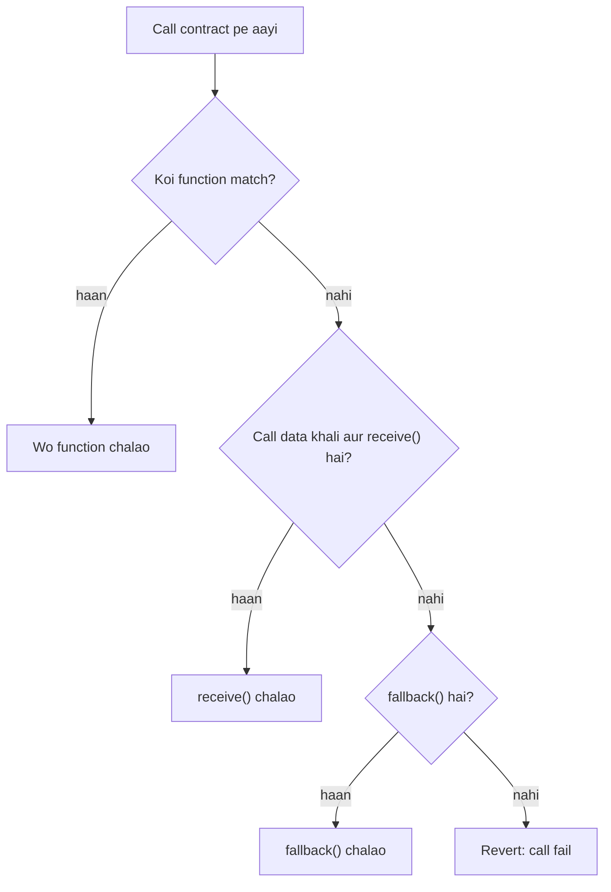
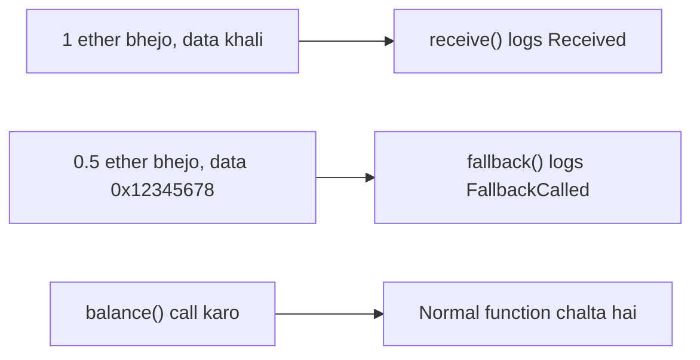

**Ek line mein:** <mark>Fallback function contract ka bina naam wala catch-all function hai: ye tab chalta hai jab call kisi function se match na kare, ya ether aisa data lekar aaye jise koi function sambhal na sake</mark>. <Cite id="solidity-docs-fallback" />

<Box kind="key">

**Fallback function ke question mein ye points likho:**

- Syntax: <mark>`fallback() external payable`</mark> (body curly braces ke andar): naam nahi, function keyword nahi, external hona zaroori.
- Tab chalta hai jab <mark>call kiya gaya function exist nahi karta</mark> ya call data kisi se match nahi karta.
- Ether lene ke liye <mark>payable</mark> chahiye; bina payable ke unknown call ke saath ether reject hota hai.
- <mark>receive() external payable</mark> <mark>empty call data</mark> wale plain ether ko sambhalta hai; baaki sab fallback ko milta hai.
- send ya transfer se pahunchne pe sirf <mark>2300 gas</mark>; chhota rakho.
- Uses: ether lena, calls forward karne wale proxy contracts, unexpected calls log karna. Risk: bhaari logic reentrancy jaise attacks khol sakta hai.

</Box>

## Core answer (5 marks, yahan ke har question ke liye)

<Box kind="definition">

A **fallback function** is a special function with no name. Solidity runs it when somebody calls the contract in a way that no other function matches, for example calling a function that does not exist, or sending ether with data that no function can handle. It is the "catch-all door" of a contract. <Cite id="solidity-docs-fallback" />

</Box>

**Fallback kab call hota hai?**

1. Call aisi function signature use kare jo contract mein nahi hai.
2. Ether bina function call ke bheja jaye aur contract mein `receive` function na ho.
3. Ether data ke saath bheja jaye aur koi function match na kare.

**Rules (Solidity 0.6 aur baad):**

- `fallback() external` ya `fallback() external payable` likhte hain.
- `external` hona zaroori hai aur naam nahi hota.
- Ether lene ke liye `payable` hona chahiye.
- Alag `receive() external payable` empty call data wale plain ether transfers ko sambhalta hai. `receive` ho to plain transfer wahan jaata hai aur fallback ko baaki sab milta hai.
- `send` ya `transfer` se pahunchne pe bahut kam gas (2300) milta hai, isliye chhota rakho. <Cite id="solidity-gfg-fallback" />



**Conclusion:** <mark>fallback function unknown calls ka aur payable ke saath unmatched data ke saath aaye ether ka contract ka default handler hai</mark>.

## Extended answer (10 marks): ye add karo

### 1. Example program

```solidity
// SPDX-License-Identifier: MIT
pragma solidity ^0.8.0;

contract Wallet {
    event Received(address indexed from, uint256 amount);
    event FallbackCalled(address indexed from, uint256 amount, bytes data);

    // Runs when plain ether arrives with empty calldata.
    receive() external payable {
        emit Received(msg.sender, msg.value);
    }

    // Runs when the called function does not exist.
    fallback() external payable {
        emit FallbackCalled(msg.sender, msg.value, msg.data);
    }

    function balance() public view returns (uint256) {
        return address(this).balance;
    }
}
```

**Line by line:**

- `event Received(...)` aur `event FallbackCalled(...)` log messages define karte hain jinhe apps blockchain se padh sakte hain.
- `receive() external payable` bina data ke plain ether pe chalta hai; `msg.sender` caller aur `msg.value` bheje gaye wei.
- `fallback() external payable` tab chalta hai jab call data kisi function se match na kare; `msg.data` poora call data rakhta hai, jo log hota hai.
- `balance()` ek `view` function hai jo `address(this).balance` deta hai. <Cite id="solidity-docs-view-pure" />

<Box kind="verify">

**Remix mein test:** (1) empty data ke saath 1 ether bhejo: `receive()` chalta hai aur `Received` log hota hai; `balance()` 1 ether ($10^{18}$ wei) deta hai. (2) Data `0x12345678` ke saath 0.5 ether bhejo (aisa function nahi hai): `fallback()` chalta hai aur `FallbackCalled` log hota hai; `balance()` 1.5 ether ho jaata hai. (3) `balance()` call karo: ye asli function se match karta hai, isliye koi special function nahi chalta.

</Box>



### 2. receive vs fallback

| Point | receive() | fallback() |
|---|---|---|
| Kab call hota hai | Plain ether, empty call data | Call data kisi function se match nahi (ya receive na ho to empty data) |
| payable | Payable hona chahiye | Ether lena ho to payable |
| Arguments | Nahi | Nahi (optional bytes form) |
| Kitne allowed | Ek | Ek |

### 3. Uses aur risks

- **Uses:** ether lena, proxy contracts mein calls forward karna, unexpected calls log karna.
- **Risk:** payable fallback galti se ether le sakta hai, aur usme complex code reentrancy jaise attack raaste khol sakta hai. <Cite id="solidity-by-example" />

## Har question mein kaise fit karein

- **"Fallback function in Solidity"** (10 marks) <PYQ id="2022-12-ce/q6d" />: **core answer** (definition, rules, routing diagram), phir section 1 (program, line by line, check) aur section 3.
- **"Explain Fallback function in Solidity with an example."** (10 marks) <PYQ id="2025-05-ce/q4b" />: definition, "kab call hota hai", routing diagram, phir section 1 ka program check ke saath aur section 2 ka table.

## Exam tips

- **Exactly likho** `fallback() external payable` aur `receive()` ko uska partner bolo.
- Routing flow draw karo: match, receive, fallback, revert.
- Achhe last line ke liye 2300 gas limit aur reentrancy ka zikr karo.

Exam mein English mein likho.
