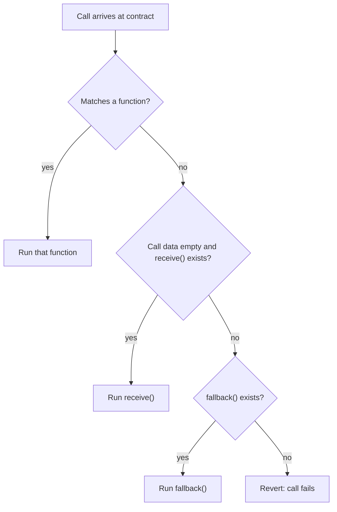
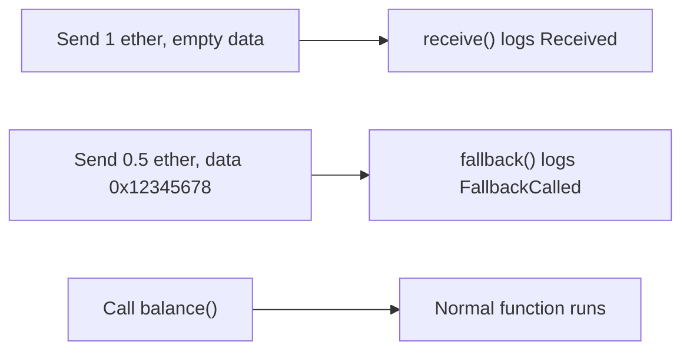

**In one line:** <mark>The fallback function is the nameless catch-all function of a contract: it runs when a call matches no other function, or when ether arrives with data that no function can handle</mark>. <Cite id="solidity-docs-fallback" />

<Box kind="key">

**Key points to write (fallback function):**

- Syntax: <mark>`fallback() external payable`</mark> with a body in braces: no name, no function keyword, must be external.
- Runs when <mark>the called function does not exist</mark> or call data matches nothing.
- <mark>payable</mark> is needed to accept ether; without it, ether with an unknown call is rejected.
- <mark>receive() external payable</mark> handles plain ether with <mark>empty call data</mark>; fallback gets everything else.
- Only <mark>2300 gas</mark> when reached through send or transfer; keep it short.
- Uses: accept ether, proxy contracts that forward calls, log unexpected calls. Risk: heavy logic can open attacks like reentrancy.

</Box>

## Core answer (5 marks, fits every question here)

<Box kind="definition">

A **fallback function** is a special function with no name. Solidity runs it when somebody calls the contract in a way that no other function matches, for example calling a function that does not exist, or sending ether with data that no function can handle. It is the "catch-all door" of a contract. <Cite id="solidity-docs-fallback" />

</Box>

**When is the fallback called?**

1. The call uses a function signature that does not exist in the contract.
2. Ether is sent with no function call and the contract has no `receive` function.
3. Ether is sent with data and no function matches.

**Rules (Solidity 0.6 and later):**

- Written as `fallback() external` or `fallback() external payable`.
- Must be `external` and has no name.
- Must be `payable` to accept ether.
- A separate `receive() external payable` handles plain ether transfers with empty call data. If `receive` exists, a plain transfer goes there and the fallback gets everything else.
- It gets little gas (2300) when reached through `send` or `transfer`, so keep it short. <Cite id="solidity-gfg-fallback" />



**Conclusion:** <mark>the fallback function is the contract's default handler for unknown calls and, with payable, for ether that arrives with unmatched data</mark>.

## Extended answer (10 marks): add these

### 1. Example program

```solidity
// SPDX-License-Identifier: MIT
pragma solidity ^0.8.0;

contract Wallet {
    event Received(address indexed from, uint256 amount);
    event FallbackCalled(address indexed from, uint256 amount, bytes data);

    // Runs when plain ether arrives with empty calldata.
    receive() external payable {
        emit Received(msg.sender, msg.value);
    }

    // Runs when the called function does not exist.
    fallback() external payable {
        emit FallbackCalled(msg.sender, msg.value, msg.data);
    }

    function balance() public view returns (uint256) {
        return address(this).balance;
    }
}
```

**Line by line:**

- `event Received(...)` and `event FallbackCalled(...)` define log messages that apps can read from the blockchain.
- `receive() external payable` runs for plain ether with no data; `msg.sender` is the caller and `msg.value` the wei sent.
- `fallback() external payable` runs when the call data matches no function; `msg.data` holds the full call data, which is logged.
- `balance()` is a `view` function returning `address(this).balance`. <Cite id="solidity-docs-view-pure" />

<Box kind="verify">

**Test in Remix:** (1) send 1 ether with empty data: `receive()` runs and logs `Received`; `balance()` returns 1 ether ($10^{18}$ wei). (2) Send 0.5 ether with data `0x12345678` (no such function): `fallback()` runs and logs `FallbackCalled`; `balance()` becomes 1.5 ether. (3) Call `balance()`: it matches a real function, so neither special function runs.

</Box>



### 2. receive versus fallback

| Point | receive() | fallback() |
|---|---|---|
| Called when | Plain ether, empty call data | Call data matches no function (or empty data with no receive) |
| payable | Must be payable | Payable if it should accept ether |
| Arguments | None | None (optional bytes form) |
| Number allowed | One | One |

### 3. Uses and risks

- **Uses:** accept ether, forward calls in proxy contracts, log unexpected calls.
- **Risk:** a payable fallback can receive ether by mistake, and complex code in it can open attack routes such as reentrancy. <Cite id="solidity-by-example" />

## Fit it to each question

- **"Fallback function in Solidity"** (10 marks) <PYQ id="2022-12-ce/q6d" />: the **core answer** (definition, rules, routing diagram), then section 1 (program, line by line, check) and section 3.
- **"Explain Fallback function in Solidity with an example."** (10 marks) <PYQ id="2025-05-ce/q4b" />: definition, "when is it called", the routing diagram, then the section 1 program with its check and the section 2 table.

## Exam tips

- **Write** `fallback() external payable` exactly, and name `receive()` as its partner.
- Draw the routing flow: match, receive, fallback, revert.
- Mention the 2300 gas limit and reentrancy for a high-scoring last line.
