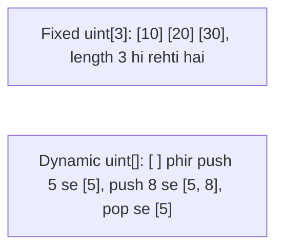
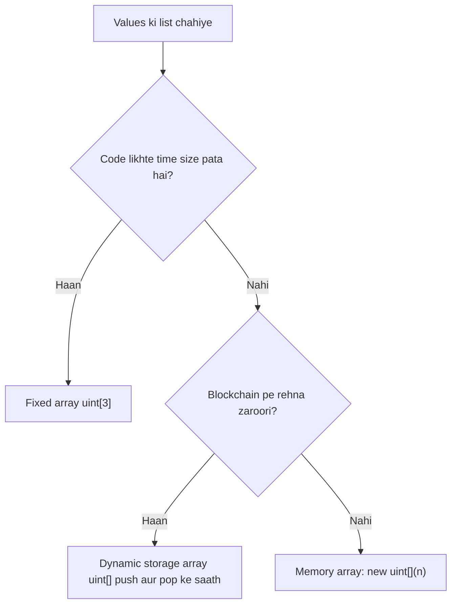

**Ek line mein:** <mark>Array ek jaise type ke values ke numbered boxes ki row hai; fixed-size array ki length code likhte time set hoti hai, dynamic array run time pe push aur pop se badh ya ghat sakta hai</mark>. <Cite id="solidity-docs-types" />

<Box kind="key">

**Solidity arrays ke question mein ye points likho:**

- <mark>Fixed-size array: uint[3] a;</mark> length compile time pe set, badal nahi sakti.
- <mark>Dynamic array: uint[] b;</mark> length run time pe badalti hai.
- Storage dynamic arrays mein <mark>push(), pop() aur length</mark>.
- Index <mark>0</mark> se shuru hota hai aur length se chhota hona chahiye, warna call <mark>revert</mark> hota hai.
- <mark>Memory arrays</mark> temporary hain aur creation pe fixed size chahiye: new uint[](n); push nahi.
- Aur: multi-dimensional arrays (uint[][]) aur strings ke arrays; <mark>public</mark> free getter banata hai.

</Box>

## Core answer (5 marks, yahan ke har question ke liye)

<Box kind="definition">

An **array** is a list of items of the same type, each reached by its index starting at 0. Solidity has **fixed-size arrays** (length fixed in code) and **dynamic arrays** (length changes at run time). <Cite id="solidity-docs-types" />

</Box>

| Point | Fixed-size array | Dynamic array |
|---|---|---|
| Declaration | `uint[3] a;` | `uint[] b;` |
| Length | Compile time pe set | Run time pe badalti hai |
| Add ya remove | Nahi ho sakta | `push()` aur `pop()` (storage arrays) |
| Gas | Sasta, size known | Length ke saath badhta hai |
| Index | 0 se shuru, length se chhota | Wahi |



```solidity
// SPDX-License-Identifier: MIT
pragma solidity ^0.8.0;

contract ArrayDemo {
    uint[3] public fixedArr = [10, 20, 30];
    uint[] public dynArr;

    function setFixed(uint index, uint value) public {
        fixedArr[index] = value;
    }

    function addDynamic(uint value) public {
        dynArr.push(value);
    }

    function removeLast() public {
        dynArr.pop();
    }

    function dynLength() public view returns (uint) {
        return dynArr.length;
    }

    function memoryArray() public pure returns (uint[] memory) {
        uint[] memory temp = new uint[](3);
        temp[0] = 1;
        temp[1] = 2;
        temp[2] = 3;
        return temp;
    }
}
```

**Line by line:**

- `uint[3] public fixedArr = [10, 20, 30];` bilkul 3 numbers ka fixed array hai starting values ke saath; `public` getter `fixedArr(i)` banata hai.
- `uint[] public dynArr;` dynamic array hai jo khali shuru hota hai.
- `setFixed` ek item badalta hai; index 3 ya usse zyada fail hota hai, kyunki length fixed hai.
- `push(value)` end mein jodta hai, `pop()` aakhri item hatata hai, `length` ginti deta hai.
- `memoryArray` dikhata hai ki function ke andar ka array (`memory`) `push` use nahi kar sakta, isliye size `new uint[](3)` se set hota hai. <Cite id="solidity-docs-datalocation" />

<Box kind="verify">

**Start:** `fixedArr(1)` 20 deta hai; `dynLength()` 0. **`addDynamic(5)` aur `addDynamic(8)` ke baad:** `dynLength()` 2 aur `dynArr(1)` 8. **`removeLast()` ke baad:** length 1. **`setFixed(2, 99)`:** `fixedArr(2)` 99. **`setFixed(3, 1)`:** revert, kyunki index 3 range se bahar hai.

</Box>

**Conclusion:** <mark>size pata ho to fixed arrays, list badhti ho to dynamic arrays use karo</mark>. <Cite id="solidity-gfg-arrays" />

## Extended answer (10 marks): ye add karo

### 1. Ek contract mein saare array types

Ye contract fixed, dynamic, multi-dimensional, string aur memory arrays dikhata hai. <Cite id="solidity-tp-arrays" />

```solidity
// SPDX-License-Identifier: MIT
pragma solidity ^0.8.0;

contract ArrayTypes {
    // 1. Fixed-size array: length 3, set when written
    uint[3] public fixedArr = [10, 20, 30];

    // 2. Dynamic array in storage: can grow and shrink
    uint[] public dynamicArr;

    // 3. Multi-dimensional (array of arrays) in storage
    uint[][] public nested;

    // 4. Array of strings
    string[] public names;

    // push adds one item at the end
    function addToDynamic(uint x) public {
        dynamicArr.push(x);
    }

    // pop removes the last item (reverts if the array is empty)
    function removeLast() public {
        dynamicArr.pop();
    }

    // length gives the number of items
    function lengthOfDynamic() public view returns (uint) {
        return dynamicArr.length;
    }

    // returns the whole storage array
    function getDynamic() public view returns (uint[] memory) {
        return dynamicArr;
    }

    // loops over the fixed array and adds its items
    function sumFixed() public view returns (uint s) {
        for (uint i = 0; i < fixedArr.length; i++) {
            s += fixedArr[i];
        }
    }

    // 5. Memory array: temporary, size must be given at creation
    function memoryArray(uint n) public pure returns (uint[] memory) {
        uint[] memory arr = new uint[](n);
        for (uint i = 0; i < n; i++) {
            arr[i] = i * 2;
        }
        return arr;
    }

    // adds a row (inner array) of two numbers to nested
    function addRow(uint a, uint b) public {
        uint[] memory row = new uint[](2);
        row[0] = a;
        row[1] = b;
        nested.push(row);
    }

    function addName(string memory n) public {
        names.push(n);
    }
}
```

<Box kind="verify">

**Fresh deployment:** `addToDynamic(5)`, `addToDynamic(7)` se [5, 7]; `lengthOfDynamic()` 2; `sumFixed()` $10 + 20 + 30 = 60$; `memoryArray(3)` [0, 2, 4]; `removeLast()` ke baad [5]; `addRow(1, 2)` phir `nested(0, 1)` 2 deta hai.

</Box>

### 2. Storage vs memory arrays

| Point | Storage array | Memory array |
|---|---|---|
| Kahan rehta hai | Blockchain pe, permanent | Sirf call ke dauran |
| Size | Fixed ya dynamic | `new` se banate time fixed |
| `push` aur `pop` | Haan (dynamic) | Nahi |
| Gas | Costly | Sasta |



## Har question mein kaise fit karein

- **"Write a smart contract in solidity to explain various types of arrays."** (10 marks) <PYQ id="2023-12/q3a" />: chhoti definition, section 1 ka `ArrayTypes` program, uska check, aur section 2 ka table.

## Exam tips

- **Program likho** jisme `uint[3]` aur `uint[]` dono hon aur `push`, `pop`, `length` dikhao.
- Table do: declaration, length, add ya remove, gas.
- Likho ki `memory` arrays mein `push` nahi hota; viva mein ye aksar puchha jaata hai.

Exam mein English mein likho.
