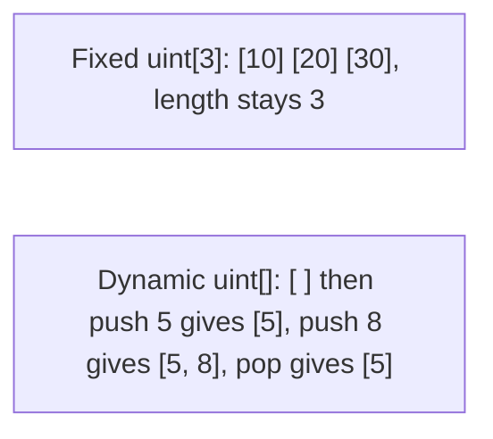
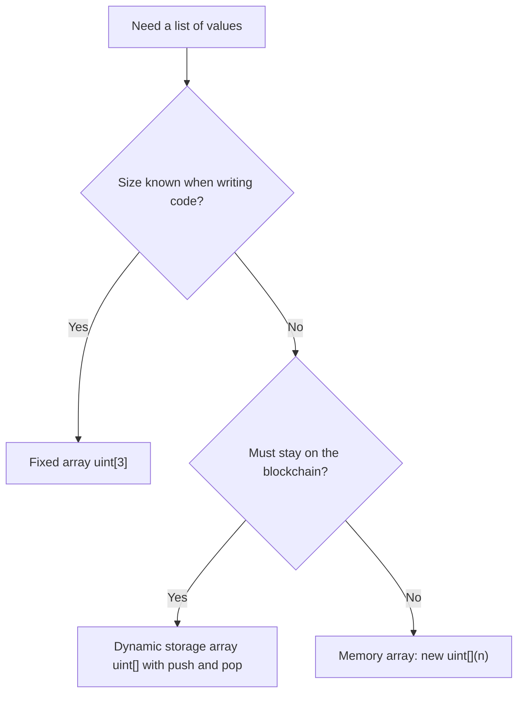

**In one line:** <mark>An array is a numbered row of boxes holding values of the same type; a fixed-size array has its length set when the code is written, a dynamic array can grow and shrink at run time with push and pop</mark>. <Cite id="solidity-docs-types" />

<Box kind="key">

**Key points to write (arrays in Solidity):**

- <mark>Fixed-size array: uint[3] a;</mark> length set at compile time, cannot change.
- <mark>Dynamic array: uint[] b;</mark> length changes at run time.
- Storage dynamic arrays have <mark>push(), pop() and length</mark>.
- Index starts at <mark>0</mark> and must be less than length, else the call <mark>reverts</mark>.
- <mark>Memory arrays</mark> are temporary and need a fixed size at creation: new uint[](n); no push.
- Also: multi-dimensional arrays (uint[][]) and arrays of strings; <mark>public</mark> makes a free getter.

</Box>

## Core answer (5 marks, fits every question here)

<Box kind="definition">

An **array** is a list of items of the same type, each reached by its index starting at 0. Solidity has **fixed-size arrays** (length fixed in code) and **dynamic arrays** (length changes at run time). <Cite id="solidity-docs-types" />

</Box>

| Point | Fixed-size array | Dynamic array |
|---|---|---|
| Declaration | `uint[3] a;` | `uint[] b;` |
| Length | Set at compile time | Changes at run time |
| Add or remove | Not possible | `push()` and `pop()` (storage arrays) |
| Gas | Cheaper, known size | Grows with length |
| Index | Starts at 0, must be less than length | Same |



```solidity
// SPDX-License-Identifier: MIT
pragma solidity ^0.8.0;

contract ArrayDemo {
    uint[3] public fixedArr = [10, 20, 30];
    uint[] public dynArr;

    function setFixed(uint index, uint value) public {
        fixedArr[index] = value;
    }

    function addDynamic(uint value) public {
        dynArr.push(value);
    }

    function removeLast() public {
        dynArr.pop();
    }

    function dynLength() public view returns (uint) {
        return dynArr.length;
    }

    function memoryArray() public pure returns (uint[] memory) {
        uint[] memory temp = new uint[](3);
        temp[0] = 1;
        temp[1] = 2;
        temp[2] = 3;
        return temp;
    }
}
```

**Line by line:**

- `uint[3] public fixedArr = [10, 20, 30];` is a fixed array of exactly 3 numbers with starting values; `public` creates a getter `fixedArr(i)`.
- `uint[] public dynArr;` is a dynamic array that starts empty.
- `setFixed` changes one item; an index of 3 or more fails, because the length is fixed.
- `push(value)` adds at the end, `pop()` removes the last item, `length` gives the count.
- `memoryArray` shows that an array inside a function (`memory`) cannot use `push`, so its size is set with `new uint[](3)`. <Cite id="solidity-docs-datalocation" />

<Box kind="verify">

**Start:** `fixedArr(1)` returns 20; `dynLength()` returns 0. **After `addDynamic(5)` and `addDynamic(8)`:** `dynLength()` returns 2 and `dynArr(1)` returns 8. **After `removeLast()`:** length 1. **`setFixed(2, 99)`:** `fixedArr(2)` returns 99. **`setFixed(3, 1)`:** reverts, because index 3 is out of range.

</Box>

**Conclusion:** <mark>use fixed arrays when the size is known and dynamic arrays when the list grows</mark>. <Cite id="solidity-gfg-arrays" />

## Extended answer (10 marks): add these

### 1. All array types in one contract

This contract shows fixed, dynamic, multi-dimensional, string and memory arrays. <Cite id="solidity-tp-arrays" />

```solidity
// SPDX-License-Identifier: MIT
pragma solidity ^0.8.0;

contract ArrayTypes {
    // 1. Fixed-size array: length 3, set when written
    uint[3] public fixedArr = [10, 20, 30];

    // 2. Dynamic array in storage: can grow and shrink
    uint[] public dynamicArr;

    // 3. Multi-dimensional (array of arrays) in storage
    uint[][] public nested;

    // 4. Array of strings
    string[] public names;

    // push adds one item at the end
    function addToDynamic(uint x) public {
        dynamicArr.push(x);
    }

    // pop removes the last item (reverts if the array is empty)
    function removeLast() public {
        dynamicArr.pop();
    }

    // length gives the number of items
    function lengthOfDynamic() public view returns (uint) {
        return dynamicArr.length;
    }

    // returns the whole storage array
    function getDynamic() public view returns (uint[] memory) {
        return dynamicArr;
    }

    // loops over the fixed array and adds its items
    function sumFixed() public view returns (uint s) {
        for (uint i = 0; i < fixedArr.length; i++) {
            s += fixedArr[i];
        }
    }

    // 5. Memory array: temporary, size must be given at creation
    function memoryArray(uint n) public pure returns (uint[] memory) {
        uint[] memory arr = new uint[](n);
        for (uint i = 0; i < n; i++) {
            arr[i] = i * 2;
        }
        return arr;
    }

    // adds a row (inner array) of two numbers to nested
    function addRow(uint a, uint b) public {
        uint[] memory row = new uint[](2);
        row[0] = a;
        row[1] = b;
        nested.push(row);
    }

    function addName(string memory n) public {
        names.push(n);
    }
}
```

<Box kind="verify">

**Fresh deployment:** `addToDynamic(5)`, `addToDynamic(7)` give [5, 7]; `lengthOfDynamic()` returns 2; `sumFixed()` returns $10 + 20 + 30 = 60$; `memoryArray(3)` returns [0, 2, 4]; `removeLast()` leaves [5]; `addRow(1, 2)` then `nested(0, 1)` returns 2.

</Box>

### 2. Storage versus memory arrays

| Point | Storage array | Memory array |
|---|---|---|
| Lives | On the blockchain, permanent | Only during the call |
| Size | Fixed or dynamic | Fixed when created with `new` |
| `push` and `pop` | Yes (dynamic) | No |
| Gas | Costly | Cheaper |



## Fit it to each question

- **"Explain fixed and dynamic arrays in solidity with suitable examples."** (10 marks) <PYQ id="2022-12-ce/q5b" /> <PYQ id="2023-05-ce/q5b" />: core answer (table, `ArrayDemo` program, line by line and check), then section 2 and the choice diagram.
- **"Write a smart contract in solidity to explain various types of arrays."** (10 marks) <PYQ id="2023-12/q3a" />: a short definition, the section 1 `ArrayTypes` program, its check, and the section 2 table.

## Exam tips

- **Write the program** with both `uint[3]` and `uint[]` and show `push`, `pop` and `length`.
- Give the table: declaration, length, add or remove, gas.
- Say that `memory` arrays have no `push`; it is a common question in vivas.
