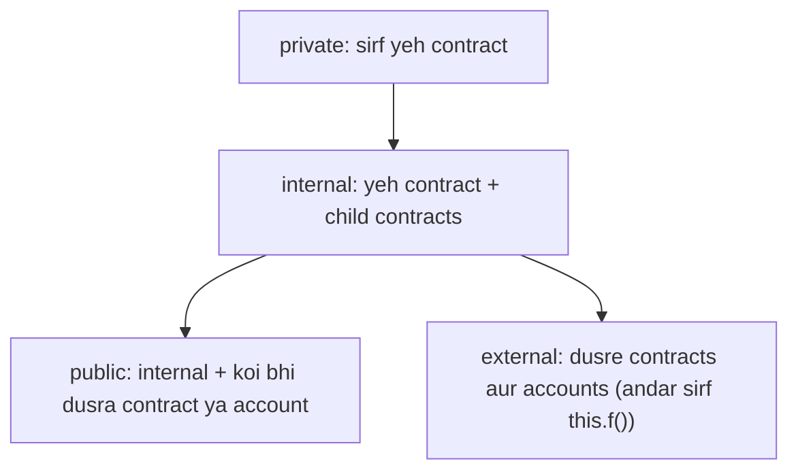
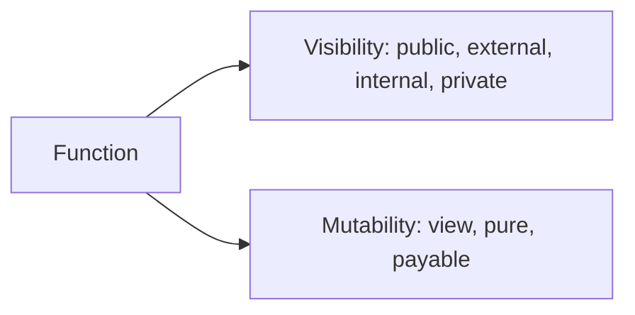

**Ek line mein:** <mark>Visibility specifiers (public, external, internal, private) decide karte hain ki function ko kaun call kar sakta hai ya state variable ko kaun padh sakta hai</mark>. <Cite id="solidity-docs-visibility" />

<Box kind="key">

**Har visibility question mein ye points likho:**

- Solidity mein **chaar** specifiers hain: <mark>public, external, internal, private</mark>.
- <mark>public</mark>: andar se, child contracts se aur bahar se call ho sakta hai. Public state variable ko free **getter** milta hai.
- <mark>external</mark>: sirf bahar se (dusre contracts ya accounts); andar se sirf `this.f()` se.
- <mark>internal</mark>: yeh contract aur uske **child** contracts (state variable ka default).
- <mark>private</mark>: sirf yeh contract, children bhi nahi.
- `private` data **chhupata nahi**: <mark>blockchain pe sab kuch padha ja sakta hai</mark>.
- Jo sabse **narrow** visibility kaam kare wahi use karo. Ek chhota contract likho jisme chaaron dikhein.

</Box>

## Core answer (5 marks, yahan ke har question ke liye)

<Box kind="definition">

**Visibility** compiler ko batati hai ki **function ko kaun call kar sakta hai** (ya state variable kaun padh sakta hai). Solidity mein chaar specifiers hain: `public`, `external`, `internal` aur `private`. <Cite id="solidity-docs-visibility" />

</Box>

**Kyun chahiye:** contract paisa aur data rakhta hai. Visibility helper functions ko bahar walon se bachati hai aur sirf asli interface bahar dikhati hai.

Ghar ki tarah socho: `public` main gate hai, `external` sirf visitors ki doorbell hai, `internal` family ke rooms hain, `private` tumhara apna room hai.

| Specifier | Isi contract ke andar | Child contract | Dusre contracts aur accounts |
|---|---|---|---|
| `public` | Haan | Haan | Haan |
| `external` | Sirf `this.f()` se | Sirf `this.f()` se | Haan |
| `internal` | Haan | Haan | Nahi |
| `private` | Haan | Nahi | Nahi |



```solidity
uint private secret = 1;     // only this contract
uint internal rate = 5;      // this contract + children
uint public bankId = 7;      // anyone, free getter bankId()
function ping() external pure returns (string memory) { return "pong"; }
```

**Conclusion:** <mark>use the narrowest visibility that works</mark>: helpers ke liye `private`, children ko jo chahiye uske liye `internal`, asli interface ke liye `public` ya `external`. <Cite id="solidity-mastering-ethereum-ch7" />

## Extended answer (10 marks): ye add karo

### 1. Poora example program

```solidity
// SPDX-License-Identifier: MIT
pragma solidity ^0.8.0;

contract Bank {
    uint private secretCode = 1234;   // only Bank can use this
    uint internal rate = 5;           // Bank and its children
    uint public bankId = 7;           // anyone, with a free getter

    // public: callable from outside and from inside
    function getRate() public view returns (uint) {
        return rate;
    }

    // external: callable only from outside (or as this.f())
    function ping() external pure returns (string memory) {
        return "pong";
    }

    // internal: only this contract and its children
    function addInterest(uint amount) internal view returns (uint) {
        return amount + (amount * rate) / 100;
    }

    // private: only this contract
    function check(uint code) private view returns (bool) {
        return code == secretCode;
    }

    // public function that uses the internal and private ones
    function withInterest(uint amount, uint code) public view returns (uint) {
        require(check(code), "Wrong code");
        return addInterest(amount);
    }

    // calling an external function from inside needs this.
    function callPing() public view returns (string memory) {
        return this.ping();
    }
}

contract SavingsBank is Bank {
    // a child can use internal members, but not private ones
    function childInterest(uint amount) public view returns (uint) {
        return addInterest(amount) + rate;
    }
}
```

- `bankId` `public` hai, isliye Solidity getter `bankId()` bana deta hai. `rate` `internal` hai, isliye `SavingsBank` use kar sakta hai; `secretCode` `private` hai, isliye child mein `secretCode` likhne par compile error aata hai.
- `withInterest` chhupe hue `check` aur `addInterest` ka public darwaza hai.
- `callPing` mein `this.ping()` chahiye kyunki `ping` `external` hai.

<Box kind="verify">

`getRate()` 5 deta hai. `withInterest(200, 1234)` deta hai 200 + (200 x 5) / 100 = 210. `withInterest(200, 1)` "Wrong code" se fail hota hai. `childInterest(200)` deta hai 210 + 5 = 215. Remix mein `addInterest` aur `check` ke buttons nahi dikhte.

</Box>

### 2. State variables

- State variable ki default visibility `internal` hai. State variable `external` nahi ho sakta.
- `public` state variable ko automatic getter function milta hai. <Cite id="solidity-gfg-visibility" />

### 3. "Activity" qualifiers: state mutability

Agar question mein "activity qualifiers" bhi likha ho to **mutability** keywords add karo, jo batate hain ki function kya kar sakta hai. <Cite id="solidity-docs-view-pure" />

| Qualifier | Matlab |
|---|---|
| `view` | State padhta hai, badalta nahi |
| `pure` | Na padhta hai na badalta hai |
| `payable` | Ether receive kar sakta hai |

```solidity
function triple(uint x) external pure returns (uint) { return x * 3; }   // pure
function sumAll() public view returns (uint) { return publicNum + getInternal(); } // view
function deposit() public payable { total += msg.value; }                // payable
```



### 4. Common galtiyan

| Galti | Result |
|---|---|
| Child `private` member use karta hai | Compile error |
| `external` function ko contract ke andar `f()` se call karna | Compile error; `this.f()` use karo |
| Sochna ki `private` data chhupata hai | Galat: off-chain koi bhi storage padh sakta hai |

## Har question mein kaise fit karein

- **"Explain different visibility specifier of functions in solidity with example."** (10 marks) <PYQ id="2023-12-ce/q4b" />: core answer (definition, table, diagram) plus extended section 1 (Bank program) aur section 4.
- **"Write and elaborate a code in solidity to explain visibility and activity qualifiers."** (10 marks) <PYQ id="2024-05-ce/q4a" />: chaar specifiers ki chhoti table, phir program line-by-line notes ke saath, aur extended section 3 `view`, `pure`, `payable` ke liye ("activity" ko state mutability padho).

## Exam tips

- **Program likho** jisme chaaron specifiers aur ek child contract ho, aur batao har ek ko kaun call kar sakta hai.
- Keywords: <mark>public, external, internal, private, getter, this.f(), inheritance</mark>.
- Yeh mat likho ki `private` data secret rakhta hai; likho ki yeh sirf code mein dusre contracts ko rokta hai.

Exam mein English mein likho.
