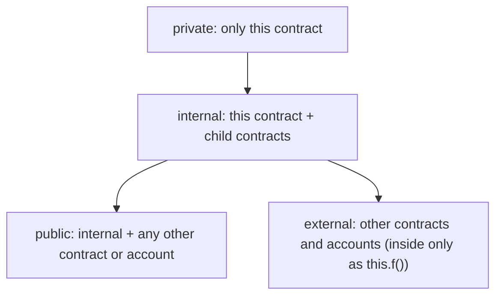
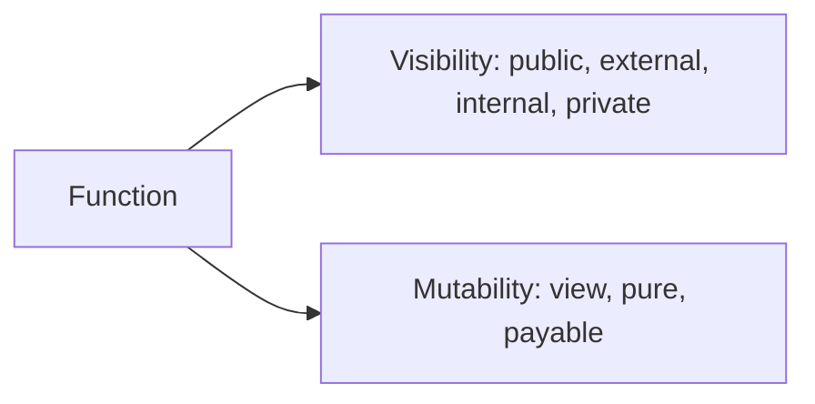

**In one line:** <mark>Visibility specifiers (public, external, internal, private) decide who is allowed to call a function or read a state variable</mark>. <Cite id="solidity-docs-visibility" />

<Box kind="key">

**Key points to write (any visibility question):**

- Solidity has **four** specifiers: <mark>public, external, internal, private</mark>.
- <mark>public</mark>: callable from inside, from child contracts and from outside. A public state variable gets a free **getter**.
- <mark>external</mark>: callable only from outside (other contracts or accounts); inside, only as `this.f()`.
- <mark>internal</mark>: this contract and its **child** contracts (default for state variables).
- <mark>private</mark>: only this contract, not even children.
- `private` does **not** hide data: <mark>everything on a blockchain can be read</mark>.
- Use the **narrowest** visibility that works. Write one small contract that shows all four.

</Box>

## Core answer (5 marks, fits every question here)

<Box kind="definition">

**Visibility** tells the compiler **who can call a function** (or read a state variable). Solidity has four specifiers: `public`, `external`, `internal` and `private`. <Cite id="solidity-docs-visibility" />

</Box>

**Why needed:** a contract holds money and data. Visibility keeps helper functions out of reach of strangers and exposes only the real interface.

Think of a house: `public` is the front gate, `external` is the doorbell for visitors only, `internal` is the family rooms, `private` is your own room.

| Specifier | Inside this contract | Child contract | Other contracts and accounts |
|---|---|---|---|
| `public` | Yes | Yes | Yes |
| `external` | Only as `this.f()` | Only as `this.f()` | Yes |
| `internal` | Yes | Yes | No |
| `private` | Yes | No | No |



```solidity
uint private secret = 1;     // only this contract
uint internal rate = 5;      // this contract + children
uint public bankId = 7;      // anyone, free getter bankId()
function ping() external pure returns (string memory) { return "pong"; }
```

**Conclusion:** <mark>use the narrowest visibility that works</mark>: `private` for helpers, `internal` for what children need, `public` or `external` for the real interface. <Cite id="solidity-mastering-ethereum-ch7" />

## Extended answer (10 marks): add these

### 1. Full example program

```solidity
// SPDX-License-Identifier: MIT
pragma solidity ^0.8.0;

contract Bank {
    uint private secretCode = 1234;   // only Bank can use this
    uint internal rate = 5;           // Bank and its children
    uint public bankId = 7;           // anyone, with a free getter

    // public: callable from outside and from inside
    function getRate() public view returns (uint) {
        return rate;
    }

    // external: callable only from outside (or as this.f())
    function ping() external pure returns (string memory) {
        return "pong";
    }

    // internal: only this contract and its children
    function addInterest(uint amount) internal view returns (uint) {
        return amount + (amount * rate) / 100;
    }

    // private: only this contract
    function check(uint code) private view returns (bool) {
        return code == secretCode;
    }

    // public function that uses the internal and private ones
    function withInterest(uint amount, uint code) public view returns (uint) {
        require(check(code), "Wrong code");
        return addInterest(amount);
    }

    // calling an external function from inside needs this.
    function callPing() public view returns (string memory) {
        return this.ping();
    }
}

contract SavingsBank is Bank {
    // a child can use internal members, but not private ones
    function childInterest(uint amount) public view returns (uint) {
        return addInterest(amount) + rate;
    }
}
```

- `bankId` is `public`, so Solidity makes a getter `bankId()`. `rate` is `internal`, so `SavingsBank` can use it; `secretCode` is `private`, so a child writing `secretCode` gets a compile error.
- `withInterest` is the public door into the hidden `check` and `addInterest`.
- `callPing` needs `this.ping()` because `ping` is `external`.

<Box kind="verify">

`getRate()` returns 5. `withInterest(200, 1234)` returns 200 + (200 x 5) / 100 = 210. `withInterest(200, 1)` fails with "Wrong code". `childInterest(200)` returns 210 + 5 = 215. Remix shows no buttons for `addInterest` and `check`.

</Box>

### 2. State variables

- Default visibility of a state variable is `internal`. A state variable cannot be `external`.
- A `public` state variable gets an automatic getter function. <Cite id="solidity-gfg-visibility" />

### 3. "Activity" qualifiers: state mutability

If the question also says "activity qualifiers", add the **mutability** keywords, which say what a function may do. <Cite id="solidity-docs-view-pure" />

| Qualifier | Meaning |
|---|---|
| `view` | Reads state, does not change it |
| `pure` | Neither reads nor changes state |
| `payable` | Can receive Ether |

```solidity
function triple(uint x) external pure returns (uint) { return x * 3; }   // pure
function sumAll() public view returns (uint) { return publicNum + getInternal(); } // view
function deposit() public payable { total += msg.value; }                // payable
```



### 4. Common mistakes

| Mistake | Result |
|---|---|
| Child uses a `private` member | Compile error |
| Calling an `external` function as `f()` inside the contract | Compile error; use `this.f()` |
| Thinking `private` hides data | Wrong: anyone can read storage off-chain |

## Fit it to each question

- **"Explain different visibility specifier of functions in solidity with example."** (10 marks) <PYQ id="2023-12-ce/q4b" />: core answer (definition, table, diagram) plus extended section 1 (the Bank program) and section 4.
- **"Write and elaborate a code in solidity to explain visibility and activity qualifiers."** (10 marks) <PYQ id="2024-05-ce/q4a" />: short table of the four specifiers, then the program with line-by-line notes, and extended section 3 for `view`, `pure`, `payable` (read "activity" as state mutability).

## Exam tips

- **Write a program** with all four specifiers and one child contract, and say who can call each.
- Keywords: <mark>public, external, internal, private, getter, this.f(), inheritance</mark>.
- Do not say `private` makes data secret; say it only blocks other contracts in code.
