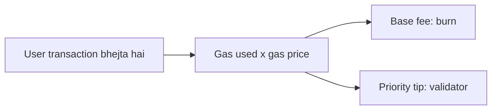
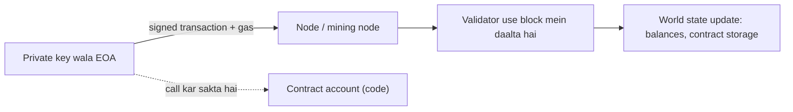

**Ek line mein:** <mark>Ether (ETH) Ethereum ka coin hai; gas computing work ki unit hai jiska aap ether mein paisa dete ho (fee = gas used x gas price); miners (ab validators) blocks jodte hain; accounts value rakhte hain aur transactions state badalte hain</mark>. <Cite id="ethereum-eth-ether" />

<Box kind="key">

**Gas, ether, miners, accounts, transactions ke question mein ye points likho:**

- <mark>Ether (ETH)</mark>: native coin; gas pay karta hai, staking mein use; <mark>1 ETH = 10^18 wei</mark>, 1 gwei = 10^-9 ETH.
- <mark>Gas</mark>: kaam ki unit; plain ETH transfer = <mark>21,000 gas</mark>; <mark>fee = gas used x gas price</mark>.
- Gas <mark>spam aur infinite loops</mark> rokta hai aur validators ko pay karta hai; London (EIP-1559) ke baad: <mark>base fee (burn) plus priority tip</mark>.
- <mark>Miner / mining node</mark>: transactions ko blocks mein pack karta hai; September 2022 tak Proof of Work, phir <mark>32 ETH stake karne wale validators</mark>.
- <mark>Accounts</mark>: EOA (private key) aur contract account (code); fields: nonce, balance, storageRoot, codeHash.
- <mark>Transaction</mark>: EOA ka signed message; recipient, value, data, gas limit, fee, nonce, signature.

</Box>

## Core answer (5 marks, yahan ke har question ke liye)

<Box kind="definition">

**Ether (ETH)** is the native coin of Ethereum. **Gas** is the unit that measures how much computing work an operation needs; you pay for gas in ether, like paying for fuel in rupees. <Cite id="ethereum-eth-ether" /> <Cite id="ethereum-eth-gas" />

</Box>

**Ether:** Ethereum ka coin, fees dene aur store of value ke liye. Sabse chhoti unit **wei** hai (1 ETH = $10^{18}$ wei); beech ki common unit **gwei** (1 gwei = $10^{-9}$ ETH). ETH stake karne wale validators ko ETH mein reward milta hai.

**Gas:**

- EVM jo bhi step chalati hai uska fixed gas cost hota hai; plain ETH transfer 21,000 gas leta hai. <Cite id="ethereum-gfg-evm" />
- **Kyun chahiye:** (1) validators ke kaam ka paisa, (2) spam rokna, (3) infinite loops rokna kyunki gas khatam hone pe program ruk jaata hai.
- **Gas limit** = jitna gas aap allow karte ho; **gas used** = jitna sach mein laga; **gas price** = per unit gas ether, gwei mein. EIP-1559 ke baad price **base fee** (burn) plus **priority tip** (validator ko) hai.

$$
\text{Fee} = \text{gas used} \times \text{gas price}
$$

**Conclusion:** <mark>ether Ethereum ka paisa hai aur gas wo meter hai jo har computation ko apna kharcha khud dene par majboor karta hai</mark>. <Cite id="ethereum-whitepaper" />

## Extended answer (10 marks): ye add karo

### 1. Worked example: fee

<Sum>

<Given>

Simple ETH transfer 21,000 gas leta hai. Base fee = 18 gwei, tip = 2 gwei.

</Given>

<Find>

gwei aur ETH mein total fee.

</Find>

<Steps>

1. Gas price $= 18 + 2 = 20$ gwei. *Reason: price = base fee plus tip.*
2. Fee $= 21{,}000 \times 20 = 420{,}000$ gwei. *Reason: fee = gas used x gas price.*
3. ETH mein: $420{,}000 \times 10^{-9} = 0.00042$ ETH. *Reason: 1 gwei $10^{-9}$ ETH hai.*

</Steps>

<Answer>

fee = 420,000 gwei = 0.00042 ETH

</Answer>

<Box kind="verify">

Burn hua hissa $21{,}000 \times 18 = 378{,}000$ gwei; tip $21{,}000 \times 2 = 42{,}000$ gwei; $378{,}000 + 42{,}000 = 420{,}000$, wahi total. Bacha gas refund hota hai; gas limit kam ho to transaction fail ("out of gas") hota hai aur kharch hua gas wapas nahi milta.

</Box>

</Sum>

### 2. Miner aur mining node

**Miner** transactions collect karke block mein pack karta hai aur reward kamaata hai. **Mining node** wo computer hai jo ye kaam karta hai: Ethereum client chalata hai, transactions validate karta hai aur agla block jodne ki race lagata hai. Ethereum September 2022 tak Proof of Work mining use karta tha; Merge ke baad miners ki jagah **validators** aaye jo 32 ETH stake karte hain. <Cite id="ethereum-eth-mining" />

### 3. Accounts

Account ka address hota hai aur wo balance rakhta hai. **Externally Owned Account (EOA):** private key se controlled, transactions shuru kar sakta hai. **Contract account:** code se controlled, sirf call hone pe chalta hai. Har ek nonce, balance aur contracts ke liye code aur storage rakhta hai. <Cite id="ethereum-eth-accounts" /> <Cite id="ethereum-gfg-accounts" />

### 4. Transactions

Transaction EOA ka signed message hai jo state badalta hai: ETH bhejna, contract deploy karna ya function call karna. Usme recipient, value, data, gas limit, gas price (fee), nonce aur signature hote hain. **Nonce** replay rokta hai. <Cite id="ethereum-eth-transactions" />

<Cite id="web-bt-1-eth-glossary" />

## Har question mein kaise fit karein

- **"Explain Gas and Ethers in detail."** (5 marks) <PYQ id="2024-05-ce/q1a" />: **core answer** (ether, gas, formula, diagram), jagah ho to section 1 ka worked example.
- **"Explain the following terms with respect to Ethereum: Miner and Mining Node, Gas, Accounts, Ether, Transactions."** (10 marks) <PYQ id="2024-12-ce/q4a" />: paanch chhote paragraphs: miner (section 2), gas aur ether (core answer, chhota), accounts (section 3), transactions (section 4), phir section 1 ka example aur aakhri diagram.

## Exam tips

- **Formula likho** fee = gas used x gas price aur number 21,000.
- Paanch-term question mein paanch labelled headings do, har ek ka chhota paragraph.
- Likho ki Merge ke baad miners ki jagah validators aaye.

Exam mein English mein likho.
