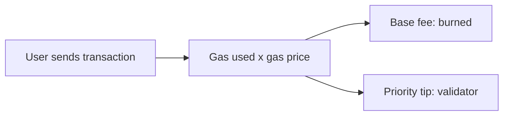
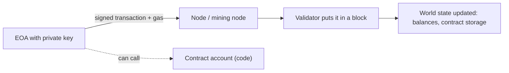

**In one line:** <mark>Ether (ETH) is Ethereum's coin; gas is the unit of computing work you pay for in ether (fee = gas used x gas price); miners (now validators) add blocks; accounts hold value and transactions change the state</mark>. <Cite id="ethereum-eth-ether" />

<Box kind="key">

**Key points to write (gas, ether, miners, accounts, transactions):**

- <mark>Ether (ETH)</mark>: native coin; pays gas, used for staking; <mark>1 ETH = 10^18 wei</mark>, 1 gwei = 10^-9 ETH.
- <mark>Gas</mark>: unit of work; a plain ETH transfer = <mark>21,000 gas</mark>; <mark>fee = gas used x gas price</mark>.
- Gas stops <mark>spam and infinite loops</mark> and pays validators; since London (EIP-1559): <mark>base fee (burned) plus priority tip</mark>.
- <mark>Miner / mining node</mark>: packs transactions into blocks; Proof of Work until September 2022, then <mark>validators who stake 32 ETH</mark>.
- <mark>Accounts</mark>: EOA (private key) and contract account (code); fields: nonce, balance, storageRoot, codeHash.
- <mark>Transaction</mark>: signed message from an EOA; recipient, value, data, gas limit, fee, nonce, signature.

</Box>

## Core answer (5 marks, fits every question here)

<Box kind="definition">

**Ether (ETH)** is the native coin of Ethereum. **Gas** is the unit that measures how much computing work an operation needs; you pay for gas in ether, like paying for fuel in rupees. <Cite id="ethereum-eth-ether" /> <Cite id="ethereum-eth-gas" />

</Box>

**Ether:** the coin of Ethereum, used to pay fees and as a store of value. The smallest unit is **wei** (1 ETH = $10^{18}$ wei); a common middle unit is **gwei** (1 gwei = $10^{-9}$ ETH). Validators who stake ETH are rewarded in ETH.

**Gas:**

- Every step the EVM runs has a fixed gas cost; a plain ETH transfer costs 21,000 gas. <Cite id="ethereum-gfg-evm" />
- **Why needed:** (1) pays validators for their work, (2) stops spam, (3) stops infinite loops because a program that runs out of gas is halted.
- **Gas limit** = most gas you allow; **gas used** = what it really used; **gas price** = ether per unit of gas, in gwei. After EIP-1559 the price is a **base fee** (burned) plus a **priority tip** (to the validator).

$$
\text{Fee} = \text{gas used} \times \text{gas price}
$$

**Conclusion:** <mark>ether is the money of Ethereum and gas is the meter that makes every computation pay for itself</mark>. <Cite id="ethereum-whitepaper" />

## Extended answer (10 marks): add these

### 1. Worked example: fee

<Sum>

<Given>

A simple ETH transfer uses 21,000 gas. Base fee = 18 gwei, tip = 2 gwei.

</Given>

<Find>

the total fee in gwei and in ETH.

</Find>

<Steps>

1. Gas price $= 18 + 2 = 20$ gwei. *Reason: price is base fee plus tip.*
2. Fee $= 21{,}000 \times 20 = 420{,}000$ gwei. *Reason: fee is gas used times gas price.*
3. In ETH: $420{,}000 \times 10^{-9} = 0.00042$ ETH. *Reason: 1 gwei is $10^{-9}$ ETH.*

</Steps>

<Answer>

fee = 420,000 gwei = 0.00042 ETH

</Answer>

<Box kind="verify">

Burned part $21{,}000 \times 18 = 378{,}000$ gwei; tip part $21{,}000 \times 2 = 42{,}000$ gwei; $378{,}000 + 42{,}000 = 420{,}000$, the same total. Unused gas is refunded; if the gas limit is too low the transaction fails ("out of gas") and the gas spent is not returned.

</Box>

</Sum>

### 2. Miner and mining node

A **miner** collects transactions, packs them into a block and earns a reward. A **mining node** is the computer doing this: it runs an Ethereum client, validates transactions and competes to add the next block. Ethereum used Proof of Work mining until September 2022; after the Merge miners were replaced by **validators** who stake 32 ETH. <Cite id="ethereum-eth-mining" />

### 3. Accounts

An account has an address and holds a balance. **Externally Owned Account (EOA):** controlled by a private key, can start transactions. **Contract account:** controlled by code, runs only when called. Each stores nonce, balance and, for contracts, code and storage. <Cite id="ethereum-eth-accounts" /> <Cite id="ethereum-gfg-accounts" />

### 4. Transactions

A transaction is a signed message from an EOA that changes the state: send ETH, deploy a contract or call a function. It holds recipient, value, data, gas limit, gas price (fee), nonce and signature. The **nonce** stops replay. <Cite id="ethereum-eth-transactions" />

<Cite id="web-bt-1-eth-glossary" />

## Fit it to each question

- **"Explain Gas and Ethers in detail."** (5 marks) <PYQ id="2024-05-ce/q1a" />: the **core answer** (ether, gas, formula, diagram), with the section 1 worked example if you have room.
- **"Explain the following terms with respect to Ethereum: Miner and Mining Node, Gas, Accounts, Ether, Transactions."** (10 marks) <PYQ id="2024-12-ce/q4a" />: five short paragraphs: miner (section 2), gas and ether (core answer, shortened), accounts (section 3), transactions (section 4), then the section 1 example and the last diagram.

## Exam tips

- **Write the formula** fee = gas used x gas price and the number 21,000.
- Give five labelled headings in the five-term question, one short paragraph each.
- Mention that miners were replaced by validators after the Merge.
