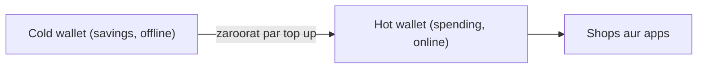
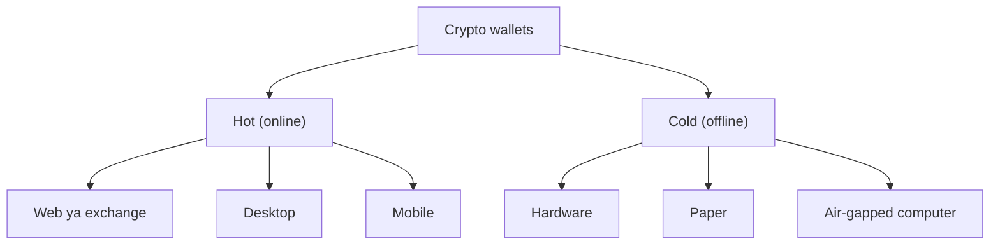

**Ek line mein:** <mark>Wallet coins store nahi karta; woh private keys store karta hai jinse tum coins kharch kar sakte ho. Hot wallet keys ko internet se juda device pe rakhta hai, cold wallet offline</mark>. <Cite id="wallets-utxo-double-spending-gfg-hot-cold" />

<Box kind="key">

**Hot, cold aur types of wallets mein ye points likho:**

- Wallet <mark>private keys</mark> rakhta hai (coins nahi): addresses banata hai, transactions sign karta hai aur balances dikhata hai. <Cite id="wallets-utxo-double-spending-wiki-crypto-wallet" />
- **Hot wallet:** <mark>internet se connected</mark>, aasaan aur fast, lekin hackers aur malware ka risk. Chhote, rozana amounts ke liye.
- **Cold wallet:** <mark>keys offline</mark> rakhta hai (hardware ya paper), bahut safe, kam convenient. Bade, lambe samay ke savings ke liye.
- Hot types: web, desktop, mobile. Cold types: <mark>hardware, paper, air-gapped computer</mark>.
- **Custodial** (koi third party tumhari keys rakhta hai) vs <mark>non-custodial</mark> (keys aur seed phrase tum rakhte ho).
- **HD wallet:** <mark>ek 12 ya 24 word ka seed phrase saari keys banata hai</mark> (BIP 39 aur BIP 32).
- Best practice: <mark>spending ke liye chhota hot wallet, savings ke liye cold wallet, seed phrase offline backup</mark>.

</Box>

## Core answer (5 marks, yahan ke har question ke liye)

<Box kind="definition">

A **crypto wallet** is software or hardware that stores private keys, creates addresses, signs transactions and shows balances. A **hot wallet** is connected to the internet; a **cold wallet** keeps its keys offline. <Cite id="wallets-utxo-double-spending-wiki-crypto-wallet" />

</Box>

Hot wallet ko jeb ka cash samjho aur cold wallet ko ghar ke locker ka paisa.

| Point | Hot wallet | Cold wallet |
|---|---|---|
| Internet | Connected | Offline |
| Security | Kam: hacking aur malware ka risk | Zyada: online attacks se safe |
| Convenience | Bahut aasaan aur fast | Kam convenient |
| Best for | Chhote amounts aur frequent trading | Bade amounts aur lambe samay ka holding |
| Cost | Zyadatar free | Hardware wallet paise leta hai |
| Main risk | Hacks, phishing | Device ya paper ka kho jana, chori ya kharab hona |
| Examples | MetaMask, mobile apps, exchange wallets | Ledger, Trezor, paper wallet |

<Cite id="wallets-utxo-double-spending-btcwiki-cold" />

**Conclusion:** <mark>hot wallets give ease, cold wallets give safety; most people use both</mark>. <Cite id="cryptocurrencies-tokens-gfg-wallets" />

## Extended answer (10 marks): ye add karo

### 1. Connection ke hisaab se types

- **Web wallets:** browser ya exchange pe chalte hain; provider tumhari keys rakh sakta hai.
- **Desktop wallets:** PC pe install (Electrum).
- **Mobile wallets:** phone apps (Trust Wallet, MetaMask mobile).
- **Hardware wallets:** chhota device jo keys andar rakhta hai aur offline sign karta hai (Ledger, Trezor). <Cite id="wallets-utxo-double-spending-wiki-hw-wallet" />
- **Paper wallets:** keys paper pe print; kho jaana ya kharab hona aasaan.

### 2. Key control ke hisaab se types

- **Custodial:** third party (exchange) tumhari keys rakhta hai. "Not your keys, not your coins."
- **Non-custodial:** keys aur seed phrase tum rakhte ho.

### 3. Key structure ke hisaab se types

- **Non-deterministic:** har key alag; backup mushkil.
- **Hierarchical deterministic (HD):** 12 ya 24 words ka ek seed phrase (BIP 39) saari keys banata hai (BIP 32), isliye ek backup kaafi. <Cite id="wallets-utxo-double-spending-bip39" /> <Cite id="wallets-utxo-double-spending-bip32" />

### 4. Verification ke hisaab se types

**Full-node wallets** poori chain verify karte hain; **SPV ya light wallets** Merkle proofs se verify karte hain aur sirf block headers rakhte hain. <Cite id="wallets-utxo-double-spending-mb-ch05-wallets" />

### 5. Good practice

Hot wallet mein sirf thoda amount rakho, savings cold storage mein, aur recovery phrase ka backup hamesha offline rakho. <Cite id="wallets-utxo-double-spending-bitcoin-org-wallet" />

## Har question mein kaise fit karein

- **"Explain different types of wallets in detail."** (10 marks) <PYQ id="2024-12/q6b" />: core answer plus extended sections 1 se 4, type tree diagram ke saath.

## Exam tips

- Tree **draw karo**: wallets, hot (web, desktop, mobile) aur cold (hardware, paper).
- Keywords: <mark>private key, seed phrase, custodial, non-custodial, hardware wallet, HD wallet, offline</mark>.
- Saaf likho ki wallet **keys** store karta hai, coins nahi.

Exam mein English mein likho.
