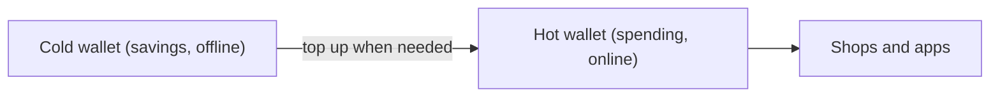
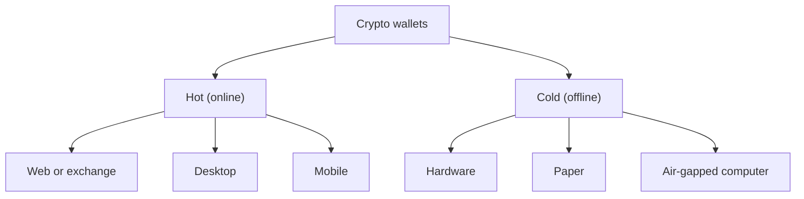

**In one line:** <mark>A wallet does not store coins; it stores the private keys that let you spend them. A hot wallet keeps the keys on an internet-connected device, a cold wallet keeps them offline</mark>. <Cite id="wallets-utxo-double-spending-gfg-hot-cold" />

<Box kind="key">

**Key points to write (hot, cold and types of wallets):**

- A wallet holds <mark>private keys</mark> (not coins): it creates addresses, signs transactions and shows balances. <Cite id="wallets-utxo-double-spending-wiki-crypto-wallet" />
- **Hot wallet:** <mark>connected to the internet</mark>, easy and fast, but exposed to hackers and malware. For small, daily amounts.
- **Cold wallet:** <mark>keys kept offline</mark> (hardware or paper), much safer, less convenient. For large, long-term savings.
- Hot types: web, desktop, mobile. Cold types: <mark>hardware, paper, air-gapped computer</mark>.
- **Custodial** (a third party holds your keys) versus <mark>non-custodial</mark> (you hold the keys and seed phrase).
- **HD wallet:** <mark>one 12 or 24 word seed phrase generates all keys</mark> (BIP 39 and BIP 32).
- Best practice: <mark>small hot wallet for spending, cold wallet for savings, seed phrase backed up offline</mark>.

</Box>

## Core answer (5 marks, fits every question here)

<Box kind="definition">

A **crypto wallet** is software or hardware that stores private keys, creates addresses, signs transactions and shows balances. A **hot wallet** is connected to the internet; a **cold wallet** keeps its keys offline. <Cite id="wallets-utxo-double-spending-wiki-crypto-wallet" />

</Box>

Think of a hot wallet as the cash in your pocket and a cold wallet as the money in a locker at home.

| Point | Hot wallet | Cold wallet |
|---|---|---|
| Internet | Connected | Offline |
| Security | Lower: exposed to hacking and malware | Higher: safe from online attacks |
| Convenience | Very easy and fast | Less convenient |
| Best for | Small amounts and frequent trading | Large amounts and long-term holding |
| Cost | Mostly free | Hardware wallet costs money |
| Main risk | Hacks, phishing | Loss, theft or damage of the device or paper |
| Examples | MetaMask, mobile apps, exchange wallets | Ledger, Trezor, paper wallet |

<Cite id="wallets-utxo-double-spending-btcwiki-cold" />

**Conclusion:** <mark>hot wallets give ease, cold wallets give safety; most people use both</mark>. <Cite id="cryptocurrencies-tokens-gfg-wallets" />

## Extended answer (10 marks): add these

### 1. Types by connection

- **Web wallets:** run in a browser or on an exchange; the provider may hold your keys.
- **Desktop wallets:** installed on a PC (Electrum).
- **Mobile wallets:** phone apps (Trust Wallet, MetaMask mobile).
- **Hardware wallets:** a small device that keeps keys inside and signs offline (Ledger, Trezor). <Cite id="wallets-utxo-double-spending-wiki-hw-wallet" />
- **Paper wallets:** keys printed on paper; easy to lose or damage.

### 2. Types by key control

- **Custodial:** a third party (exchange) holds your keys. "Not your keys, not your coins."
- **Non-custodial:** you hold the keys and the seed phrase.

### 3. Types by key structure

- **Non-deterministic:** each key is separate; backups are hard.
- **Hierarchical deterministic (HD):** one seed phrase of 12 or 24 words (BIP 39) generates all keys (BIP 32), so one backup is enough. <Cite id="wallets-utxo-double-spending-bip39" /> <Cite id="wallets-utxo-double-spending-bip32" />

### 4. Types by verification

**Full-node wallets** verify the whole chain; **SPV or light wallets** verify with Merkle proofs and store only block headers. <Cite id="wallets-utxo-double-spending-mb-ch05-wallets" />

### 5. Good practice

Keep only a small amount in a hot wallet, keep savings in cold storage, and always back up the recovery phrase offline. <Cite id="wallets-utxo-double-spending-bitcoin-org-wallet" />

## Fit it to each question

- **"Explain different types of wallets in detail."** (10 marks) <PYQ id="2024-12/q6b" />: core answer plus extended sections 1 to 4, with the type tree diagram.

## Exam tips

- **Draw** the tree: wallets, hot (web, desktop, mobile) and cold (hardware, paper).
- Keywords: <mark>private key, seed phrase, custodial, non-custodial, hardware wallet, HD wallet, offline</mark>.
- Say clearly that a wallet stores **keys**, not coins.
