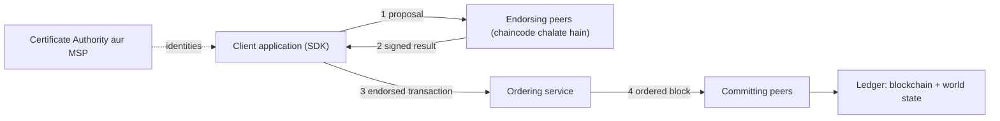
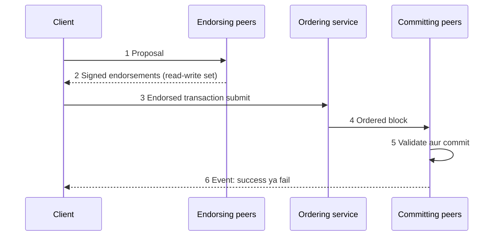

**Ek line mein:** <mark>Hyperledger Fabric businesses ke liye open-source permissioned blockchain platform hai, jahan peers chaincode execute karte hain, ordering service transactions ka order tay karti hai, aur peers validate karke commit karte hain (execute-order-validate)</mark>. <Cite id="hyperledger-fabric-whatis" />

<Box kind="key">

**Har Fabric question mein ye points likho:**

- <mark>Linux Foundation (Hyperledger)</mark> host karta hai; <mark>permissioned</mark>, modular, cryptocurrency ki zaroorat nahi.
- Components: <mark>Clients (SDK), Peers (endorsing aur committing), Ordering service, MSP aur CA, Channels, Ledger, Chaincode</mark>.
- Flow hai <mark>execute, order, validate</mark>: pehle endorse, phir order, aakhir mein validate aur commit.
- **Ledger** = <mark>blockchain (history) + world state (latest values)</mark>.
- **Channels** <mark>private sub-networks</mark> dete hain, har ek ka apna ledger.
- <mark>Endorsement policy</mark> batati hai kaunsi organizations ko sign karna hai (jaise "Org1 AND Org2").
- Orderer <mark>chaincode nahi chalata</mark>. v1 options: Solo, Kafka; baad mein Raft.

</Box>

## Core answer (5 marks, yahan ke har question ke liye)

<Box kind="definition">

**Hyperledger Fabric** is an open-source, **permissioned** blockchain platform hosted by the Linux Foundation. Only known, approved members join. It runs smart contracts called **chaincode** and has a **modular** design, so parts such as consensus can be swapped. <Cite id="hyperledger-fabric-androulaki-2018" />

</Box>

**Naya design kyun:** purani blockchains har node se har transaction chalwati aur order karwati hain, jo slow hai aur privacy nahi deta. Fabric mein sirf zaroori peers transaction execute karte hain.

**Components (v1 architecture):**

1. **Client (application):** SDK se transaction proposal bhejta hai.
2. **Peers:** ledger aur chaincode rakhte hain. *Endorsing peers* chaincode chalate hain aur result sign karte hain; *committing peers* validate karke blocks likhte hain.
3. **Ordering service:** endorsed transactions jama karti hai, order karti hai, blocks banati hai aur peers ko bhejti hai. Yeh chaincode nahi chalati. <Cite id="hyperledger-fabric-txflow" />
4. **CA aur MSP:** CA certificates deta hai; MSP tay karta hai kaun kya kar sakta hai.
5. **Channels:** apne ledger wale private sub-networks.
6. **Ledger:** blockchain plus world state.
7. **Chaincode:** smart contract (Go, Java, JavaScript), Docker container mein.

**Conclusion:** <mark>Fabric separates endorsing, ordering and validating, which gives a scalable and private enterprise blockchain</mark>. <Cite id="hyperledger-fabric-gfg-fabric" />

## Extended answer (10 marks): ye add karo

### 1. Transaction flow (execute, order, validate)

1. Client endorsement policy mein bataye gaye endorsing peers ko signed **proposal** bhejta hai.
2. Har peer identity check karta hai, apne world state pe chaincode **simulate** karta hai (abhi koi change nahi) aur signed **read-write set** lautata hai.
3. Client kaafi matching endorsements jama karke orderer ko bhejta hai.
4. Orderer transactions ko ek sequence mein rakhta hai, **block** banata hai aur channel ke peers ko deliver karta hai.
5. Har peer **endorsement policy** check karta hai aur yeh ki read set badla nahi (conflict nahi). Kharab transactions invalid mark hoti hain par block mein rehti hain. Valid writes world state update karti hain.
6. Peer client ko notify karta hai. <Cite id="hyperledger-fabric-txflow" />

### 2. Ledger, channels aur private data

- **Ledger:** *blockchain* blocks ka unchangeable log hai; *world state* har key ki latest value ka database hai. <Cite id="hyperledger-fabric-ledger" />
- **Channel:** private sub-network; har channel ka apna ledger hota hai, isliye sirf uske members uska data dekhte hain. <Cite id="hyperledger-fabric-channels" />
- **Private data collections:** channel ke andar kuch data sirf chuni hui organizations ke paas hota hai. <Cite id="hyperledger-fabric-private-data" />

### 3. Ordering service

Yeh contents padhe bina transactions ko order karti hai aur blocks deliver karti hai. v1 mein **Solo** (testing) aur **Kafka** (crash fault tolerant) the; baad ke versions mein **Raft** recommended hai. <Cite id="hyperledger-fabric-ordering" />

### 4. Features aur comparison

| Point | Fabric | Bitcoin ya Ethereum |
|---|---|---|
| Access | Permissioned | Public |
| Consensus | Pluggable ordering (Raft, Kafka) | PoW ya PoS |
| Privacy | Channels, private data | Nahi |
| Currency | Optional | Zaroori |
| Smart contract | Chaincode (Go, Java, JavaScript) | Solidity (Ethereum) |

**Advantages:** privacy, known identities, high throughput, pluggable consensus. **Limitations:** kam decentralised; members ko setup aur management karna padta hai. **Uses:** supply chain (IBM Food Trust), trade finance, healthcare records. <Cite id="hyperledger-fabric-ibm-fabric" />

## Har question mein kaise fit karein

- **"Explain Hyperledger Fabric v1 architecture."** (10 marks) <PYQ id="2022-12-ce/q3b" /> <PYQ id="2023-05-ce/q3b" /> <PYQ id="2025-05-ce/q2b" />: core answer component list aur architecture diagram ke saath, phir extended section 1 (flow) aur 2.
- **"Hyperledger Fabric v1 Architecture"** (10 marks) <PYQ id="2024-12-ce/q6b" />: upar jaisa; comparison table add karo.
- **"Explain Hyperledger fabric architecture in detail."** (10 marks) <PYQ id="2024-12/q3b" />: saare sections: components, flow diagram, ledger aur channels, ordering.
- **"Explain Hyperledger Fabric in detail."** (10 marks) <PYQ id="2023-12/q3b" />: core answer plus sections 1, 2 aur 4 (features, advantages, uses).
- **"Explain Hyperledger Fabric in detail"** (10 marks) <PYQ id="2025-05/q4a" />: pichhle jaisa; comparison table aur use cases include karo.
- **"Hyperledger Fabric"** (10 marks) <PYQ id="2023-12-ce/q6b" />: poora answer: definition, components, diagram, flow, features aur uses.

## Exam tips

- **Architecture draw karo** (client, endorsing peers, orderer, committing peers, ledger, CA/MSP) aur flow steps number karo.
- Keywords: <mark>permissioned, chaincode, endorsing peer, orderer, channel, world state, MSP, execute-order-validate</mark>.
- Yeh mat likho ki orderer chaincode chalata hai; woh sirf order karta hai.

Exam mein English mein likho.
