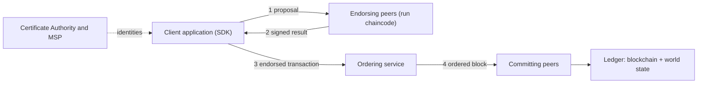
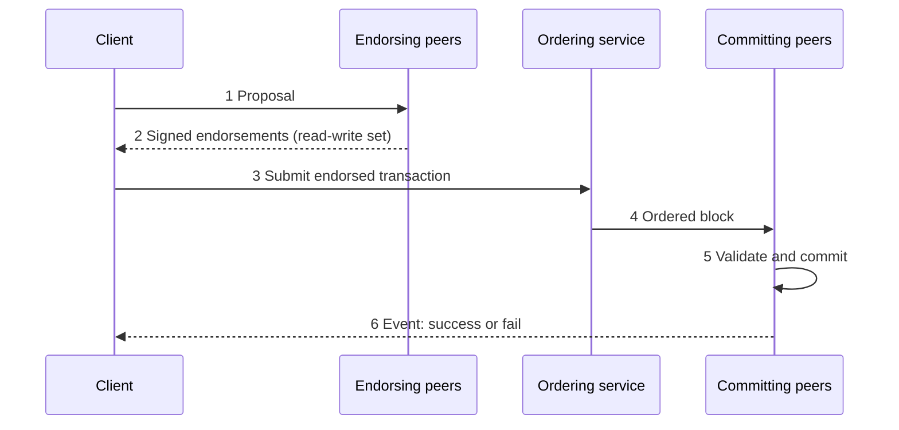

**In one line:** <mark>Hyperledger Fabric is an open-source permissioned blockchain platform for businesses, where peers execute chaincode, an ordering service orders transactions and peers validate and commit them (execute-order-validate)</mark>. <Cite id="hyperledger-fabric-whatis" />

<Box kind="key">

**Key points to write (any Fabric question):**

- Hosted by the <mark>Linux Foundation (Hyperledger)</mark>; <mark>permissioned</mark>, modular, no cryptocurrency needed.
- Components: <mark>Clients (SDK), Peers (endorsing and committing), Ordering service, MSP and CA, Channels, Ledger, Chaincode</mark>.
- Flow is <mark>execute, order, validate</mark>: endorse first, order second, validate and commit last.
- **Ledger** = <mark>blockchain (history) + world state (latest values)</mark>.
- **Channels** give <mark>private sub-networks</mark>, each with its own ledger.
- <mark>Endorsement policy</mark> says which organizations must sign (for example "Org1 AND Org2").
- The orderer does <mark>not run chaincode</mark>. v1 options: Solo, Kafka; Raft later.

</Box>

## Core answer (5 marks, fits every question here)

<Box kind="definition">

**Hyperledger Fabric** is an open-source, **permissioned** blockchain platform hosted by the Linux Foundation. Only known, approved members join. It runs smart contracts called **chaincode** and has a **modular** design, so parts such as consensus can be swapped. <Cite id="hyperledger-fabric-androulaki-2018" />

</Box>

**Why a new design:** older blockchains make every node run and order every transaction, which is slow and gives no privacy. Fabric lets only the needed peers execute a transaction.

**Components (v1 architecture):**

1. **Client (application):** uses an SDK to send a transaction proposal.
2. **Peers:** hold the ledger and chaincode. *Endorsing peers* run chaincode and sign the result; *committing peers* validate and write blocks.
3. **Ordering service:** collects endorsed transactions, orders them, cuts blocks, sends them to peers. It does not run chaincode. <Cite id="hyperledger-fabric-txflow" />
4. **CA and MSP:** the CA issues certificates; the MSP decides who may do what.
5. **Channels:** private sub-networks with their own ledger.
6. **Ledger:** blockchain plus world state.
7. **Chaincode:** the smart contract (Go, Java, JavaScript) in a Docker container.

**Conclusion:** <mark>Fabric separates endorsing, ordering and validating, which gives a scalable and private enterprise blockchain</mark>. <Cite id="hyperledger-fabric-gfg-fabric" />

## Extended answer (10 marks): add these

### 1. Transaction flow (execute, order, validate)

1. The client sends a signed **proposal** to the endorsing peers named by the endorsement policy.
2. Each peer checks the identity, **simulates** the chaincode on its world state (no change yet) and returns a signed **read-write set**.
3. The client collects enough matching endorsements and sends them to the orderer.
4. The orderer puts transactions in one sequence, cuts a **block** and delivers it to the peers of the channel.
5. Each peer checks the **endorsement policy** and that the read set is unchanged (no conflict). Bad transactions are marked invalid but stay in the block. Valid writes update the world state.
6. The peer notifies the client. <Cite id="hyperledger-fabric-txflow" />

### 2. Ledger, channels and private data

- **Ledger:** the *blockchain* is an unchangeable log of blocks; the *world state* is a database of the latest value of each key. <Cite id="hyperledger-fabric-ledger" />
- **Channel:** a private sub-network; each channel has its own ledger, so only its members see its data. <Cite id="hyperledger-fabric-channels" />
- **Private data collections:** inside a channel, only chosen organizations hold some data. <Cite id="hyperledger-fabric-private-data" />

### 3. Ordering service

It orders transactions and delivers blocks, without reading the contents. v1 offered **Solo** (testing) and **Kafka** (crash fault tolerant); **Raft** is the recommended choice in later versions. <Cite id="hyperledger-fabric-ordering" />

### 4. Features and comparison

| Point | Fabric | Bitcoin or Ethereum |
|---|---|---|
| Access | Permissioned | Public |
| Consensus | Pluggable ordering (Raft, Kafka) | PoW or PoS |
| Privacy | Channels, private data | None |
| Currency | Optional | Required |
| Smart contract | Chaincode (Go, Java, JavaScript) | Solidity (Ethereum) |

**Advantages:** privacy, known identities, high throughput, pluggable consensus. **Limitations:** less decentralised; members must set up and manage it. **Uses:** supply chain (IBM Food Trust), trade finance, healthcare records. <Cite id="hyperledger-fabric-ibm-fabric" />

## Fit it to each question

- **"Explain Hyperledger fabric architecture in detail."** (10 marks) <PYQ id="2024-12/q3b" />: all sections: components, flow diagram, ledger and channels, ordering.
- **"Explain Hyperledger Fabric in detail."** (10 marks) <PYQ id="2023-12/q3b" />: core answer plus sections 1, 2 and 4 (features, advantages, uses).
- **"Explain Hyperledger Fabric in detail"** (10 marks) <PYQ id="2025-05/q4a" />: same as the previous one; include the comparison table and the use cases.

## Exam tips

- **Draw** the architecture (client, endorsing peers, orderer, committing peers, ledger, CA/MSP) and number the flow steps.
- Keywords: <mark>permissioned, chaincode, endorsing peer, orderer, channel, world state, MSP, execute-order-validate</mark>.
- Do not say the orderer runs chaincode; it only orders.
