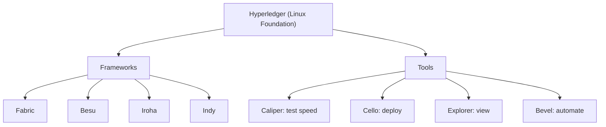
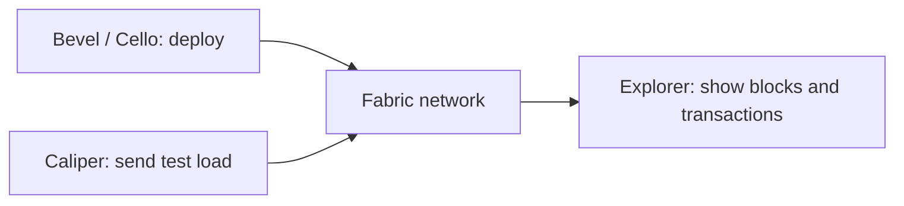

**In one line:** <mark>Hyperledger is a Linux Foundation umbrella of open-source enterprise blockchain projects: frameworks such as Fabric, Besu, Iroha and Indy, and tools such as Caliper, Cello, Explorer and Bevel</mark>. <Cite id="class-bt-m4" loc="slide 31" />

<Box kind="key">

**Key points to write (Hyperledger tools and frameworks):**

- Hyperledger provides a platform for <mark>personalised, permissioned blockchain services</mark> for business. <Cite id="class-bt-m4" loc="slide 18" />
- **Frameworks (build the blockchain):** <mark>Fabric, Besu, Iroha, Indy</mark>. <Cite id="class-bt-m4" loc="slide 36" />
- **Tools (deploy, manage, test, monitor):** <mark>Caliper, Cello, Explorer, Bevel</mark>. <Cite id="class-bt-m4" loc="slide 31" />
- Caliper = <mark>performance testing (TPS, latency)</mark>; Cello = <mark>deploy and manage networks</mark>; Explorer = <mark>view blocks and transactions</mark>; Bevel = <mark>automated deployment</mark>.
- Fabric = <mark>enterprise permissioned chain</mark>; Besu = <mark>Ethereum-compatible</mark>; Iroha = <mark>simple assets and identity</mark>; Indy = <mark>decentralised identity</mark>.

</Box>

## Core answer (5 marks, fits every question here)

<Box kind="definition">

**Hyperledger** is a global collaboration, hosted by the Linux Foundation, for building high-performance, reliable, enterprise-ready permissioned blockchain and distributed ledger frameworks. <Cite id="class-bt-m4" loc="slide 18" /> <Cite id="web-bt-sol-b-wiki-hyperledger" />

</Box>

**Tools** (they deploy, manage, test, monitor and use blockchain networks): <Cite id="class-bt-m4" loc="slide 31" />

1. **Hyperledger Caliper:** performance testing. It measures transactions per second and latency. *Example:* test if a network can handle 1,000 TPS. <Cite id="class-bt-m4" loc="slide 32" /> <Cite id="web-bt-sol-b-caliper" />
2. **Hyperledger Cello:** deploys and manages blockchain networks and reduces set-up effort. <Cite id="class-bt-m4" loc="slide 33" />
3. **Hyperledger Explorer:** a graphical view of blocks, transactions, channels and participants. <Cite id="class-bt-m4" loc="slide 34" />
4. **Hyperledger Bevel:** reusable scripts that automate deployment on cloud and other infrastructure, for Fabric and Besu. <Cite id="class-bt-m4" loc="slide 35" />

**Frameworks:** <Cite id="class-bt-m4" loc="slide 36" />

1. **Fabric:** enterprise permissioned blockchain with channels and chaincode. <Cite id="class-bt-m4" loc="slide 37" />
2. **Besu:** an Ethereum client for public and private networks; supports Ethereum smart contracts and tools. <Cite id="class-bt-m4" loc="slide 38" /> <Cite id="web-bt-sol-b-besu" />
3. **Iroha:** simple platform for digital assets and identities. <Cite id="class-bt-m4" loc="slide 39" /> <Cite id="web-bt-sol-b-iroha" />
4. **Indy:** decentralised identity with verifiable credentials. <Cite id="class-bt-m4" loc="slide 40" /> <Cite id="web-bt-sol-b-indy" />

**Conclusion:** <mark>frameworks give the blockchain, tools make it easy to test, deploy and monitor</mark>.

## Extended answer (10 marks): add these

### 1. Frameworks compared

| Framework | Purpose | Smart contract | Example use |
|---|---|---|---|
| Fabric | Enterprise permissioned chain | Chaincode | Supply chain network |
| Besu | Ethereum-compatible, public or private | Solidity | Banks' private Ethereum network |
| Iroha | Simple assets and identity | Built-in commands | Digital assets and customer accounts |
| Indy | Decentralised identity | Not a general contract chain | University certificate as verifiable credential |

<Cite id="class-bt-m4" loc="slide 37" /> <Cite id="hyperledger-fabric-gfg-fabric" />

### 2. Tools compared

| Tool | Purpose | Example |
|---|---|---|
| Caliper | Benchmark TPS and latency | Test 1,000 TPS |
| Cello | Deploy and manage networks | Many networks for many apps |
| Explorer | Monitor blocks and transactions | Admin views latest blocks |
| Bevel | Automated multi-cloud deployment | Deploy across clouds |

### 3. Where the tools act

### 4. Present status (from the sources cited)

Hyperledger started in December 2015 and its foundation became part of Linux Foundation Decentralized Trust in 2024. Fabric, Besu, Iroha and Indy are listed there as graduated projects. Some older projects have ended: Sawtooth was archived in 2024, and Wikipedia lists Composer, Explorer and Quilt as end of life. Hyperledger is an umbrella of projects, not one blockchain. <Cite id="web-bt-sol-b-lfdt-projects" /> <Cite id="hyperledger-fabric-ibm-fabric" />

## Fit it to each question

- **"List out tools and framework of Hyperledger."** (5 marks) <PYQ id="assignment-4/q4c" />: the core answer: four tools and four frameworks, one line each, with the umbrella diagram.

## Exam tips

- **Draw** the tree: Hyperledger, then Frameworks and Tools, four boxes each.
- Keywords: <mark>Caliper (benchmark), Cello (deploy), Explorer (view), Bevel (automate), Fabric, Besu, Iroha, Indy</mark>.
- Do not mix up the two groups: Fabric is a framework, not a tool.
