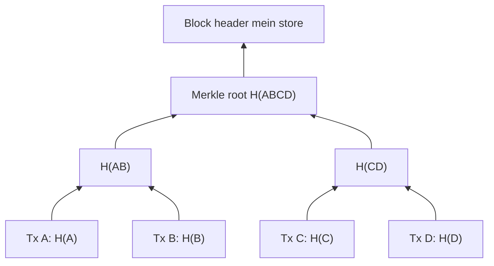
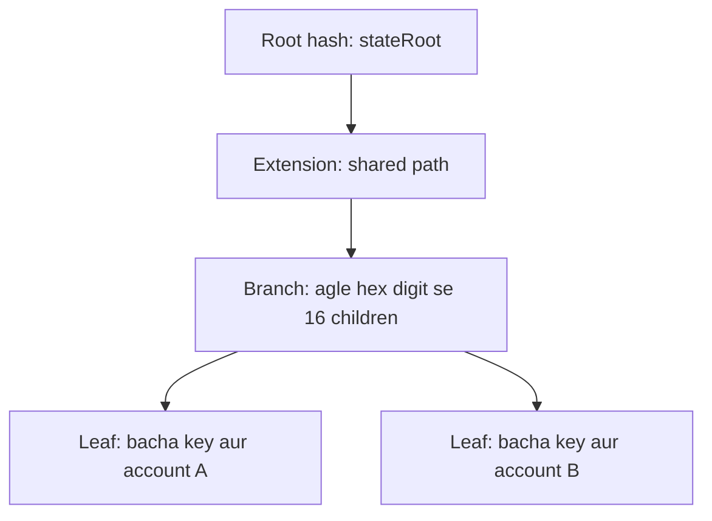

**Ek line mein:** <mark>Merkle tree hashes ka binary tree hai: har leaf ek transaction ka hash hai, har parent apne do children ka hash hai, aur sabse upar ka single hash Merkle root hai</mark>. Root block header mein store hota hai aur block ke saare transactions ko represent karta hai. <Cite id="block-structure-merkle-wiki-merkle" />

<Box kind="key">

**Har Merkle tree question mein ye points likho:**

- <mark>Leaf = ek transaction ka hash; parent = apne do children ko jod kar hash</mark>; sabse upar ka node **Merkle root**.
- **Neeche se upar** banta hai; agar kisi level mein nodes odd hain to <mark>aakhri hash duplicate</mark> hota hai (Bitcoin).
- **32-byte root block header mein store** hota hai, isliye header saare transactions ko represent karta hai.
- <mark>Ek transaction badlo to root tak ka har hash badal jaata hai</mark>: tamper detection.
- <mark>Merkle proof: sirf log2(n) hashes</mark> se prove hota hai ki transaction block mein hai (SPV ya light wallets).
- Ethereum key-value state ke liye <mark>Merkle Patricia Trie</mark> use karta hai; har header mein <mark>stateRoot, transactionsRoot aur receiptsRoot</mark> hote hain.

</Box>

## Core answer (5 marks, yahan ke har question ke liye)

<Box kind="definition">

A **Merkle tree** (hash tree) is a binary tree in which every leaf is the hash of a data block (a transaction) and every parent node is the hash of its two children joined together. The top hash is the **Merkle root**. <Cite id="block-structure-merkle-wiki-merkle" />

</Box>

**Kyun chahiye:** ek block mein hazaaron transactions ho sakte hain. Tree un sabka ek chhota fingerprint deta hai, jisse koi bhi change pakda jaata hai aur poora block bheje bina prove ho jaata hai ki ek transaction andar hai. <Cite id="block-structure-merkle-gfg-merkle-intro" />

**Structure, neeche se upar:** <Cite id="block-structure-merkle-mb-ch11" />

1. **Leaves:** har transaction ka hash: H(A), H(B), H(C), H(D).
2. **Pair banao:** H(AB) = H(H(A) + H(B)) aur H(CD) = H(H(C) + H(D)).
3. **Repeat** karo jab tak ek hash bache: **Merkle root**.
4. **Odd nodes:** aakhri hash ki copy ke saath pair hota hai.
5. Root ko block header mein **store** karo.

| Property | Fayda |
|---|---|
| Saare transactions ka ek root | Chhota block header (32 bytes) |
| Koi bhi change root badal deta hai | Tamper detection |
| Proof ko sirf log2(n) hashes | Light (SPV) wallets poora block liye bina verify karte hain |

**Conclusion:** <mark>Merkle tree bahut saare transactions ko ek root hash mein summarise karta hai aur checking aur tamper detection fast banata hai</mark>.

## Extended answer (10 marks): ye add karo

### 1. Merkle proof ke saath worked example

<Sum>

<Given>

Ek block mein chaar transactions A, B, C, D.

</Given>

<Find>

Merkle root, hashes ki ginti, aur C block mein hai iska proof.

</Find>

<Steps>

1. Leaves: $H_A, H_B, H_C, H_D$. *Reason: har transaction ka ek hash.*
2. Level 1: $H_{AB} = H(H_A \| H_B)$ aur $H_{CD} = H(H_C \| H_D)$. *Reason: har parent apne do children ko hash karta hai.*
3. Root: $H_{ABCD} = H(H_{AB} \| H_{CD})$.
4. Total hashes $= 4 + 2 + 1 = 7 = 2n - 1$.
5. C ka proof: verifier ko sirf $H_D$ aur $H_{AB}$ chahiye. Wo $H_C$, phir $H_{CD}$, phir root nikaalta hai aur header se compare karta hai. *Reason: har level pe sirf sibling hash missing hai.*

</Steps>

<Answer>

Root $= H(H(H_A\|H_B)\,\|\,H(H_C\|H_D))$; proof mein 2 hashes ($\log_2 4 = 2$).

</Answer>

<Box kind="verify">

1000 transactions ke liye bhi proof sirf $\lceil \log_2 1000 \rceil = 10$ hashes (lagbhag 320 bytes). C badle to $H_C$, $H_{CD}$ aur root sab badal jaate hain, isliye header check fail hota hai.

</Box>

</Sum>

### 2. Odd number of transactions

Teen transactions A, B, C ho to aakhri khud ke saath pair hota hai: $H_{CC} = H(H_C \| H_C)$. <Cite id="block-structure-merkle-mb-ch11" />

### 3. Patricia tree aur Merkle Patricia Trie (Ethereum)

Ethereum **key-value data** (account address se account state) store karta hai jo baar baar badalta hai. Plain Merkle tree iske liye weak hai, isliye Ethereum **Merkle Patricia Trie (MPT)** use karta hai: ek Patricia (radix) trie jiske nodes hashes se linked hain. <Cite id="block-structure-merkle-eth-mpt" /> <Cite id="block-structure-merkle-wiki-radix" />

- **Patricia (radix) tree:** jin keys ki shuruaat same hai unka path share hota hai, isliye common prefix ek baar store hota hai.
- Key **hex digits (nibbles)** mein todi jaati hai aur root se path inhi digits ko follow karta hai.
- **Node types:** <mark>branch</mark> (16 children, har hex digit ke liye ek, plus value), <mark>extension</mark> (common path share karke space bachata hai) aur <mark>leaf</mark> (bacha hua path aur value).
- Har node apne content ke **Keccak-256 hash** ke under store hota hai, isliye root hash saare data ko commit karta hai.
- Har block header mein teen roots: <mark>stateRoot</mark> (saare accounts), <mark>transactionsRoot</mark> aur <mark>receiptsRoot</mark>. <Cite id="block-structure-merkle-eth-yellow" />

### 4. Merkle tree vs Merkle Patricia Trie

| | Merkle tree (Bitcoin) | Merkle Patricia Trie (Ethereum) |
|---|---|---|
| Kya store karta hai | Transactions ki list | Key-value state |
| Shape | Binary tree | 16-way branches wala trie |
| Ek item update | Ek path rebuild | Sirf badla hua path re-hash |
| Proof | Presence | Presence aur absence |

**Merkle trees ke uses:** Bitcoin aur Ethereum block headers, Git aur IPFS. <Cite id="web-bt-1-protocol" />

## Har question mein kaise fit karein

- **"Explain merkle tree in detail."** (10 marks) <PYQ id="2024-12/q5b" />: core answer, section 1 (proof) aur section 2, phir uses pe ek line (header, SPV, Git).
- **"What Merkle root tree. Explain Pectricia Merkle root in ethereum."** (10 marks) <PYQ id="2023-12/q2a" />: core answer (chhota), phir section 3 (Patricia trie, node types, teen roots) aur section 4 ka table.

## Exam tips

- **Hamesha draw karo:** H(A) se H(ABCD) tak label kiya hua chaar-transaction tree; zyada marks isi se aate hain.
- Har answer mein <mark>"changing one transaction changes the root"</mark> line aur **Merkle proof** word likho.
- Ethereum question mein teen node types aur teen roots ke naam likho. Ye mat likho ki Ethereum mein Merkle tree nahi hai: wo Patricia version use karta hai.

Exam mein English mein likho.
