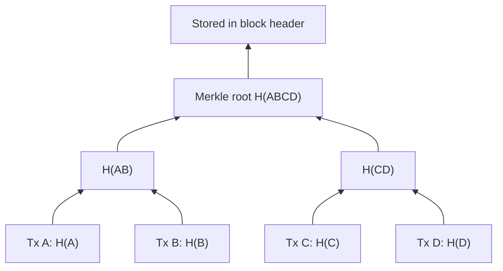
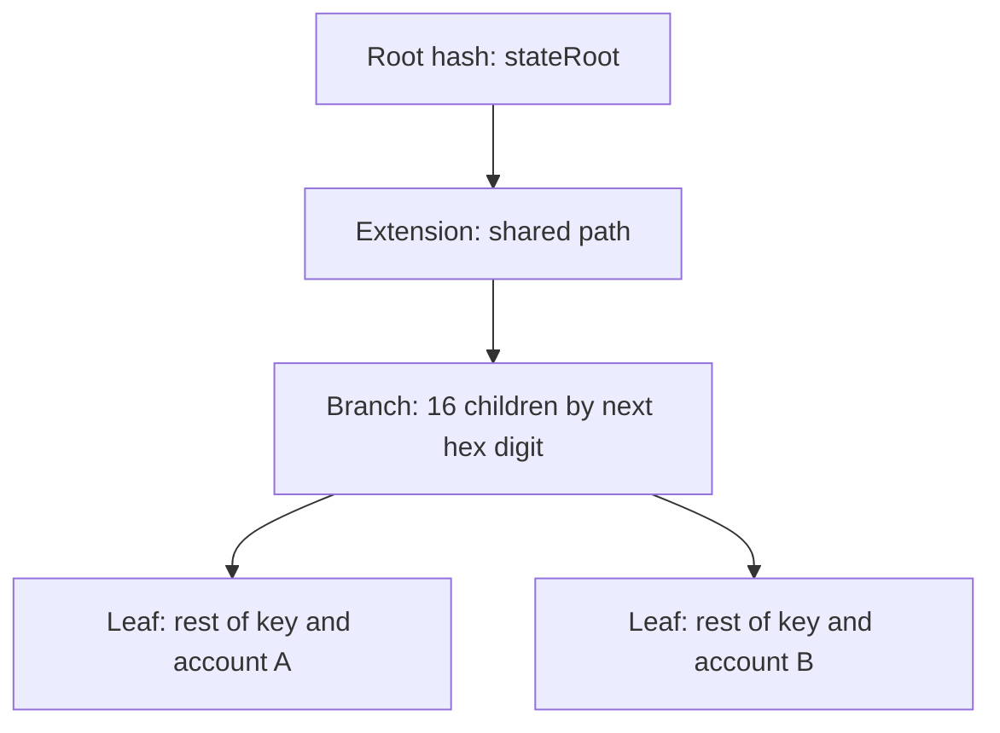

**In one line:** <mark>A Merkle tree is a binary tree of hashes: each leaf is the hash of a transaction, each parent is the hash of its two children, and the single hash at the top is the Merkle root</mark>. The root is stored in the block header and stands for every transaction in the block. <Cite id="block-structure-merkle-wiki-merkle" />

<Box kind="key">

**Key points to write (any Merkle tree question):**

- <mark>Leaf = hash of one transaction; parent = hash of its two children joined</mark>; the top node is the **Merkle root**.
- Built **bottom to top**; if a level has an odd number of nodes, <mark>the last hash is duplicated</mark> (Bitcoin).
- The **32-byte root is stored in the block header**, so the header stands for all transactions.
- <mark>Change one transaction and every hash up to the root changes</mark>: tamper detection.
- <mark>Merkle proof: only about log2(n) hashes</mark> prove that one transaction is in the block (used by SPV or light wallets).
- Ethereum uses a <mark>Merkle Patricia Trie</mark> for key-value state; each header holds <mark>stateRoot, transactionsRoot and receiptsRoot</mark>.

</Box>

## Core answer (5 marks, fits every question here)

<Box kind="definition">

A **Merkle tree** (hash tree) is a binary tree in which every leaf is the hash of a data block (a transaction) and every parent node is the hash of its two children joined together. The top hash is the **Merkle root**. <Cite id="block-structure-merkle-wiki-merkle" />

</Box>

**Why it is needed:** a block can hold thousands of transactions. The tree gives one short fingerprint of all of them, so we can detect any change and prove one transaction is inside without sending the whole block. <Cite id="block-structure-merkle-gfg-merkle-intro" />

**Structure, bottom to top:** <Cite id="block-structure-merkle-mb-ch11" />

1. **Leaves:** hash each transaction: H(A), H(B), H(C), H(D).
2. **Pair up:** H(AB) = H(H(A) + H(B)) and H(CD) = H(H(C) + H(D)).
3. **Repeat** on each new level until one hash is left: the **Merkle root**.
4. **Odd number of nodes:** the last hash is paired with a copy of itself.
5. **Store** the root in the block header.

| Property | Benefit |
|---|---|
| One root for all transactions | Small block header (32 bytes) |
| Any change alters the root | Tamper detection |
| Proof needs only log2(n) hashes | Light (SPV) wallets verify without the full block |

**Conclusion:** <mark>a Merkle tree summarises many transactions in one root hash and makes checking and tamper detection fast</mark>.

## Extended answer (10 marks): add these

### 1. Worked example with a Merkle proof

<Sum>

<Given>

Four transactions A, B, C, D in a block.

</Given>

<Find>

the Merkle root, the number of hashes, and the proof that C is in the block.

</Find>

<Steps>

1. Leaves: $H_A, H_B, H_C, H_D$. *Reason: one hash per transaction.*
2. Level 1: $H_{AB} = H(H_A \| H_B)$ and $H_{CD} = H(H_C \| H_D)$. *Reason: each parent hashes its two children.*
3. Root: $H_{ABCD} = H(H_{AB} \| H_{CD})$.
4. Total hashes $= 4 + 2 + 1 = 7 = 2n - 1$.
5. Proof for C: the verifier needs only $H_D$ and $H_{AB}$. It computes $H_C$, then $H_{CD}$, then the root, and compares with the header. *Reason: only the sibling hash at each level is missing.*

</Steps>

<Answer>

Root $= H(H(H_A\|H_B)\,\|\,H(H_C\|H_D))$; the proof has 2 hashes ($\log_2 4 = 2$).

</Answer>

<Box kind="verify">

For 1000 transactions the proof is still only $\lceil \log_2 1000 \rceil = 10$ hashes (about 320 bytes). If C is changed, $H_C$, $H_{CD}$ and the root all change, so the header check fails.

</Box>

</Sum>

### 2. Odd number of transactions

With three transactions A, B, C, the last one is paired with itself: $H_{CC} = H(H_C \| H_C)$. <Cite id="block-structure-merkle-mb-ch11" />

### 3. Patricia tree and the Merkle Patricia Trie (Ethereum)

Ethereum stores **key-value data** (account address to account state), which changes often. A plain Merkle tree is poor for this, so Ethereum uses the **Merkle Patricia Trie (MPT)**: a Patricia (radix) trie whose nodes are linked by hashes. <Cite id="block-structure-merkle-eth-mpt" /> <Cite id="block-structure-merkle-wiki-radix" />

- **Patricia (radix) tree:** keys that share a start share a path, so common prefixes are stored once.
- The key is split into **hex digits (nibbles)** and the path from the root follows them.
- **Node types:** <mark>branch</mark> (16 children, one per hex digit, plus a value), <mark>extension</mark> (shares a common path to save space) and <mark>leaf</mark> (rest of the path and the value).
- Each node is stored under the **Keccak-256 hash** of its content, so the root hash commits to all the data.
- Every block header holds three roots: <mark>stateRoot</mark> (all accounts), <mark>transactionsRoot</mark> and <mark>receiptsRoot</mark>. <Cite id="block-structure-merkle-eth-yellow" />

### 4. Merkle tree versus Merkle Patricia Trie

| | Merkle tree (Bitcoin) | Merkle Patricia Trie (Ethereum) |
|---|---|---|
| Stores | List of transactions | Key-value state |
| Shape | Binary tree | Trie with 16-way branches |
| Update one item | Rebuild a path | Only the changed path is re-hashed |
| Proof | Presence | Presence and absence |

**Uses of Merkle trees:** Bitcoin and Ethereum block headers, Git and IPFS. <Cite id="web-bt-1-protocol" />

## Fit it to each question

- **"What is a Merkle tree? Explain the structure of a Merkle tree."** (5 marks) <PYQ id="2022-12-ce/q1d" /> <PYQ id="2023-05-ce/q1d" /> <PYQ id="2024-12-ce/q1a" />: write the **core answer** only, with the four-transaction diagram.
- **"Explain Merkle Tree with the help of an example."** (10 marks) <PYQ id="2024-05-ce/q3a" />: core answer, then section 1 (worked example with proof) and section 2 (odd number).
- **"Explain merkle tree in detail."** (10 marks) <PYQ id="2024-12/q5b" />: core answer, section 1 (proof) and section 2, then a line on the uses (header, SPV, Git).
- **"What Merkle root tree. Explain Pectricia Merkle root in ethereum."** (10 marks) <PYQ id="2023-12/q2a" />: core answer (short), then section 3 (Patricia trie, node types, three roots) and the section 4 table.

## Exam tips

- **Always draw** the four-transaction tree with H(A) to H(ABCD) labelled; it carries most of the marks.
- Write the line <mark>"changing one transaction changes the root"</mark> and the word **Merkle proof** in every answer.
- For the Ethereum question name the three node types and the three roots. Do not say Ethereum has no Merkle tree: it uses the Patricia version.
