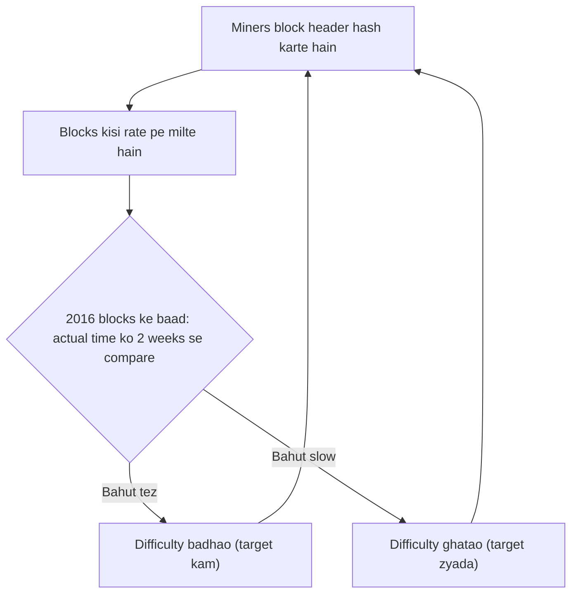

**Ek line mein:** <mark>Mining difficulty naapti hai ki target se chhota block hash dhoondhna kitna mushkil hai; Bitcoin ise har 2016 blocks pe retarget karta hai taaki lagbhag 10 minutes mein ek block aaye</mark>. <Cite id="bitcoin-btcwiki-difficulty" />

<Box kind="key">

**Mining difficulty ke question mein ye points likho:**

- Miner <mark>nonce</mark> badalta hai aur header ko hash karta hai (SHA-256 do baar) jab tak <mark>hash target se chhota</mark> na ho.
- <mark>Chhota target = mushkil puzzle</mark>. Difficulty = target_max / target.
- Ek block ke liye expected hashes <mark>lagbhag difficulty x 2^32</mark>.
- <mark>Har 2016 blocks pe retarget</mark> (10 minutes per block pe lagbhag 2 weeks).
- <mark>New difficulty = old difficulty x (2016 x 10 min) / actual time</mark>; ek change 4 guna tak limited.
- Planned se tez matlab mushkil; slow matlab aasaan. Purpose: <mark>block time aur coin supply steady rakhna</mark>.

</Box>

## Core answer (5 marks, yahan ke har question ke liye)

<Box kind="definition">

**Mining difficulty** says how hard it is to find a valid block in proof of work. A miner must find a hash of the block header that is **below a target number**; the lower the target, the harder the puzzle. The network adjusts difficulty so blocks keep a steady rate (Bitcoin: one per 10 minutes). <Cite id="bitcoin-btcwiki-difficulty" />

</Box>

**Kyun chahiye:** miners aate jaate hain aur hardware tez hota jaata hai. Adjustment ke bina bahut miners aane pe blocks bahut tez aate, aur chhodne pe bahut slow. <Cite id="blockchain-fundamentals-nakamoto" loc="§4" />

**Kaise kaam karta hai:**

1. Miner nonce badalta hai, header ko SHA-256 se do baar hash karta hai aur check karta hai $\text{hash} < \text{target}$. Hash effectively random hota hai, isliye bas baar baar try karna padta hai. <Cite id="web-bt-1-block-hashing" />
2. Ek try ke safal hone ka chance $\text{target} / 2^{256}$ hai, isliye expected tries $2^{256} / \text{target}$.
3. $\text{Difficulty} = \text{target}_{max} / \text{target}$. <Cite id="web-bt-1-target" />
4. **Har 2016 blocks pe retarget:**

$$
\text{new difficulty} = \text{old difficulty} \times \frac{2016 \times 10 \text{ min}}{\text{actual time taken}}
$$

Bahut tez to difficulty badhti hai; bahut slow to ghatti hai. Ek change 4 guna tak limited hai. <Cite id="bitcoin-mb-ch12-mining" />

**Conclusion:** <mark>difficulty total mining power kuch bhi ho, block rate ko stable rakhti hai, aur attacks ko costly banati hai</mark>. <Cite id="bitcoin-gfg-pow" />

## Extended answer (10 marks): ye add karo

### 1. Leading zeros ka aasaan example

Valid hash ko 4 zero hex digits se shuru hona hai to har digit ke zero hone ka chance 16 mein 1 hai, isliye ek try ke safal hone ki probability $1/16^4$ aur expected tries $16^4 = 65{,}536$. Har extra zero kaam ko 16 guna badha deta hai. <Cite id="bitcoin-lmab-mining" />

### 2. Worked example

<Sum>

<Given>

Difficulty $= 1{,}000{,}000$. Miner ke paas 1 TH/s $= 10^{12}$ hashes per second hai. Pichhle 2016 blocks target 14 days ki jagah 12 days mein bane.

</Given>

<Find>

(a) ek block ke expected hashes, (b) miner ka expected time, (c) new difficulty.

</Find>

<Steps>

1. **Expected hashes.** $10^6 \times 2^{32} = 10^6 \times 4{,}294{,}967{,}296 \approx 4.29 \times 10^{15}$. *Reason: expected hashes = difficulty x $2^{32}$.*
2. **Expected time.** $4.29 \times 10^{15} \div 10^{12} = 4295$ seconds, lagbhag 71.6 minutes. *Reason: time = work / hash rate.*
3. **New difficulty.** $10^6 \times \dfrac{14}{12} = 1{,}166{,}667$ (rounded). *Reason: blocks planned se tez aaye, isliye puzzle target time aur actual time ke ratio mein mushkil banta hai.*

</Steps>

<Answer>

(a) lagbhag $4.29 \times 10^{15}$ hashes; (b) lagbhag 71.6 minutes; (c) new difficulty lagbhag 1,166,667.

</Answer>

<Box kind="verify">

Poore network ko is difficulty pe har 10 minutes mein block ke liye $4.29 \times 10^{15} \div 600 \approx 7.16 \times 10^{12}$ H/s chahiye, isliye 1 TH/s wale miner ke paas lagbhag 14% hai, aur wo lagbhag $600 \div 0.14 \approx 4295$ s mein ek block jeetta hai. Ye step 2 se match karta hai. (c) ke liye: 12 days 14 se chhote hain, isliye ratio $14/12 > 1$ aur difficulty badhni hi chahiye.

</Box>

</Sum>

### 3. Baaki questions mein kya alag

- Pichhle 2016 blocks 10 days mein bane: ratio $14/10 = 1.4$, to new difficulty $= 1.4\,D$ (40% mushkil).
- 20 days mein bane: ratio $14/20 = 0.7$, to new difficulty $= 0.7\,D$ (30% aasaan).
- 2 days mein bane: ratio 7 hota, lekin 4 ki limit lagti hai, isliye new difficulty $= 4\,D$.

## Har question mein kaise fit karein

- **"Write a note on Mining Difficulty."** (5 marks) <PYQ id="2024-12/q1c" />: definition, kyun, retarget formula, loop diagram aur section 3 ka chhota 10-day example.

## Exam tips

- **Formula likho** $\text{new} = \text{old} \times 14 \text{ days} / \text{actual}$ aur 2016 blocks, 2 weeks bolo.
- Direction dikhao: <mark>tez blocks, mushkil; slow blocks, aasaan</mark>.
- Factor-of-4 limit ka zikr karo; ye easy extra mark hai.

Exam mein English mein likho.
