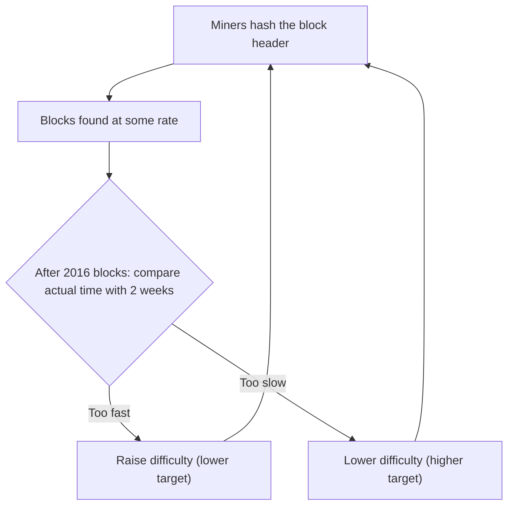

**In one line:** <mark>Mining difficulty measures how hard it is to find a block hash below the target; Bitcoin retargets it every 2016 blocks so that one block arrives about every 10 minutes</mark>. <Cite id="bitcoin-btcwiki-difficulty" />

<Box kind="key">

**Key points to write (mining difficulty):**

- Miner changes the <mark>nonce</mark> and hashes the header (SHA-256 twice) until <mark>hash is less than target</mark>.
- <mark>Smaller target = harder puzzle</mark>. Difficulty = target_max / target.
- Expected hashes for one block <mark>about difficulty x 2^32</mark>.
- <mark>Retarget every 2016 blocks</mark> (about 2 weeks at 10 minutes per block).
- <mark>New difficulty = old difficulty x (2016 x 10 min) / actual time</mark>; one change is limited to a factor of 4.
- Faster than planned means harder; slower means easier. Purpose: <mark>keep block time and coin supply steady</mark>.

</Box>

## Core answer (5 marks, fits every question here)

<Box kind="definition">

**Mining difficulty** says how hard it is to find a valid block in proof of work. A miner must find a hash of the block header that is **below a target number**; the lower the target, the harder the puzzle. The network adjusts difficulty so blocks keep a steady rate (Bitcoin: one per 10 minutes). <Cite id="bitcoin-btcwiki-difficulty" />

</Box>

**Why it is needed:** miners join and leave and hardware gets faster. Without adjustment blocks would come too fast when many miners join, or too slowly when they leave. <Cite id="blockchain-fundamentals-nakamoto" loc="§4" />

**How it works:**

1. The miner changes the nonce, hashes the header with SHA-256 twice and checks $\text{hash} < \text{target}$. A hash is effectively random, so the only way is to try again and again. <Cite id="web-bt-1-block-hashing" />
2. The chance of one try succeeding is $\text{target} / 2^{256}$, so the expected number of tries is $2^{256} / \text{target}$.
3. $\text{Difficulty} = \text{target}_{max} / \text{target}$. <Cite id="web-bt-1-target" />
4. **Retarget every 2016 blocks:**

$$
\text{new difficulty} = \text{old difficulty} \times \frac{2016 \times 10 \text{ min}}{\text{actual time taken}}
$$

Too fast means difficulty goes up; too slow means it goes down. One change is limited to a factor of 4. <Cite id="bitcoin-mb-ch12-mining" />

**Conclusion:** <mark>difficulty keeps the block rate stable whatever the total mining power, and it makes attacks costly</mark>. <Cite id="bitcoin-gfg-pow" />

## Extended answer (10 marks): add these

### 1. Easy example with leading zeros

If a valid hash must start with 4 zero hex digits, each digit is zero with chance 1 in 16, so a try succeeds with probability $1/16^4$ and the expected tries are $16^4 = 65{,}536$. Each extra zero multiplies the work by 16. <Cite id="bitcoin-lmab-mining" />

### 2. Worked example

<Sum>

<Given>

Difficulty $= 1{,}000{,}000$. A miner has 1 TH/s $= 10^{12}$ hashes per second. The last 2016 blocks took 12 days instead of the target 14 days.

</Given>

<Find>

(a) expected hashes for one block, (b) the miner's expected time, (c) the new difficulty.

</Find>

<Steps>

1. **Expected hashes.** $10^6 \times 2^{32} = 10^6 \times 4{,}294{,}967{,}296 \approx 4.29 \times 10^{15}$. *Reason: expected hashes equal difficulty times $2^{32}$.*
2. **Expected time.** $4.29 \times 10^{15} \div 10^{12} = 4295$ seconds, about 71.6 minutes. *Reason: time equals work divided by hash rate.*
3. **New difficulty.** $10^6 \times \dfrac{14}{12} = 1{,}166{,}667$ (rounded). *Reason: blocks came faster than planned, so the puzzle is made harder in the ratio target time to actual time.*

</Steps>

<Answer>

(a) about $4.29 \times 10^{15}$ hashes; (b) about 71.6 minutes; (c) new difficulty about 1,166,667.

</Answer>

<Box kind="verify">

The whole network needs $4.29 \times 10^{15} \div 600 \approx 7.16 \times 10^{12}$ H/s to find a block every 10 minutes at this difficulty, so the 1 TH/s miner owns about 14%, and wins a block about once per $600 \div 0.14 \approx 4295$ s. This matches step 2. For (c): 12 days is shorter than 14, so the ratio $14/12 > 1$ and difficulty must rise.

</Box>

</Sum>

### 3. How the other questions differ

- If the last 2016 blocks took 10 days: ratio $14/10 = 1.4$, so new difficulty $= 1.4\,D$ (40% harder).
- If they took 20 days: ratio $14/20 = 0.7$, so new difficulty $= 0.7\,D$ (30% easier).
- If they took 2 days: ratio would be 7, but the limit of 4 applies, so new difficulty $= 4\,D$.

## Fit it to each question

- **"What is mining difficulty and how is it calculated in a proof-of-work? Explain with an example."** (10 marks) <PYQ id="2024-05-ce/q3b" />: core answer, then section 2 (full worked example) and section 1.
- **"Write a note on Mining Difficulty."** (5 marks) <PYQ id="2024-12/q1c" />: definition, why, the retarget formula, the loop diagram and the short 10-day example from section 3.

## Exam tips

- **Write the formula** $\text{new} = \text{old} \times 14 \text{ days} / \text{actual}$ and say 2016 blocks, 2 weeks.
- Show the direction: <mark>faster blocks, harder; slower blocks, easier</mark>.
- Mention the factor-of-4 limit; it is an easy extra mark.
